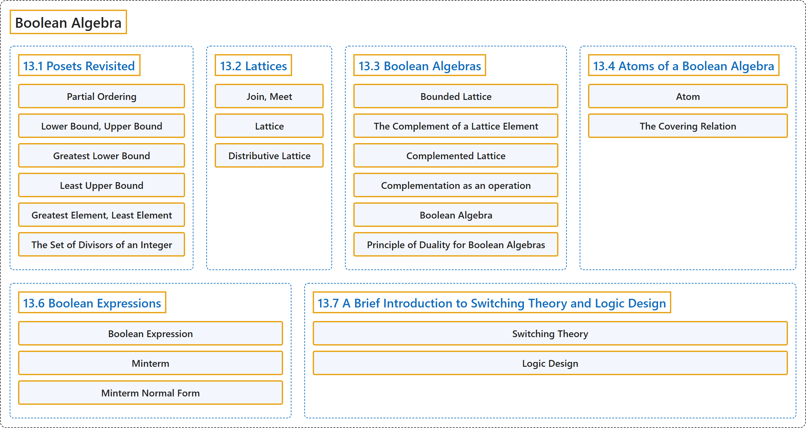

# 13 Boolean Algebra

## Classification

## Glossary

| Term | Definition | 中文翻译 | Source |
|---|---|---|---|
| **13 Boolean Algebra** 布尔代数 | (No definition) | （无定义） | [Doerr & Levasseur, n.d., chapter 13](https://discretemath.org/ads/chapter_13.html) |
| **13.1 Posets Revisited** 再论偏序集 | (No definition) | （无定义） | [Doerr & Levasseur, n.d., section 13.1](https://discretemath.org/ads/s-posets-revisited.html) |
| **Partial Ordering** 偏序 | "Let $\preceq$ be a relation on a set $L\text{.}$ We say that $\preceq$ is **a partial ordering on $L$** if it is **reflexive, antisymmetric, and transitive**. That is:" | 设 $\preceq$ 为集合 $L$。 上的关系。若它是**自反、反对称且传递**的，则称 $\preceq$ 是 $L$ 上的**偏序**。即： | [Doerr & Levasseur, n.d., Definition 13.1.1](https://discretemath.org/ads/s-posets-revisited.html#def-partial-ordering-13) |
| **Lower Bound, Upper Bound** 下界、上界 | "Let $(L, \preceq)$ be a poset, and $a, b \in L\text{.}$ Then $c \in L$ is **a lower bound** of $a$ and $b$ if $c \preceq a$ and $c \preceq b\text{.}$ Also, $d \in L$ is **an upper bound** of $a$ and $b$ if $a \preceq d$ and $b \preceq d\text{.}$" | 设 $(L, \preceq)$ 为偏序集，$a, b \in L$。 若 $c \preceq a$ 且 $c \preceq b$。 则 $c \in L$ 是 $a$ 和 $b$ 的**下界**。又，若 $a \preceq d$ 且 $b \preceq d$。 则 $d \in L$ 是 $a$ 和 $b$ 的**上界**。 | [Doerr & Levasseur, n.d., Definition 13.1.3](https://discretemath.org/ads/s-posets-revisited.html#def-bounds) |
| **Greatest Lower Bound** 最大下界 | "Let $(L, \preceq)$ be a poset. If $a, b \in L\text{,}$ then $\ell \in L$ is **a greatest lower bound** of $a$ and $b$ if and only if" | 设 $(L, \preceq)$ 为偏序集。若 $a, b \in L$， 则 $\ell \in L$ 是 $a$ 和 $b$ 的**最大下界**，当且仅当 | [Doerr & Levasseur, n.d., Definition 13.1.4](https://discretemath.org/ads/s-posets-revisited.html#def-glb) |
| **Least Upper Bound** 最小上界 | "Let $(L, \preceq)$ be a poset. If $a, b \in L\text{,}$ then $u \in L$ is **a least upper bound** of $a$ and $b$ if and only if" | 设 $(L, \preceq)$ 为偏序集。若 $a, b \in L$， 则 $u \in L$ 是 $a$ 和 $b$ 的**最小上界**，当且仅当 | [Doerr & Levasseur, n.d., Definition 13.1.5](https://discretemath.org/ads/s-posets-revisited.html#def-lub) |
| **Greatest Element, Least Element** 最大元、最小元 | "Let $(L, \preceq)$ be a poset. $M \in L$ is called the **greatest (maximum) element** of $L$ if, for all $a \in L\text{,}$ $a \preceq M\text{.}$ In addition, $m \in L$ is called the **least (minimum) element** of $L$ if for all $a \in L\text{,}$ $m \preceq a\text{.}$ The greatest and least elements, when they exist, are frequently denoted by $\pmb{1}$ and $\pmb{0}$ respectively." | 设 $(L, \preceq)$ 为偏序集。若对所有 $a \in L$， 有 $a \preceq M$。 则称 $M \in L$ 为 $L$ 的**最大元**。此外，若对所有 $a \in L$， 有 $m \preceq a$。 则称 $m \in L$ 为 $L$ 的**最小元**。最大元和最小元存在时，常分别记作 $\pmb{1}$ 和 $\pmb{0}$。 | [Doerr & Levasseur, n.d., Definition 13.1.7](https://discretemath.org/ads/s-posets-revisited.html#def-greatest-least) |
| **The Set of Divisors of an Integer** 整数的因子集 | "For any positive integer $n\text{,}$ **the divisors of $n$** is **the set of integers that divide evenly into $n\text{.}$** We denote this set $D_n\text{.}$" | 对任意正整数 $n$， **$n$ 的因数**是**能整除 $n$ 的整数的集合**。我们将该集合记作 $D_n$。 | [Doerr & Levasseur, n.d., Definition 13.1.9](https://discretemath.org/ads/s-posets-revisited.html#def-set-of-divisors) |
| **13.2 Lattices** 格 | (No definition) | （无定义） | [Doerr & Levasseur, n.d., section 13.2](https://discretemath.org/ads/s-lattices.html) |
| **Join, Meet** 并、交 | "Let $(L, \preceq)$ be **a poset**, and $a, b \in L\text{.}$ We define:" | 设 $(L, \preceq)$ 为**偏序集**，$a, b \in L$。 我们定义： | [Doerr & Levasseur, n.d., Definition 13.2.1](https://discretemath.org/ads/s-lattices.html#def-id) |
| **Lattice** 格 | "**A lattice** is a poset $(L, \preceq)$ for which every pair of elements has a **greatest lower bound and least upper bound**. Since a lattice $L$ is an algebraic system with binary operations $\lor$ and $\land\text{,}$ it is denoted by $[L; \lor, \land]\text{.}$ If we want to make it clear what partial ordering the lattice is based on, we say it is a lattice under $\preceq\text{.}$" | **格**是这样的偏序集 $(L, \preceq)$：每一对元素都有**最大下界和最小上界**。由于格 $L$ 是带有二元运算 $\lor$ 和 $\land$， 的代数系统，因此记作 $[L; \lor, \land]$。 若想明确格所基于的偏序，则称其为 $\preceq$。 下的格。 | [Doerr & Levasseur, n.d., Definition 13.2.2](https://discretemath.org/ads/s-lattices.html#def-lattice) |
| **Distributive Lattice** 分配格 | "Let $\mathcal{L}=[L; \lor, \land ]$ be a lattice under $\preceq$. $\mathcal{L}$ is called **a distributive lattice** if and only if **the distributive laws hold**; that is, for all $a, b, c \in L$ we have" | 设 $\mathcal{L}=[L; \lor, \land ]$ 为 $\preceq$ 下的格。当且仅当**分配律成立**时，$\mathcal{L}$ 称为**分配格**；即，对所有 $a, b, c \in L$ 有 | [Doerr & Levasseur, n.d., Definition 13.2.4](https://discretemath.org/ads/s-lattices.html#def-distributive-lattice) |
| **13.3 Boolean Algebras** 布尔代数 | (No definition) | （无定义） | [Doerr & Levasseur, n.d., section 13.3](https://discretemath.org/ads/s-boolean-algebras.html) |
| **Bounded Lattice** 有界格 | "**A bounded lattice** is a lattice that contains **both a least element and a greatest element**." | **有界格**是既含**最小元又含最大元**的格。 | [Doerr & Levasseur, n.d., Definition 13.3.1](https://discretemath.org/ads/s-boolean-algebras.html#def-boundeded-lattice) |
| **The Complement of a Lattice Element** 格元素的补元 | "Let $[L; \lor,\land ]$ be **a bounded lattice**. If $a \in L\text{,}$ then $a$ has **a complement** if there exists $b \in L$ such that" | 设 $[L; \lor,\land ]$ 为**有界格**。若 $a \in L$， 则当存在 $b \in L$ 使得下式成立时，称 $a$ 有**补元** | [Doerr & Levasseur, n.d., Definition 13.3.2](https://discretemath.org/ads/s-boolean-algebras.html#def-lattice-complement) |
| **Complemented Lattice** 有补格 | "Let $\mathcal{L}=[L; \lor,\land ]$ be a bounded lattice. $\mathcal{L}$ is **a complemented lattice** if **every element of $L$ has a complement in $L\text{.}$**" | 设 $\mathcal{L}=[L; \lor,\land ]$ 为有界格。若 **$L$ 的每个元素在 $L$ 中都有补元**，则 $\mathcal{L}$ 是**有补格**。 | [Doerr & Levasseur, n.d., Definition 13.3.3](https://discretemath.org/ads/s-boolean-algebras.html#def-complemented-lattice) |
| **Complementation as an operation** 作为运算的补 | "If a complemented lattice has the property that **the complement of every element is unique**, then we consider complementation to be **a unary operation**. The usual notation for the complement of $a$ is $\bar{a}\text{.}$" | 若一个有补格具有**每个元素的补元都是唯一的**这一性质，则我们把求补视为**一元运算**。$a$ 的补元的通常记法是 $\bar{a}$。 | [Doerr & Levasseur, n.d., Definition 13.3.6](https://discretemath.org/ads/s-boolean-algebras.html#def-complement-operation) |
| **Boolean Algebra** 布尔代数 | "**A Boolean algebra** is a lattice that contains a least element and a greatest element and that is both **complemented and distributive**. The notation $[B; \lor, \land, \bar{\hspace{5 mm}}]$ is used to denote the boolean algebra with operations join, meet and complementation." | **布尔代数**是含有最小元和最大元、且**既有补又分配**的格。记号 $[B; \lor, \land, \bar{\hspace{5 mm}}]$ 用来表示带有并、交和求补运算的布尔代数。 | [Doerr & Levasseur, n.d., Definition 13.3.8](https://discretemath.org/ads/s-boolean-algebras.html#def-boolean-algebra) |
| **Principle of Duality for Boolean Algebras** 布尔代数的对偶原理 | "Let $\mathcal{B}=[B; \lor, \land, \hspace{1 mm}^c]$ be a Boolean algebra under $\preceq\text{,}$ and let $S$ be **a true statement for** $\mathcal{B}\text{.}$ If $S^*$ is obtained from $S$ by replacing $\preceq$ with $\succeq$ (this is equivalent to turning the graph upside down), $\lor$ with $\land\text{,}$ $\land$ with $\lor\text{,}$ $\pmb{0}$ with $\pmb{1}\text{,}$ and $\pmb{1}$ with $\pmb{0}\text{,}$ then $S^*$ is **also a true statement in** $\mathcal{B}\text{.}$" | 设 $\mathcal{B}=[B; \lor, \land, \hspace{1 mm}^c]$ 为 $\preceq$， 下的布尔代数，$S$ 为 $\mathcal{B}$。 的一个**真命题**。若 $S^*$ 是将 $S$ 中的 $\preceq$ 换成 $\succeq$（这等价于把图倒置）、$\lor$ 换成 $\land$， $\land$ 换成 $\lor$， $\pmb{0}$ 换成 $\pmb{1}$， $\pmb{1}$ 换成 $\pmb{0}$， 所得，则 $S^*$ 也是 $\mathcal{B}$。 中的**真命题**。 | [Doerr & Levasseur, n.d., Definition 13.3.12](https://discretemath.org/ads/s-boolean-algebras.html#def-boolean-duality) |
| **13.4 Atoms of a Boolean Algebra** 布尔代数的原子 | (No definition) | （无定义） | [Doerr & Levasseur, n.d., section 13.4](https://discretemath.org/ads/s-atoms-of-a-boolean-algebra.html) |
| **Atom** 原子 | "**A non-least element** $a$ in a Boolean algebra $[B; \lor, \land, \bar{}\hspace{3 pt}]$ is called **an atom** if for every $x \in B\text{,}$ $x \land a = a$ or $x \land a = 0\text{.}$" | 布尔代数 $[B; \lor, \land, \bar{}\hspace{3 pt}]$ 中的**非最小元** $a$，若对每个 $x \in B$， 有 $x \land a = a$ 或 $x \land a = 0$。 则称为**原子**。 | [Doerr & Levasseur, n.d., Definition 13.4.2](https://discretemath.org/ads/s-atoms-of-a-boolean-algebra.html#def-atom) |
| **The Covering Relation** 覆盖关系 | "Given a Boolean algebra $[B; \lor, \land, \bar{}\hspace{3 pt}]\text{,}$ let $x, z \in B\text{.}$ We say that **$z$ covers $x$** iff $x \prec z$ and there does not exist $y \in B$ with $x \prec y \prec z\text{.}$" | 给定布尔代数 $[B; \lor, \land, \bar{}\hspace{3 pt}]$， 设 $x, z \in B$。 当且仅当 $x \prec z$ 且不存在 $y \in B$ 使 $x \prec y \prec z$。 时，我们说 $z$ **覆盖** $x$。 | [Doerr & Levasseur, n.d., Definition 13.4.4](https://discretemath.org/ads/s-atoms-of-a-boolean-algebra.html#def-cover) |
| **13.6 Boolean Expressions** 布尔表达式 | (No definition) | （无定义） | [Doerr & Levasseur, n.d., section 13.6](https://discretemath.org/ads/s-boolean-expressions.html) |
| **Boolean Expression** 布尔表达式 | "Let $[B; \lor, \land, - ]$ be any Boolean algebra, and let $x_1, x_2, \ldots, x_k$ be variables in $B\text{;}$ that is, variables that can assume values from $B\text{.}$ **A Boolean expression** generated by $x_1, x_2, \ldots, x_k$ is **any valid combination** of the $x_i$ and the elements of $B$ with the operations of meet, join, and complementation." | 设 $[B; \lor, \land, - ]$ 为任意布尔代数，$x_1, x_2, \ldots, x_k$ 为 $B$ 中的变量，即可取 $B$ 中值的变量。由 $x_1, x_2, \ldots, x_k$ 生成的**布尔表达式**是由 $x_i$ 与 $B$ 的元素通过交、并和求补运算构成的任意**有效组合**。 | [Doerr & Levasseur, n.d., Definition 13.6.1](https://discretemath.org/ads/s-boolean-expressions.html#def-boolean-expression) |
| **Minterm** 最小项 | "**A Boolean expression** generated by $x_1, x_2, \ldots, x_k$ that has the form" | 由 $x_1, x_2, \ldots, x_k$ 生成且具有如下形式的**布尔表达式** | [Doerr & Levasseur, n.d., Definition 13.6.3](https://discretemath.org/ads/s-boolean-expressions.html#def-minterm) |
| **Minterm Normal Form** 最小项范式 | "A Boolean expression generated by $x_1, \ldots, x_k$ is in **minterm normal form** if it is **the join of expressions** of the form $a \land m\text{,}$ where $a\in B$ and $m$ is a minterm generated by $x_1, \ldots, x_k\text{.}$ That is, it is of the form" | 若一个由 $x_1, \ldots, x_k$ 生成的布尔表达式是形如 $a \land m$， 的表达式的**并**，其中 $a\in B$ 且 $m$ 是由 $x_1, \ldots, x_k$ 生成的最小项，则它为**最小项范式**。即，它具有如下形式 | [Doerr & Levasseur, n.d., Definition 13.6.4](https://discretemath.org/ads/s-boolean-expressions.html#def-minterm-normal-form) |
| **13.7 A Brief Introduction to Switching Theory and Logic Design** 开关理论与逻辑设计简介 | (No definition) | （无定义） | [Doerr & Levasseur, n.d., section 13.7](https://discretemath.org/ads/s-logic-design.html) |
| **Switching Theory** 开关理论 | (context) "Pioneering computer scientists such as Claude Shannon realized that the operation of these computers could be simplified by making use of an **isomorphism between computer circuits and boolean algebra**. The term **Switching Theory** was used at the time." | （语境）克劳德·香农等计算机科学先驱意识到，利用**计算机电路与布尔代数之间的同构**可以简化这些计算机的运作。当时使用的术语是**开关理论**。 | [Doerr & Levasseur, n.d., section 13.7](https://discretemath.org/ads/s-logic-design.html#s-logic-design-5) |
| **Logic Design** 逻辑设计 | (Definition pending) | （定义待补） | [Doerr & Levasseur, n.d., section 13.7](https://discretemath.org/ads/s-logic-design.html) |

## References

Doerr, A., & Levasseur, K. (n.d.). *Applied discrete structures*. Retrieved October 28, 2026, from <https://discretemath.org/ads/index-ads.html>
