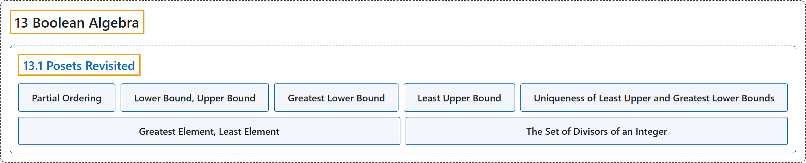

# 13.1 Posets Revisited

## Classification

## Glossary

| Term | Definition | 中文翻译 | Source |
|---|---|---|---|
| **13.1 Posets Revisited** 再论偏序集 | (No definition) | （无定义） | [Doerr & Levasseur, n.d., section 13.1](https://discretemath.org/ads/s-posets-revisited.html) |
| **Partial Ordering** 偏序 | "Let $\preceq$ be a relation on a set $L\text{.}$ We say that $\preceq$ is **a partial ordering on $L$** if it is **reflexive, antisymmetric, and transitive**. That is:" | 设 $\preceq$ 为集合 $L$。 上的关系。若它是**自反、反对称且传递**的，则称 $\preceq$ 是 $L$ 上的**偏序**。即： | [Doerr & Levasseur, n.d., Definition 13.1.1](https://discretemath.org/ads/s-posets-revisited.html#def-partial-ordering-13) |
| **Lower Bound, Upper Bound** 下界、上界 | "Let $(L, \preceq)$ be a poset, and $a, b \in L\text{.}$ Then $c \in L$ is **a lower bound** of $a$ and $b$ if $c \preceq a$ and $c \preceq b\text{.}$ Also, $d \in L$ is **an upper bound** of $a$ and $b$ if $a \preceq d$ and $b \preceq d\text{.}$" | 设 $(L, \preceq)$ 为偏序集，$a, b \in L$。 若 $c \preceq a$ 且 $c \preceq b$。 则 $c \in L$ 是 $a$ 和 $b$ 的**下界**。又，若 $a \preceq d$ 且 $b \preceq d$。 则 $d \in L$ 是 $a$ 和 $b$ 的**上界**。 | [Doerr & Levasseur, n.d., Definition 13.1.3](https://discretemath.org/ads/s-posets-revisited.html#def-bounds) |
| **Greatest Lower Bound** 最大下界 | "Let $(L, \preceq)$ be a poset. If $a, b \in L\text{,}$ then $\ell \in L$ is **a greatest lower bound** of $a$ and $b$ if and only if" | 设 $(L, \preceq)$ 为偏序集。若 $a, b \in L$， 则 $\ell \in L$ 是 $a$ 和 $b$ 的**最大下界**，当且仅当 | [Doerr & Levasseur, n.d., Definition 13.1.4](https://discretemath.org/ads/s-posets-revisited.html#def-glb) |
| **Least Upper Bound** 最小上界 | "Let $(L, \preceq)$ be a poset. If $a, b \in L\text{,}$ then $u \in L$ is **a least upper bound** of $a$ and $b$ if and only if" | 设 $(L, \preceq)$ 为偏序集。若 $a, b \in L$， 则 $u \in L$ 是 $a$ 和 $b$ 的**最小上界**，当且仅当 | [Doerr & Levasseur, n.d., Definition 13.1.5](https://discretemath.org/ads/s-posets-revisited.html#def-lub) |
| **Uniqueness of Least Upper and Greatest Lower Bounds** 最小上界与最大下界的唯一性 | "Let $(L, \preceq)$ be a poset, and $a, b \in L$. If a greatest lower bound of $a$ and $b$ exists, **then it is unique**. The same is true of a least upper bound, if it exists." | 设 $(L, \preceq)$ 是偏序集，$a, b \in L$。若 $a$ 与 $b$ 的最大下界存在，则**它是唯一的**。最小上界（若存在）也是如此。 | [Doerr & Levasseur, n.d., Theorem 13.1.6](https://discretemath.org/ads/s-posets-revisited.html#theorem-unique-lub-glb) |
| **Greatest Element, Least Element** 最大元、最小元 | "Let $(L, \preceq)$ be a poset. $M \in L$ is called the **greatest (maximum) element** of $L$ if, for all $a \in L\text{,}$ $a \preceq M\text{.}$ In addition, $m \in L$ is called the **least (minimum) element** of $L$ if for all $a \in L\text{,}$ $m \preceq a\text{.}$ The greatest and least elements, when they exist, are frequently denoted by $\pmb{1}$ and $\pmb{0}$ respectively." | 设 $(L, \preceq)$ 为偏序集。若对所有 $a \in L$， 有 $a \preceq M$。 则称 $M \in L$ 为 $L$ 的**最大元**。此外，若对所有 $a \in L$， 有 $m \preceq a$。 则称 $m \in L$ 为 $L$ 的**最小元**。最大元和最小元存在时，常分别记作 $\pmb{1}$ 和 $\pmb{0}$。 | [Doerr & Levasseur, n.d., Definition 13.1.7](https://discretemath.org/ads/s-posets-revisited.html#def-greatest-least) |
| **The Set of Divisors of an Integer** 整数的因子集 | "For any positive integer $n\text{,}$ **the divisors of $n$** is **the set of integers that divide evenly into $n\text{.}$** We denote this set $D_n\text{.}$" | 对任意正整数 $n$， **$n$ 的因数**是**能整除 $n$ 的整数的集合**。我们将该集合记作 $D_n$。 | [Doerr & Levasseur, n.d., Definition 13.1.9](https://discretemath.org/ads/s-posets-revisited.html#def-set-of-divisors) |

## References

Doerr, A., & Levasseur, K. (n.d.). *Applied discrete structures*. Retrieved October 28, 2026, from <https://discretemath.org/ads/index-ads.html>
