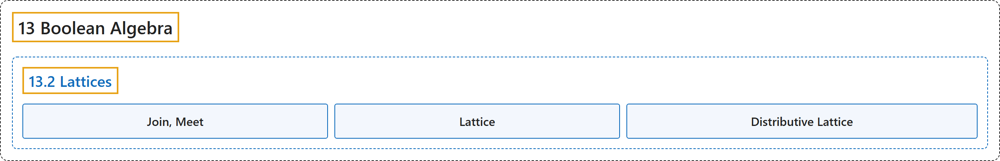

# 13.2 Lattices

## Classification

## Glossary

| Term | Definition | 中文翻译 | Source |
|---|---|---|---|
| **13.2 Lattices** 格 | (No definition) | （无定义） | [Doerr & Levasseur, n.d., section 13.2](https://discretemath.org/ads/s-lattices.html) |
| **Join, Meet** 并、交 | "Let $(L, \preceq)$ be **a poset**, and $a, b \in L\text{.}$ We define:" | 设 $(L, \preceq)$ 为**偏序集**，$a, b \in L$。 我们定义： | [Doerr & Levasseur, n.d., Definition 13.2.1](https://discretemath.org/ads/s-lattices.html#def-id) |
| **Lattice** 格 | "**A lattice** is a poset $(L, \preceq)$ for which every pair of elements has a **greatest lower bound and least upper bound**. Since a lattice $L$ is an algebraic system with binary operations $\lor$ and $\land\text{,}$ it is denoted by $[L; \lor, \land]\text{.}$ If we want to make it clear what partial ordering the lattice is based on, we say it is a lattice under $\preceq\text{.}$" | **格**是这样的偏序集 $(L, \preceq)$：每一对元素都有**最大下界和最小上界**。由于格 $L$ 是带有二元运算 $\lor$ 和 $\land$， 的代数系统，因此记作 $[L; \lor, \land]$。 若想明确格所基于的偏序，则称其为 $\preceq$。 下的格。 | [Doerr & Levasseur, n.d., Definition 13.2.2](https://discretemath.org/ads/s-lattices.html#def-lattice) |
| **Distributive Lattice** 分配格 | "Let $\mathcal{L}=[L; \lor, \land ]$ be a lattice under $\preceq$. $\mathcal{L}$ is called **a distributive lattice** if and only if **the distributive laws hold**; that is, for all $a, b, c \in L$ we have" | 设 $\mathcal{L}=[L; \lor, \land ]$ 为 $\preceq$ 下的格。当且仅当**分配律成立**时，$\mathcal{L}$ 称为**分配格**；即，对所有 $a, b, c \in L$ 有 | [Doerr & Levasseur, n.d., Definition 13.2.4](https://discretemath.org/ads/s-lattices.html#def-distributive-lattice) |

## References

Doerr, A., & Levasseur, K. (n.d.). *Applied discrete structures*. Retrieved October 28, 2026, from <https://discretemath.org/ads/index-ads.html>
