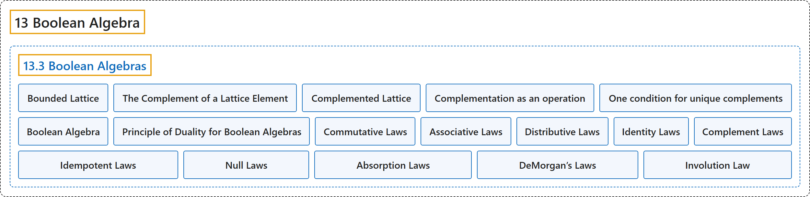

# 13.3 Boolean Algebras

## Classification

## Glossary

| Term | Definition | 中文翻译 | Source |
|---|---|---|---|
| **13.3 Boolean Algebras** 布尔代数 | (No definition) | （无定义） | [Doerr & Levasseur, n.d., section 13.3](https://discretemath.org/ads/s-boolean-algebras.html) |
| **Bounded Lattice** 有界格 | "**A bounded lattice** is a lattice that contains **both a least element and a greatest element**." | **有界格**是既含**最小元又含最大元**的格。 | [Doerr & Levasseur, n.d., Definition 13.3.1](https://discretemath.org/ads/s-boolean-algebras.html#def-boundeded-lattice) |
| **The Complement of a Lattice Element** 格元素的补元 | "Let $[L; \lor,\land ]$ be **a bounded lattice**. If $a \in L\text{,}$ then $a$ has **a complement** if there exists $b \in L$ such that" | 设 $[L; \lor,\land ]$ 为**有界格**。若 $a \in L$， 则当存在 $b \in L$ 使得下式成立时，称 $a$ 有**补元** | [Doerr & Levasseur, n.d., Definition 13.3.2](https://discretemath.org/ads/s-boolean-algebras.html#def-lattice-complement) |
| **Complemented Lattice** 有补格 | "Let $\mathcal{L}=[L; \lor,\land ]$ be a bounded lattice. $\mathcal{L}$ is **a complemented lattice** if **every element of $L$ has a complement in $L\text{.}$**" | 设 $\mathcal{L}=[L; \lor,\land ]$ 为有界格。若 **$L$ 的每个元素在 $L$ 中都有补元**，则 $\mathcal{L}$ 是**有补格**。 | [Doerr & Levasseur, n.d., Definition 13.3.3](https://discretemath.org/ads/s-boolean-algebras.html#def-complemented-lattice) |
| **Complementation as an operation** 作为运算的补 | "If a complemented lattice has the property that **the complement of every element is unique**, then we consider complementation to be **a unary operation**. The usual notation for the complement of $a$ is $\bar{a}\text{.}$" | 若一个有补格具有**每个元素的补元都是唯一的**这一性质，则我们把求补视为**一元运算**。$a$ 的补元的通常记法是 $\bar{a}$。 | [Doerr & Levasseur, n.d., Definition 13.3.6](https://discretemath.org/ads/s-boolean-algebras.html#def-complement-operation) |
| **One condition for unique complements** 补元唯一的一个条件 | "If $[L; \lor ,\land ]$ is a complemented, distributive lattice, then the complement of each element $a \in L$ **is unique**." | 若 $[L; \lor ,\land ]$ 是有补分配格，则每个元素 $a \in L$ 的补元**是唯一的**。 | [Doerr & Levasseur, n.d., Theorem 13.3.7](https://discretemath.org/ads/s-boolean-algebras.html#theorem-unique-complements) |
| **Boolean Algebra** 布尔代数 | "**A Boolean algebra** is a lattice that contains a least element and a greatest element and that is both **complemented and distributive**. The notation $[B; \lor, \land, \bar{\hspace{5 mm}}]$ is used to denote the boolean algebra with operations join, meet and complementation." | **布尔代数**是含有最小元和最大元、且**既有补又分配**的格。记号 $[B; \lor, \land, \bar{\hspace{5 mm}}]$ 用来表示带有并、交和求补运算的布尔代数。 | [Doerr & Levasseur, n.d., Definition 13.3.8](https://discretemath.org/ads/s-boolean-algebras.html#def-boolean-algebra) |
| **Principle of Duality for Boolean Algebras** 布尔代数的对偶原理 | "Let $\mathcal{B}=[B; \lor, \land, \hspace{1 mm}^c]$ be a Boolean algebra under $\preceq\text{,}$ and let $S$ be **a true statement for** $\mathcal{B}\text{.}$ If $S^*$ is obtained from $S$ by replacing $\preceq$ with $\succeq$ (this is equivalent to turning the graph upside down), $\lor$ with $\land\text{,}$ $\land$ with $\lor\text{,}$ $\pmb{0}$ with $\pmb{1}\text{,}$ and $\pmb{1}$ with $\pmb{0}\text{,}$ then $S^*$ is **also a true statement in** $\mathcal{B}\text{.}$" | 设 $\mathcal{B}=[B; \lor, \land, \hspace{1 mm}^c]$ 为 $\preceq$， 下的布尔代数，$S$ 为 $\mathcal{B}$。 的一个**真命题**。若 $S^*$ 是将 $S$ 中的 $\preceq$ 换成 $\succeq$（这等价于把图倒置）、$\lor$ 换成 $\land$， $\land$ 换成 $\lor$， $\pmb{0}$ 换成 $\pmb{1}$， $\pmb{1}$ 换成 $\pmb{0}$， 所得，则 $S^*$ 也是 $\mathcal{B}$。 中的**真命题**。 | [Doerr & Levasseur, n.d., Definition 13.3.12](https://discretemath.org/ads/s-boolean-algebras.html#def-boolean-duality) |
| **Commutative Laws** 交换律 | "$a\lor b = b\lor a$ $a \land b = b \land a$" | $a\lor b = b\lor a$ $a \land b = b \land a$ | [Doerr & Levasseur, n.d., Table 13.3.11](https://discretemath.org/ads/s-boolean-algebras.html#table-boolean-laws) |
| **Associative Laws** 结合律 | "$a \lor (b \lor c) = (a \lor b) \lor c$ $a \land (b \land c) = (a \land b) \land c$" | $a \lor (b \lor c) = (a \lor b) \lor c$ $a \land (b \land c) = (a \land b) \land c$ | [Doerr & Levasseur, n.d., Table 13.3.11](https://discretemath.org/ads/s-boolean-algebras.html#table-boolean-laws) |
| **Distributive Laws** 分配律 | "$a \land (b \lor c) = (a \land b) \lor (a \land c)$ $a \lor (b \land c) = (a \lor b) \land (a \lor c)$" | $a \land (b \lor c) = (a \land b) \lor (a \land c)$ $a \lor (b \land c) = (a \lor b) \land (a \lor c)$ | [Doerr & Levasseur, n.d., Table 13.3.11](https://discretemath.org/ads/s-boolean-algebras.html#table-boolean-laws) |
| **Identity Laws** 同一律 | "$a \lor 0 = 0 \lor a = a$ $a \land 1= 1 \land a = a$" | $a \lor 0 = 0 \lor a = a$ $a \land 1= 1 \land a = a$ | [Doerr & Levasseur, n.d., Table 13.3.11](https://discretemath.org/ads/s-boolean-algebras.html#table-boolean-laws) |
| **Complement Laws** 补律 | "$a \lor \bar{a} = 1$ $a \land \bar{a}= 0$" | $a \lor \bar{a} = 1$ $a \land \bar{a}= 0$ | [Doerr & Levasseur, n.d., Table 13.3.11](https://discretemath.org/ads/s-boolean-algebras.html#table-boolean-laws) |
| **Idempotent Laws** 幂等律 | "$a \lor a = a$ $a \land a = a$" | $a \lor a = a$ $a \land a = a$ | [Doerr & Levasseur, n.d., Table 13.3.11](https://discretemath.org/ads/s-boolean-algebras.html#table-boolean-laws) |
| **Null Laws** 零律 | "$a \lor 1 = 1$ $a \land 0 = 0$" | $a \lor 1 = 1$ $a \land 0 = 0$ | [Doerr & Levasseur, n.d., Table 13.3.11](https://discretemath.org/ads/s-boolean-algebras.html#table-boolean-laws) |
| **Absorption Laws** 吸收律 | "$a \lor (a \land b) = a$ $a \land (a \lor b) = a$" | $a \lor (a \land b) = a$ $a \land (a \lor b) = a$ | [Doerr & Levasseur, n.d., Table 13.3.11](https://discretemath.org/ads/s-boolean-algebras.html#table-boolean-laws) |
| **DeMorgan’s Laws** 德摩根律 | "$\overline{a \lor b} = \bar{a} \land \bar{b}$ $\overline{a \land b} = \bar{a} \lor \bar{b}$" | $\overline{a \lor b} = \bar{a} \land \bar{b}$ $\overline{a \land b} = \bar{a} \lor \bar{b}$ | [Doerr & Levasseur, n.d., Table 13.3.11](https://discretemath.org/ads/s-boolean-algebras.html#table-boolean-laws) |
| **Involution Law** 对合律 | "$\overline{\bar{a}} = a$" | $\overline{\bar{a}} = a$ | [Doerr & Levasseur, n.d., Table 13.3.11](https://discretemath.org/ads/s-boolean-algebras.html#table-boolean-laws) |

## References

Doerr, A., & Levasseur, K. (n.d.). *Applied discrete structures*. Retrieved October 28, 2026, from <https://discretemath.org/ads/index-ads.html>
