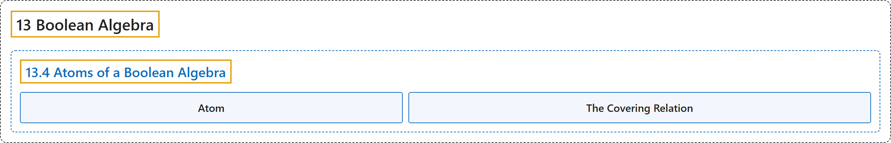

# 13.4 Atoms of a Boolean Algebra

## Classification

## Glossary

| Term | Definition | 中文翻译 | Source |
|---|---|---|---|
| **13.4 Atoms of a Boolean Algebra** 布尔代数的原子 | (No definition) | （无定义） | [Doerr & Levasseur, n.d., section 13.4](https://discretemath.org/ads/s-atoms-of-a-boolean-algebra.html) |
| **Atom** 原子 | "**A non-least element** $a$ in a Boolean algebra $[B; \lor, \land, \bar{}\hspace{3 pt}]$ is called **an atom** if for every $x \in B\text{,}$ $x \land a = a$ or $x \land a = 0\text{.}$" | 布尔代数 $[B; \lor, \land, \bar{}\hspace{3 pt}]$ 中的**非最小元** $a$，若对每个 $x \in B$， 有 $x \land a = a$ 或 $x \land a = 0$。 则称为**原子**。 | [Doerr & Levasseur, n.d., Definition 13.4.2](https://discretemath.org/ads/s-atoms-of-a-boolean-algebra.html#def-atom) |
| **The Covering Relation** 覆盖关系 | "Given a Boolean algebra $[B; \lor, \land, \bar{}\hspace{3 pt}]\text{,}$ let $x, z \in B\text{.}$ We say that **$z$ covers $x$** iff $x \prec z$ and there does not exist $y \in B$ with $x \prec y \prec z\text{.}$" | 给定布尔代数 $[B; \lor, \land, \bar{}\hspace{3 pt}]$， 设 $x, z \in B$。 当且仅当 $x \prec z$ 且不存在 $y \in B$ 使 $x \prec y \prec z$。 时，我们说 $z$ **覆盖** $x$。 | [Doerr & Levasseur, n.d., Definition 13.4.4](https://discretemath.org/ads/s-atoms-of-a-boolean-algebra.html#def-cover) |

## References

Doerr, A., & Levasseur, K. (n.d.). *Applied discrete structures*. Retrieved October 28, 2026, from <https://discretemath.org/ads/index-ads.html>
