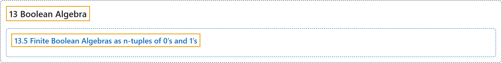

# 13.5 Finite Boolean Algebras as n-tuples of 0’s and 1’s

## Classification

## Glossary

| Term | Definition | 中文翻译 | Source |
|---|---|---|---|
| **13.5 Finite Boolean Algebras as n-tuples of 0’s and 1’s** 作为 0 与 1 的 n 元组的有限布尔代数 | (No definition) | （无定义） | [Doerr & Levasseur, n.d., section 13.5](https://discretemath.org/ads/s-finite-boolean-algebras-ntuples.html) |

## References

Doerr, A., & Levasseur, K. (n.d.). *Applied discrete structures*. Retrieved October 28, 2026, from <https://discretemath.org/ads/index-ads.html>
