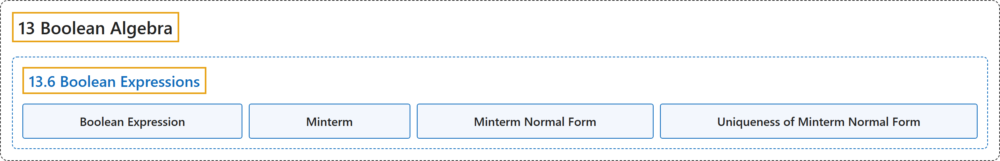

# 13.6 Boolean Expressions

## Classification

## Glossary

| Term | Definition | 中文翻译 | Source |
|---|---|---|---|
| **13.6 Boolean Expressions** 布尔表达式 | (No definition) | （无定义） | [Doerr & Levasseur, n.d., section 13.6](https://discretemath.org/ads/s-boolean-expressions.html) |
| **Boolean Expression** 布尔表达式 | "Let $[B; \lor, \land, - ]$ be any Boolean algebra, and let $x_1, x_2, \ldots, x_k$ be variables in $B\text{;}$ that is, variables that can assume values from $B\text{.}$ **A Boolean expression** generated by $x_1, x_2, \ldots, x_k$ is **any valid combination** of the $x_i$ and the elements of $B$ with the operations of meet, join, and complementation." | 设 $[B; \lor, \land, - ]$ 为任意布尔代数，$x_1, x_2, \ldots, x_k$ 为 $B$ 中的变量，即可取 $B$ 中值的变量。由 $x_1, x_2, \ldots, x_k$ 生成的**布尔表达式**是由 $x_i$ 与 $B$ 的元素通过交、并和求补运算构成的任意**有效组合**。 | [Doerr & Levasseur, n.d., Definition 13.6.1](https://discretemath.org/ads/s-boolean-expressions.html#def-boolean-expression) |
| **Minterm** 最小项 | "**A Boolean expression** generated by $x_1, x_2, \ldots, x_k$ that has the form" | 由 $x_1, x_2, \ldots, x_k$ 生成且具有如下形式的**布尔表达式** | [Doerr & Levasseur, n.d., Definition 13.6.3](https://discretemath.org/ads/s-boolean-expressions.html#def-minterm) |
| **Minterm Normal Form** 最小项范式 | "A Boolean expression generated by $x_1, \ldots, x_k$ is in **minterm normal form** if it is **the join of expressions** of the form $a \land m\text{,}$ where $a\in B$ and $m$ is a minterm generated by $x_1, \ldots, x_k\text{.}$ That is, it is of the form" | 若一个由 $x_1, \ldots, x_k$ 生成的布尔表达式是形如 $a \land m$， 的表达式的**并**，其中 $a\in B$ 且 $m$ 是由 $x_1, \ldots, x_k$ 生成的最小项，则它为**最小项范式**。即，它具有如下形式 | [Doerr & Levasseur, n.d., Definition 13.6.4](https://discretemath.org/ads/s-boolean-expressions.html#def-minterm-normal-form) |
| **Uniqueness of Minterm Normal Form** 极小项范式的唯一性 | "Let $e\left(x_1,\ldots , x_k\right)$ be a Boolean expression over B. **There exists a unique minterm normal form** $M\left(x_1, \ldots , x_k\right)$ that is equivalent to $e\left(x_1, \ldots , x_k\right)$ in the sense that e and M define the same function from $B^k$ into $B$." | 设 $e\left(x_1,\ldots , x_k\right)$ 是 B 上的布尔表达式。**存在唯一的极小项范式** $M\left(x_1, \ldots , x_k\right)$ 与 $e\left(x_1, \ldots , x_k\right)$ 等价，意思是 e 和 M 定义了从 $B^k$ 到 $B$ 的同一个函数。 | [Doerr & Levasseur, n.d., Theorem 13.6.6](https://discretemath.org/ads/s-boolean-expressions.html#th-minterm-normal-form) |

## References

Doerr, A., & Levasseur, K. (n.d.). *Applied discrete structures*. Retrieved October 28, 2026, from <https://discretemath.org/ads/index-ads.html>
