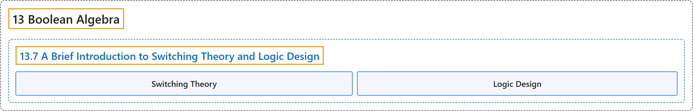

# 13.7 A Brief Introduction to Switching Theory and Logic Design

## Classification

## Glossary

| Term | Definition | 中文翻译 | Source |
|---|---|---|---|
| **13.7 A Brief Introduction to Switching Theory and Logic Design** 开关理论与逻辑设计简介 | (No definition) | （无定义） | [Doerr & Levasseur, n.d., section 13.7](https://discretemath.org/ads/s-logic-design.html) |
| **Switching Theory** 开关理论 | (context) "Pioneering computer scientists such as Claude Shannon realized that the operation of these computers could be simplified by making use of an **isomorphism between computer circuits and boolean algebra**. The term **Switching Theory** was used at the time." | （语境）香农等计算机科学先驱意识到，利用**计算机电路与布尔代数之间的同构**可以简化这些计算机的运作。当时使用的术语是**开关理论**。 | [Doerr & Levasseur, n.d., section 13.7](https://discretemath.org/ads/s-logic-design.html#s-logic-design-5) |
| **Logic Design** 逻辑设计 | (Definition pending) | （定义待补） | [Doerr & Levasseur, n.d., section 13.7](https://discretemath.org/ads/s-logic-design.html) |

## References

Doerr, A., & Levasseur, K. (n.d.). *Applied discrete structures*. Retrieved October 28, 2026, from <https://discretemath.org/ads/index-ads.html>
