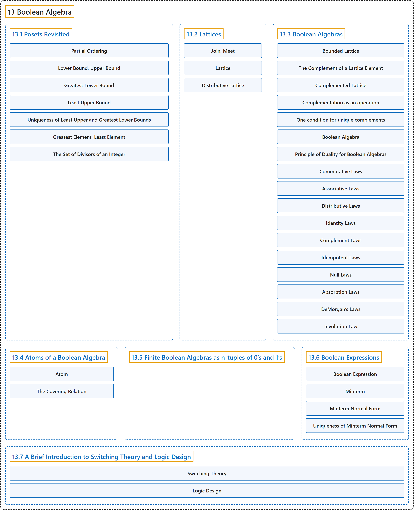

# 13 Boolean Algebra

## Classification

## Glossary

| Term | Definition | 中文翻译 | Source |
|---|---|---|---|
| **13 Boolean Algebra** 布尔代数 | (No definition) | （无定义） | [Doerr & Levasseur, n.d., chapter 13](https://discretemath.org/ads/chapter_13.html) |
| **[13.1 Posets Revisited](13-1-posets-revisited.md)** 再论偏序集 | (No definition) | （无定义） | [Doerr & Levasseur, n.d., section 13.1](https://discretemath.org/ads/s-posets-revisited.html) |
| **[13.2 Lattices](13-2-lattices.md)** 格 | (No definition) | （无定义） | [Doerr & Levasseur, n.d., section 13.2](https://discretemath.org/ads/s-lattices.html) |
| **[13.3 Boolean Algebras](13-3-boolean-algebras.md)** 布尔代数 | (No definition) | （无定义） | [Doerr & Levasseur, n.d., section 13.3](https://discretemath.org/ads/s-boolean-algebras.html) |
| **[13.4 Atoms of a Boolean Algebra](13-4-atoms-of-a-boolean-algebra.md)** 布尔代数的原子 | (No definition) | （无定义） | [Doerr & Levasseur, n.d., section 13.4](https://discretemath.org/ads/s-atoms-of-a-boolean-algebra.html) |
| **[13.5 Finite Boolean Algebras as n-tuples of 0’s and 1’s](13-5-finite-boolean-algebras-as-n-tuples-of-0s-and-1s.md)** 作为 0 与 1 的 n 元组的有限布尔代数 | (No definition) | （无定义） | [Doerr & Levasseur, n.d., section 13.5](https://discretemath.org/ads/s-finite-boolean-algebras-ntuples.html) |
| **[13.6 Boolean Expressions](13-6-boolean-expressions.md)** 布尔表达式 | (No definition) | （无定义） | [Doerr & Levasseur, n.d., section 13.6](https://discretemath.org/ads/s-boolean-expressions.html) |
| **[13.7 A Brief Introduction to Switching Theory and Logic Design](13-7-a-brief-introduction-to-switching-theory-and-logic-design.md)** 开关理论与逻辑设计简介 | (No definition) | （无定义） | [Doerr & Levasseur, n.d., section 13.7](https://discretemath.org/ads/s-logic-design.html) |

## References

Doerr, A., & Levasseur, K. (n.d.). *Applied discrete structures*. Retrieved October 28, 2026, from <https://discretemath.org/ads/index-ads.html>
