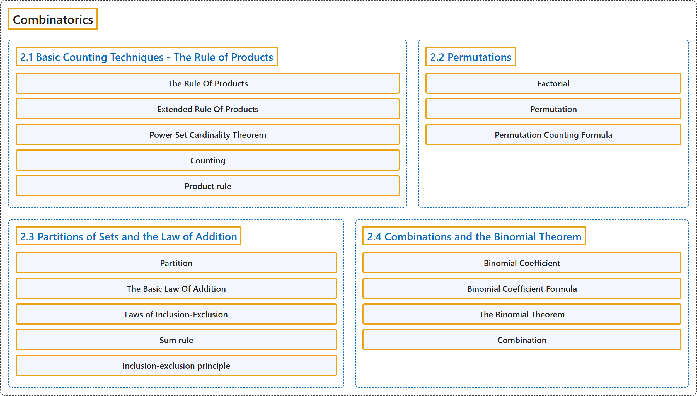

# 2 Combinatorics

## Classification

## Glossary

| Term | Definition | 中文翻译 | Source |
|---|---|---|---|
| **2 Combinatorics** 组合数学 | (No definition) | （无定义） | [Doerr & Levasseur, n.d., chapter 2](https://discretemath.org/ads/chapter_2.html) |
| **2.1 Basic Counting Techniques - The Rule of Products** 基本计数技巧：乘法原理 | (No definition) | （无定义） | [Doerr & Levasseur, n.d., section 2.1](https://discretemath.org/ads/s-the-rule-of-products.html) |
| **The Rule Of Products** 乘法原理 | "If two operations must be performed, and if the first operation can always be performed $p_1$ different ways and the second operation can always be performed $p_2$ different ways, then there are **$p_1 p_2$ different ways** that the two operations can be performed." | 若必须完成两个操作，且第一个操作总是有 $p_1$ 种不同的完成方式，第二个操作总是有 $p_2$ 种不同的完成方式，则这两个操作共有 **$p_1 p_2$ 种不同的完成方式**。 | [Doerr & Levasseur, n.d., Theorem 2.1.5](https://discretemath.org/ads/s-the-rule-of-products.html#prop-rule-of-products) |
| **Extended Rule Of Products** 推广的乘法原理 | "If $n$ operations must be performed, and the number of options for each operation is $p_1\text{,}$ $p_2, \dots, p_n$ respectively, with each $p_i$ independent of previous choices, then the $n$ operations can be performed **$p_1 \cdot p_2 \cdot \cdots \cdot p_n$ different ways**." | 若必须完成 $n$ 个操作，各操作的选择数分别为 $p_1$， $p_2, \dots, p_n$，且每个 $p_i$ 都与先前的选择无关，则这 $n$ 个操作共有 **$p_1 \cdot p_2 \cdot \cdots \cdot p_n$ 种不同的完成方式**。 | [Doerr & Levasseur, n.d., Theorem 2.1.7](https://discretemath.org/ads/s-the-rule-of-products.html#prop-extended-rule-of-products) |
| **Power Set Cardinality Theorem** 幂集基数定理 | "If $A$ is a finite set, then **$\lvert \mathcal{P}(A) \rvert = 2^{\lvert A \rvert }\text{.}$**" | 若 $A$ 是有限集，则 **$\lvert \mathcal{P}(A) \rvert = 2^{\lvert A \rvert }$。** | [Doerr & Levasseur, n.d., Theorem 2.1.9](https://discretemath.org/ads/s-the-rule-of-products.html#power-set-cardinality-theorem) |
| **Counting** 计数 | (context) "Enumerative combinatorics is the part concerned specifically with **counting finite sets of objects** satisfying **prescribed conditions**." | （语境）枚举组合学是专门研究**对有限的对象集合计数**的部分，这些对象满足**规定的条件**。 | [Weisstein, n.d.-b, "Combinatorics" entry, para. 2](https://mathworld.wolfram.com/Combinatorics.html#:~:text=Enumerative%20combinatorics%20is%20the%20part%20concerned%20specifically%20with%20counting) |
| **Product rule** 乘法原理 | "In particular, if **one choice can be made in m ways** and a second in n ways for each first choice, then **the pair of choices can be made in mn ways**." | 特别地，如果**第一个选择有 m 种做法**，而对每个第一个选择，第二个选择有 n 种做法，那么**这一对选择共有 mn 种做法**。 | [Weisstein, n.d.-f, "Multiplication principle" entry, para. 2](https://mathworld.wolfram.com/MultiplicationPrinciple.html#:~:text=if%20one%20choice%20can%20be%20made%20in) |
| **2.2 Permutations** 排列 | (No definition) | （无定义） | [Doerr & Levasseur, n.d., section 2.2](https://discretemath.org/ads/s-permutations.html) |
| **Factorial** 阶乘 | "If $n$ is a positive integer then **$n$ factorial** is the **product of the first $n$ positive integers** and is denoted $n!\text{.}$ Additionally, we define zero factorial, $0!\text{,}$ to be 1." | 若 $n$ 是正整数，则 $n$ 的**阶乘**是**前 $n$ 个正整数的乘积**，记作 $n!$。此外，我们规定零的阶乘 $0!$， 为 1。 | [Doerr & Levasseur, n.d., Definition 2.2.5](https://discretemath.org/ads/s-permutations.html#Definition-Factorial) |
| **Permutation** 排列 | "An **ordered arrangement of $k$ elements selected from a set of $n$ elements**, $0 \leq k \leq n\text{,}$ where no two elements of the arrangement are the same, is called a **permutation of $n$ objects taken $k$ at a time**. The total number of such permutations is denoted by $P(n, k)\text{.}$" | 从 $n$ 个元素的集合中选取 $k$ 个元素（$0 \leq k \leq n$）构成的、其中任意两个元素互不相同的**有序排列**，称为 **$n$ 个对象每次取 $k$ 个的排列**。这类排列的总数记作 $P(n, k)$。 | [Doerr & Levasseur, n.d., Definition 2.2.7](https://discretemath.org/ads/s-permutations.html#permutation) |
| **Permutation Counting Formula** 排列计数公式 | "The **number of possible permutations of $k$ elements taken from a set of $n$ elements** is" | 从 $n$ 个元素的集合中取 $k$ 个元素的**可能排列数**为 | [Doerr & Levasseur, n.d., Theorem 2.2.8](https://discretemath.org/ads/s-permutations.html#permutations-counting-formula) |
| **2.3 Partitions of Sets and the Law of Addition** 集合的划分与加法原理 | (No definition) | （无定义） | [Doerr & Levasseur, n.d., section 2.3](https://discretemath.org/ads/s-partitions-and-law-of-addition.html) |
| **Partition** 划分 | "A **partition of set $A$** is a **set of one or more nonempty subsets of $A\text{:}$** $A_1, A_2, A_3, \cdots\text{,}$ such that every element of $A$ is in exactly one set. Symbolically," | 集合 $A$ 的**划分**是 **$A$ 的一个或多个非空子集构成的集合**：$A_1, A_2, A_3, \cdots$， 使得 $A$ 的每个元素恰好属于其中一个集合。用符号表示为， | [Doerr & Levasseur, n.d., Definition 2.3.1](https://discretemath.org/ads/s-partitions-and-law-of-addition.html#partition) |
| **The Basic Law Of Addition** 基本加法原理 | "If $A$ is a **finite set**, and if $\{A_1,A_2,\ldots,A_n\}$ is a **partition of $A$**, then" | 若 $A$ 是**有限集**，且 $\{A_1,A_2,\ldots,A_n\}$ 是 **$A$ 的一个划分**，则 | [Doerr & Levasseur, n.d., Theorem 2.3.4](https://discretemath.org/ads/s-partitions-and-law-of-addition.html#basic-law-addition) |
| **Laws of Inclusion-Exclusion** 容斥原理 | "**Given finite sets $A_1, A_2, A_3\text{,}$** then" | 给定**有限集** $A_1, A_2, A_3$，则 | [Doerr & Levasseur, n.d., Theorem 2.3.9](https://discretemath.org/ads/s-partitions-and-law-of-addition.html#inclusion-exclusion) |
| **Sum rule** 加法原理 | (context) "Let \|A\| denote the **cardinal number of set A**, then it follows immediately that **\|A ∪ B\| = \|A\| + \|B\| − \|A ∩ B\|**." | （语境）设 \|A\| 表示**集合 A 的基数**，则立即可得 **\|A ∪ B\| = \|A\| + \|B\| − \|A ∩ B\|**。 | [Weisstein, n.d.-e, "Inclusion-exclusion principle" entry, para. 1](https://mathworld.wolfram.com/Inclusion-ExclusionPrinciple.html#:~:text=denote%20the%20cardinal%20number%20of%20set) |
| **Inclusion-exclusion principle** 容斥原理 | "Let \|A\| denote the **cardinal number of set A**, then it follows immediately that **\|A ∪ B\| = \|A\| + \|B\| − \|A ∩ B\|**." | 设 \|A\| 表示**集合 A 的基数**，则立即可得 **\|A ∪ B\| = \|A\| + \|B\| − \|A ∩ B\|**。 | [Weisstein, n.d.-e, "Inclusion-exclusion principle" entry, para. 1](https://mathworld.wolfram.com/Inclusion-ExclusionPrinciple.html#:~:text=denote%20the%20cardinal%20number%20of%20set) |
| **2.4 Combinations and the Binomial Theorem** 组合与二项式定理 | (No definition) | （无定义） | [Doerr & Levasseur, n.d., section 2.4](https://discretemath.org/ads/s-combinations-and-the-binomial-theorem.html) |
| **Binomial Coefficient** 二项式系数 | "Let $n$ and $k$ be nonnegative integers. The **binomial coefficient $\binom{n}{k}$** represents the **number of combinations of $n$ objects taken $k$ at a time**, and is read “$n$ choose $k\text{.}$”" | 设 $n$ 和 $k$ 是非负整数。**二项式系数** $\binom{n}{k}$ 表示 **$n$ 个对象每次取 $k$ 个的组合数**，读作“$n$ 取 $k$”。 | [Doerr & Levasseur, n.d., Definition 2.4.3](https://discretemath.org/ads/s-combinations-and-the-binomial-theorem.html#binomial-coefficient) |
| **Binomial Coefficient Formula** 二项式系数公式 | "If $n$ and $k$ are nonnegative integers with $0 \leq k \leq n\text{,}$ then the **number $k$-element subsets of an $n$ element set** is equal to" | 若 $n$ 和 $k$ 是非负整数且 $0 \leq k \leq n$，则 $n$ 元集合的 **$k$ 元子集的个数**等于 | [Doerr & Levasseur, n.d., Theorem 2.4.4](https://discretemath.org/ads/s-combinations-and-the-binomial-theorem.html#binomial-coefficient-formula) |
| **The Binomial Theorem** 二项式定理 | "If $n \geq 0\text{,}$ and **$x$ and $y$ are numbers**, then" | 若 $n \geq 0$，且 **$x$ 和 $y$ 是数**，则 | [Doerr & Levasseur, n.d., Theorem 2.4.9](https://discretemath.org/ads/s-combinations-and-the-binomial-theorem.html#binomial-theorem) |
| **Combination** 组合 | "The number of ways of **picking k unordered outcomes** from **n possibilities**." | **选出 k 个无序结果**的方式数，这些结果取自 **n 种可能**。 | [Weisstein, n.d.-a, "Combination" entry, para. 1](https://mathworld.wolfram.com/Combination.html#:~:text=The%20number%20of%20ways%20of%20picking) |

## References

Doerr, A., & Levasseur, K. (n.d.). *Applied discrete structures*. Retrieved October 28, 2026, from <https://discretemath.org/ads/index-ads.html>

Weisstein, E. W. (n.d.-a). *Combination*. MathWorld: A Wolfram Resource. Retrieved October 27, 2026, from <https://mathworld.wolfram.com/Combination.html>

Weisstein, E. W. (n.d.-b). *Combinatorics*. MathWorld: A Wolfram Resource. Retrieved October 27, 2026, from <https://mathworld.wolfram.com/Combinatorics.html>

Weisstein, E. W. (n.d.-e). *Inclusion-exclusion principle*. MathWorld: A Wolfram Resource. Retrieved October 27, 2026, from <https://mathworld.wolfram.com/Inclusion-ExclusionPrinciple.html>

Weisstein, E. W. (n.d.-f). *Multiplication principle*. MathWorld: A Wolfram Resource. Retrieved October 27, 2026, from <https://mathworld.wolfram.com/MultiplicationPrinciple.html>
