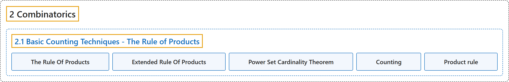

# 2.1 Basic Counting Techniques - The Rule of Products

## Classification

## Glossary

| Term | Definition | 中文翻译 | Source |
|---|---|---|---|
| **2.1 Basic Counting Techniques - The Rule of Products** 基本计数技巧：乘法原理 | (No definition) | （无定义） | [Doerr & Levasseur, n.d., section 2.1](https://discretemath.org/ads/s-the-rule-of-products.html) |
| **The Rule Of Products** 乘法原理 | "If two operations must be performed, and if the first operation can always be performed $p_1$ different ways and the second operation can always be performed $p_2$ different ways, then there are **$p_1 p_2$ different ways** that the two operations can be performed." | 若必须完成两个操作，且第一个操作总是有 $p_1$ 种不同的完成方式，第二个操作总是有 $p_2$ 种不同的完成方式，则这两个操作共有 **$p_1 p_2$ 种不同的完成方式**。 | [Doerr & Levasseur, n.d., Theorem 2.1.5](https://discretemath.org/ads/s-the-rule-of-products.html#prop-rule-of-products) |
| **Extended Rule Of Products** 推广的乘法原理 | "If $n$ operations must be performed, and the number of options for each operation is $p_1\text{,}$ $p_2, \dots, p_n$ respectively, with each $p_i$ independent of previous choices, then the $n$ operations can be performed **$p_1 \cdot p_2 \cdot \cdots \cdot p_n$ different ways**." | 若必须完成 $n$ 个操作，各操作的选择数分别为 $p_1$， $p_2, \dots, p_n$，且每个 $p_i$ 都与先前的选择无关，则这 $n$ 个操作共有 **$p_1 \cdot p_2 \cdot \cdots \cdot p_n$ 种不同的完成方式**。 | [Doerr & Levasseur, n.d., Theorem 2.1.7](https://discretemath.org/ads/s-the-rule-of-products.html#prop-extended-rule-of-products) |
| **Power Set Cardinality Theorem** 幂集基数定理 | "If $A$ is a finite set, then **$\lvert \mathcal{P}(A) \rvert = 2^{\lvert A \rvert }\text{.}$**" | 若 $A$ 是有限集，则 **$\lvert \mathcal{P}(A) \rvert = 2^{\lvert A \rvert }$。** | [Doerr & Levasseur, n.d., Theorem 2.1.9](https://discretemath.org/ads/s-the-rule-of-products.html#power-set-cardinality-theorem) |
| **Counting** 计数 | (context) "Enumerative combinatorics is the part concerned specifically with **counting finite sets of objects** satisfying **prescribed conditions**." | （语境）枚举组合学是专门研究**对有限的对象集合计数**的部分，这些对象满足**规定的条件**。 | [Weisstein, n.d.-b, "Combinatorics" entry, para. 2](https://mathworld.wolfram.com/Combinatorics.html#:~:text=Enumerative%20combinatorics%20is%20the%20part%20concerned%20specifically%20with%20counting) |
| **Product rule** 乘法原理 | "In particular, if **one choice can be made in m ways** and a second in n ways for each first choice, then **the pair of choices can be made in mn ways**." | 特别地，如果**第一个选择有 m 种做法**，而对每个第一个选择，第二个选择有 n 种做法，那么**这一对选择共有 mn 种做法**。 | [Weisstein, n.d.-f, "Multiplication principle" entry, para. 2](https://mathworld.wolfram.com/MultiplicationPrinciple.html#:~:text=if%20one%20choice%20can%20be%20made%20in) |

## References

Doerr, A., & Levasseur, K. (n.d.). *Applied discrete structures*. Retrieved October 28, 2026, from <https://discretemath.org/ads/index-ads.html>

Weisstein, E. W. (n.d.-b). *Combinatorics*. MathWorld: A Wolfram Resource. Retrieved October 27, 2026, from <https://mathworld.wolfram.com/Combinatorics.html>

Weisstein, E. W. (n.d.-f). *Multiplication principle*. MathWorld: A Wolfram Resource. Retrieved October 27, 2026, from <https://mathworld.wolfram.com/MultiplicationPrinciple.html>
