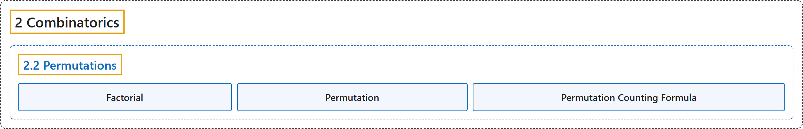

# 2.2 Permutations

## Classification

## Glossary

| Term | Definition | 中文翻译 | Source |
|---|---|---|---|
| **2.2 Permutations** 排列 | (No definition) | （无定义） | [Doerr & Levasseur, n.d., section 2.2](https://discretemath.org/ads/s-permutations.html) |
| **Factorial** 阶乘 | "If $n$ is a positive integer then **$n$ factorial** is the **product of the first $n$ positive integers** and is denoted $n!\text{.}$ Additionally, we define zero factorial, $0!\text{,}$ to be 1." | 若 $n$ 是正整数，则 $n$ 的**阶乘**是**前 $n$ 个正整数的乘积**，记作 $n!$。此外，我们规定零的阶乘 $0!$， 为 1。 | [Doerr & Levasseur, n.d., Definition 2.2.5](https://discretemath.org/ads/s-permutations.html#Definition-Factorial) |
| **Permutation** 排列 | "An **ordered arrangement of $k$ elements selected from a set of $n$ elements**, $0 \leq k \leq n\text{,}$ where no two elements of the arrangement are the same, is called a **permutation of $n$ objects taken $k$ at a time**. The total number of such permutations is denoted by $P(n, k)\text{.}$" | 从 $n$ 个元素的集合中选取 $k$ 个元素（$0 \leq k \leq n$）构成的、其中任意两个元素互不相同的**有序排列**，称为 **$n$ 个对象每次取 $k$ 个的排列**。这类排列的总数记作 $P(n, k)$。 | [Doerr & Levasseur, n.d., Definition 2.2.7](https://discretemath.org/ads/s-permutations.html#permutation) |
| **Permutation Counting Formula** 排列计数公式 | "The **number of possible permutations of $k$ elements taken from a set of $n$ elements** is" | 从 $n$ 个元素的集合中取 $k$ 个元素的**可能排列数**为 | [Doerr & Levasseur, n.d., Theorem 2.2.8](https://discretemath.org/ads/s-permutations.html#permutations-counting-formula) |

## References

Doerr, A., & Levasseur, K. (n.d.). *Applied discrete structures*. Retrieved October 28, 2026, from <https://discretemath.org/ads/index-ads.html>
