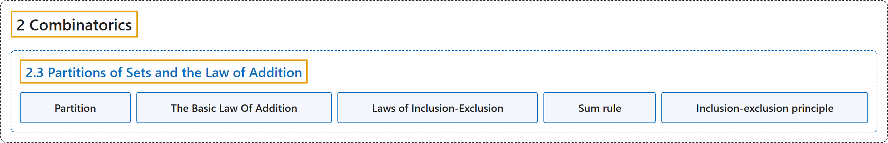

# 2.3 Partitions of Sets and the Law of Addition

## Classification

## Glossary

| Term | Definition | 中文翻译 | Source |
|---|---|---|---|
| **2.3 Partitions of Sets and the Law of Addition** 集合的划分与加法原理 | (No definition) | （无定义） | [Doerr & Levasseur, n.d., section 2.3](https://discretemath.org/ads/s-partitions-and-law-of-addition.html) |
| **Partition** 划分 | "A **partition of set $A$** is a **set of one or more nonempty subsets of $A\text{:}$** $A_1, A_2, A_3, \cdots\text{,}$ such that every element of $A$ is in exactly one set. Symbolically," | 集合 $A$ 的**划分**是 **$A$ 的一个或多个非空子集构成的集合**：$A_1, A_2, A_3, \cdots$， 使得 $A$ 的每个元素恰好属于其中一个集合。用符号表示为， | [Doerr & Levasseur, n.d., Definition 2.3.1](https://discretemath.org/ads/s-partitions-and-law-of-addition.html#partition) |
| **The Basic Law Of Addition** 基本加法原理 | "If $A$ is a **finite set**, and if $\{A_1,A_2,\ldots,A_n\}$ is a **partition of $A$**, then" | 若 $A$ 是**有限集**，且 $\{A_1,A_2,\ldots,A_n\}$ 是 **$A$ 的一个划分**，则 | [Doerr & Levasseur, n.d., Theorem 2.3.4](https://discretemath.org/ads/s-partitions-and-law-of-addition.html#basic-law-addition) |
| **Laws of Inclusion-Exclusion** 容斥原理 | "**Given finite sets $A_1, A_2, A_3\text{,}$** then" | 给定**有限集** $A_1, A_2, A_3$，则 | [Doerr & Levasseur, n.d., Theorem 2.3.9](https://discretemath.org/ads/s-partitions-and-law-of-addition.html#inclusion-exclusion) |
| **Sum rule** 加法原理 | (context) "Let \|A\| denote the **cardinal number of set A**, then it follows immediately that **\|A ∪ B\| = \|A\| + \|B\| − \|A ∩ B\|**." | （语境）设 \|A\| 表示**集合 A 的基数**，则立即可得 **\|A ∪ B\| = \|A\| + \|B\| − \|A ∩ B\|**。 | [Weisstein, n.d.-e, "Inclusion-exclusion principle" entry, para. 1](https://mathworld.wolfram.com/Inclusion-ExclusionPrinciple.html#:~:text=denote%20the%20cardinal%20number%20of%20set) |
| **Inclusion-exclusion principle** 容斥原理 | "Let \|A\| denote the **cardinal number of set A**, then it follows immediately that **\|A ∪ B\| = \|A\| + \|B\| − \|A ∩ B\|**." | 设 \|A\| 表示**集合 A 的基数**，则立即可得 **\|A ∪ B\| = \|A\| + \|B\| − \|A ∩ B\|**。 | [Weisstein, n.d.-e, "Inclusion-exclusion principle" entry, para. 1](https://mathworld.wolfram.com/Inclusion-ExclusionPrinciple.html#:~:text=denote%20the%20cardinal%20number%20of%20set) |

## References

Doerr, A., & Levasseur, K. (n.d.). *Applied discrete structures*. Retrieved October 28, 2026, from <https://discretemath.org/ads/index-ads.html>

Weisstein, E. W. (n.d.-e). *Inclusion-exclusion principle*. MathWorld: A Wolfram Resource. Retrieved October 27, 2026, from <https://mathworld.wolfram.com/Inclusion-ExclusionPrinciple.html>
