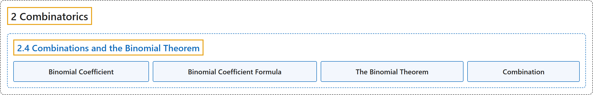

# 2.4 Combinations and the Binomial Theorem

## Classification

## Glossary

| Term | Definition | 中文翻译 | Source |
|---|---|---|---|
| **2.4 Combinations and the Binomial Theorem** 组合与二项式定理 | (No definition) | （无定义） | [Doerr & Levasseur, n.d., section 2.4](https://discretemath.org/ads/s-combinations-and-the-binomial-theorem.html) |
| **Binomial Coefficient** 二项式系数 | "Let $n$ and $k$ be nonnegative integers. The **binomial coefficient $\binom{n}{k}$** represents the **number of combinations of $n$ objects taken $k$ at a time**, and is read “$n$ choose $k\text{.}$”" | 设 $n$ 和 $k$ 是非负整数。**二项式系数** $\binom{n}{k}$ 表示 **$n$ 个对象每次取 $k$ 个的组合数**，读作“$n$ 取 $k$”。 | [Doerr & Levasseur, n.d., Definition 2.4.3](https://discretemath.org/ads/s-combinations-and-the-binomial-theorem.html#binomial-coefficient) |
| **Binomial Coefficient Formula** 二项式系数公式 | "If $n$ and $k$ are nonnegative integers with $0 \leq k \leq n\text{,}$ then the **number $k$-element subsets of an $n$ element set** is equal to" | 若 $n$ 和 $k$ 是非负整数且 $0 \leq k \leq n$，则 $n$ 元集合的 **$k$ 元子集的个数**等于 | [Doerr & Levasseur, n.d., Theorem 2.4.4](https://discretemath.org/ads/s-combinations-and-the-binomial-theorem.html#binomial-coefficient-formula) |
| **The Binomial Theorem** 二项式定理 | "If $n \geq 0\text{,}$ and **$x$ and $y$ are numbers**, then" | 若 $n \geq 0$，且 **$x$ 和 $y$ 是数**，则 | [Doerr & Levasseur, n.d., Theorem 2.4.9](https://discretemath.org/ads/s-combinations-and-the-binomial-theorem.html#binomial-theorem) |
| **Combination** 组合 | "The number of ways of **picking k unordered outcomes** from **n possibilities**." | **选出 k 个无序结果**的方式数，这些结果取自 **n 种可能**。 | [Weisstein, n.d.-a, "Combination" entry, para. 1](https://mathworld.wolfram.com/Combination.html#:~:text=The%20number%20of%20ways%20of%20picking) |

## References

Doerr, A., & Levasseur, K. (n.d.). *Applied discrete structures*. Retrieved October 28, 2026, from <https://discretemath.org/ads/index-ads.html>

Weisstein, E. W. (n.d.-a). *Combination*. MathWorld: A Wolfram Resource. Retrieved October 27, 2026, from <https://mathworld.wolfram.com/Combination.html>
