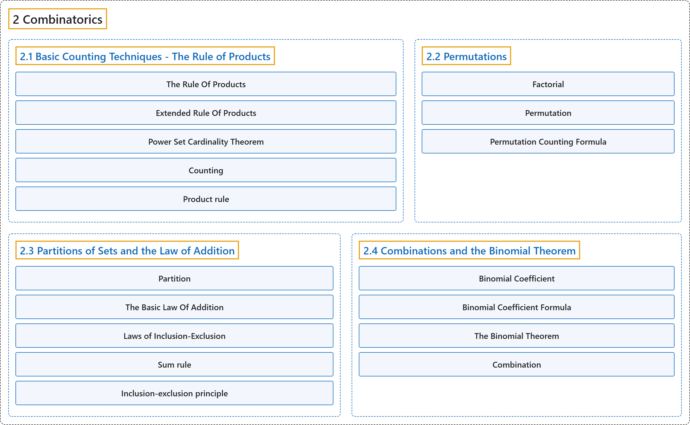

# 2 Combinatorics

## Classification

## Glossary

| Term | Definition | 中文翻译 | Source |
|---|---|---|---|
| **2 Combinatorics** 组合数学 | (No definition) | （无定义） | [Doerr & Levasseur, n.d., chapter 2](https://discretemath.org/ads/chapter_2.html) |
| **[2.1 Basic Counting Techniques - The Rule of Products](2-1-basic-counting-techniques-the-rule-of-products.md)** 基本计数技巧：乘法原理 | (No definition) | （无定义） | [Doerr & Levasseur, n.d., section 2.1](https://discretemath.org/ads/s-the-rule-of-products.html) |
| **[2.2 Permutations](2-2-permutations.md)** 排列 | (No definition) | （无定义） | [Doerr & Levasseur, n.d., section 2.2](https://discretemath.org/ads/s-permutations.html) |
| **[2.3 Partitions of Sets and the Law of Addition](2-3-partitions-of-sets-and-the-law-of-addition.md)** 集合的划分与加法原理 | (No definition) | （无定义） | [Doerr & Levasseur, n.d., section 2.3](https://discretemath.org/ads/s-partitions-and-law-of-addition.html) |
| **[2.4 Combinations and the Binomial Theorem](2-4-combinations-and-the-binomial-theorem.md)** 组合与二项式定理 | (No definition) | （无定义） | [Doerr & Levasseur, n.d., section 2.4](https://discretemath.org/ads/s-combinations-and-the-binomial-theorem.html) |

## References

Doerr, A., & Levasseur, K. (n.d.). *Applied discrete structures*. Retrieved October 28, 2026, from <https://discretemath.org/ads/index-ads.html>
