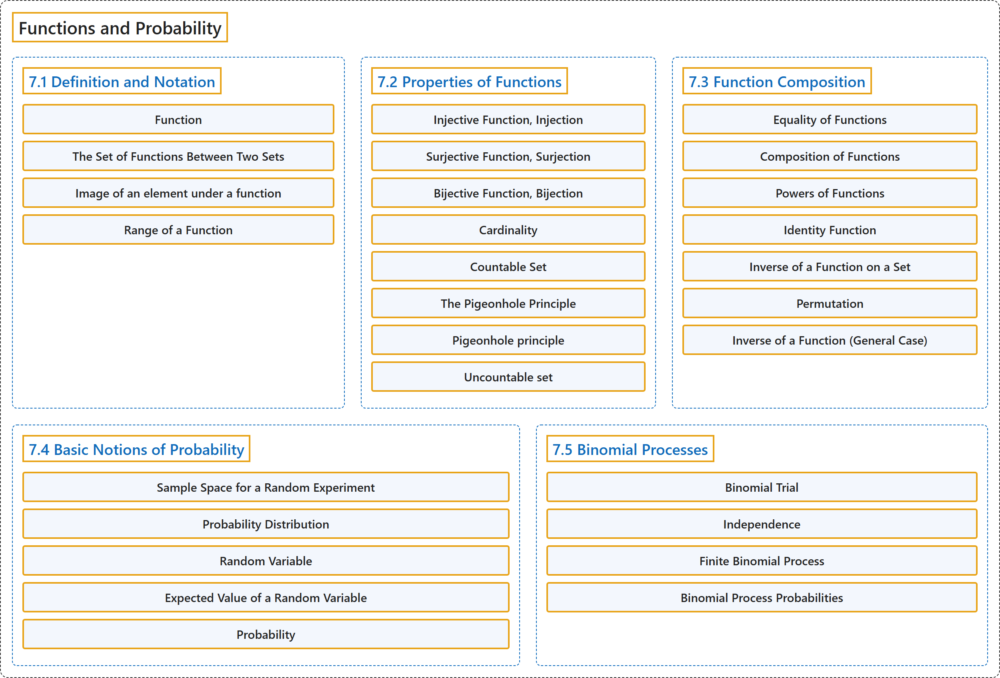

# 7 Functions and Probability

## Classification

## Glossary

| Term | Definition | 中文翻译 | Source |
|---|---|---|---|
| **7 Functions and Probability** 函数与概率 | (No definition) | （无定义） | [Doerr & Levasseur, n.d., chapter 7](https://discretemath.org/ads/chapter_7.html) |
| **7.1 Definition and Notation** 定义与记号 | (No definition) | （无定义） | [Doerr & Levasseur, n.d., section 7.1](https://discretemath.org/ads/s-function-def-notation.html) |
| **Function** 函数 | "A function is a relation that **uniquely associates members of one set** with **members of another set**." | 函数是一种关系，它把**一个集合的成员唯一地对应**到**另一个集合的成员**。 | [Weisstein, n.d.-d, "Function" entry, para. 1](https://mathworld.wolfram.com/Function.html#:~:text=A%20function%20is%20a%20relation%20that%20uniquely%20associates%20members%20of%20one%20set) |
| **The Set of Functions Between Two Sets** 两个集合之间的函数集 | "Given two sets, $A$ and $B\text{,}$ the **set of all functions from $A$ into $B$** is denoted **$B^A\text{.}$**" | 给定两个集合 $A$ 和 $B$，**从 $A$ 到 $B$ 的所有函数的集合**记作 **$B^A$。** | [Doerr & Levasseur, n.d., Definition 7.1.5](https://discretemath.org/ads/s-function-def-notation.html#def-set-of-functions) |
| **Image of an element under a function** 元素在函数下的像 | "Let $f:A \rightarrow B\text{,}$ read “Let $f$ be a function from the set $A$ into the set $B\text{.}$” If $a \in A\text{,}$ then $f(a)$ is used to denote that element of $B$ to which $a$ is related. $f(a)$ is called the **image of $a\text{,}$** or, more precisely, the **image of $a$ under $f\text{.}$** We write $f(a) = b$ to indicate that the image of $a$ is $b\text{.}$" | 设 $f:A \rightarrow B$，读作“设 $f$ 是从集合 $A$ 到集合 $B$ 的函数”。若 $a \in A$，则用 $f(a)$ 表示 $B$ 中与 $a$ 有关系的那个元素。$f(a)$ 称为 $a$ 的**像**，更准确地说，称为 $a$ 在 $f$ 下的**像**。我们记 $f(a) = b$ 来表示 $a$ 的像是 $b$。 | [Doerr & Levasseur, n.d., Definition 7.1.7](https://discretemath.org/ads/s-function-def-notation.html#def-image-of-an-element) |
| **Range of a Function** 函数的值域 | "The **range of a function** is the **set of images of its domain**. If $f:X \rightarrow Y\text{,}$ then the range of $f$ is denoted $f(X)\text{,}$ and" | 函数的**值域**是**其定义域的像的集合**。若 $f:X \rightarrow Y$，则 $f$ 的值域记作 $f(X)$，并且 | [Doerr & Levasseur, n.d., Definition 7.1.8](https://discretemath.org/ads/s-function-def-notation.html#def-range-of-function) |
| **7.2 Properties of Functions** 函数的性质 | (No definition) | （无定义） | [Doerr & Levasseur, n.d., section 7.2](https://discretemath.org/ads/s-properties-of-functions.html) |
| **Injective Function, Injection** 单射函数、单射 | "A function $f: A \rightarrow B$ is **injective** if" | 函数 $f: A \rightarrow B$ 是**单射的**，若 | [Doerr & Levasseur, n.d., Definition 7.2.1](https://discretemath.org/ads/s-properties-of-functions.html#def-injective-function) |
| **Surjective Function, Surjection** 满射函数、满射 | "A function $f: A \rightarrow B$ is **surjective** if its **range, $f(A)\text{,}$ is equal to its codomain, $B\text{.}$** A surjective function is called a **surjection**, or an **onto function**." | 函数 $f: A \rightarrow B$ 是**满射的**，若它的**值域 $f(A)$， 等于它的陪域 $B$。**满射函数称为**满射**，或**映上函数**。 | [Doerr & Levasseur, n.d., Definition 7.2.2](https://discretemath.org/ads/s-properties-of-functions.html#def-surjective-function) |
| **Bijective Function, Bijection** 双射函数、双射 | "A function $f: A \rightarrow B$ is **bijective** if it is **both injective and surjective**. Bijective functions are also called **one-to-one, onto functions**." | 函数 $f: A \rightarrow B$ 是**双射的**，若它**既是单射又是满射**。双射函数也称为**一一映上函数**。 | [Doerr & Levasseur, n.d., Definition 7.2.3](https://discretemath.org/ads/s-properties-of-functions.html#def-bijective-function) |
| **Cardinality** 基数 | "In formal set theory, a cardinal number (also called 'the cardinality') is a **type of number** defined in such a way that **any method of counting sets using it gives the same result**." | 在形式集合论中，基数（也称为 cardinality）是一种**数的类型**，它的定义方式保证**用它计数集合的任何方法都得到相同的结果**。 | [Weisstein, n.d.-a, "Cardinal number" entry, para. 2](https://mathworld.wolfram.com/CardinalNumber.html#:~:text=is%20a%20type%20of%20number%20defined%20in%20such%20a%20way%20that%20any%20method%20of%20counting%20sets) |
| **Countable Set** 可数集 | "A countable set is a set that is **either finite or denumerable**." | 可数集是**有限的或可列的**集合。 | [Weisstein, n.d.-b, "Countable set" entry, para. 1](https://mathworld.wolfram.com/CountableSet.html#:~:text=A%20countable%20set%20is%20a%20set%20that%20is%20either%20finite%20or%20denumerable) |
| **The Pigeonhole Principle** 鸽巢原理 | "Let $f$ be a function from a finite set $X$ into a finite set $Y\text{.}$ If $n\geq 1$ and $\lvert X\rvert > n\lvert Y\rvert\text{,}$ then **there exists an element of $Y$ that is the image under $f$ of at least $n + 1$ elements of X**." | 设 $f$ 是从有限集 $X$ 到有限集 $Y$ 的函数。若 $n\geq 1$ 且 $\lvert X\rvert > n\lvert Y\rvert$，则**存在 $Y$ 的一个元素，它是 $X$ 中至少 $n + 1$ 个元素在 $f$ 下的像**。 | [Doerr & Levasseur, n.d., Theorem 7.2.13](https://discretemath.org/ads/s-properties-of-functions.html#th-pigeonhole-principle) |
| **Pigeonhole principle** 鸽巢原理 | "A.k.a. the pigeonhole principle. Given n boxes and m>n objects, **at least one box must contain more than one object**." | 又称鸽巢原理。给定 n 个盒子和 m>n 个物体，**至少有一个盒子必须装有多于一个物体**。 | [Weisstein, n.d.-c, "Dirichlet's box principle" entry, para. 1](https://mathworld.wolfram.com/DirichletsBoxPrinciple.html#:~:text=at%20least%20one%20box%20must%20contain%20more%20than%20one%20object) |
| **Uncountable set** 不可数集 | "The phrase 'uncountably infinite' describes **an infinite set**, such as the real numbers, which is **not countably infinite**." | “不可数无限”一词描述的是**一个无限集合**（例如实数集），它**不是可数无限的**。 | [Weisstein, n.d.-i, "Uncountably infinite" entry, para. 1](https://mathworld.wolfram.com/UncountablyInfinite.html#:~:text=describes%20an%20infinite%20set) |
| **7.3 Function Composition** 函数的复合 | (No definition) | （无定义） | [Doerr & Levasseur, n.d., section 7.3](https://discretemath.org/ads/s-function-composition.html) |
| **Equality of Functions** 函数相等 | "Let $f, g:A \rightarrow B\text{;}$ that is, let $f$ and $g$ both be functions from $A$ into $B\text{.}$ Then **$f$ is equal to $g$** (denoted $f=g$) if and only if **$f(x) = g(x)$ for all $x \in A\text{.}$**" | 设 $f, g:A \rightarrow B$；即设 $f$ 和 $g$ 都是从 $A$ 到 $B$。 的函数。则 **$f$ 等于 $g$**（记作 $f=g$），当且仅当**对所有 $x \in A$。 有 $f(x) = g(x)$**。 | [Doerr & Levasseur, n.d., Definition 7.3.1](https://discretemath.org/ads/s-function-composition.html#def-equality-of-functions) |
| **Composition of Functions** 函数的复合 | "Let $f:A \rightarrow B$ and $g:B \rightarrow C\text{.}$ Then the **composition of $f$ followed by $g\text{,}$** written $g\circ f\text{,}$ is **a function from $A$ into $C$** defined by $(g \circ f)(x) = g(f(x))\text{,}$ which is read “$g$ of $f$ of $x\text{.}$”" | 设 $f:A \rightarrow B$，$g:B \rightarrow C$。则**先 $f$ 后 $g$ 的复合**，记作 $g\circ f$，是**从 $A$ 到 $C$ 的函数**，定义为 $(g \circ f)(x) = g(f(x))$，读作“$g$ of $f$ of $x$。”。 | [Doerr & Levasseur, n.d., Definition 7.3.2](https://discretemath.org/ads/s-function-composition.html#def-composition-of-functions) |
| **Powers of Functions** 函数的幂 | "**Let $f: A\to A\text{.}$**" | **设 $f: A\to A$。**。 | [Doerr & Levasseur, n.d., Definition 7.3.5](https://discretemath.org/ads/s-function-composition.html#def-powers-of-functions) |
| **Identity Function** 恒等函数 | "For any set $A\text{,}$ the **identity function on $A$** is **a function from $A$ onto $A\text{,}$** denoted by $i$ (or, more specifically, $i_A$) such that $i(a) = a$ for all $a\in A\text{.}$" | 对任意集合 $A$，**$A$ 上的恒等函数**是**从 $A$ 到 $A$ 的满射函数**，记作 $i$（或更具体地记作 $i_A$），使得对所有 $a\in A$。 都有 $i(a) = a$。 | [Doerr & Levasseur, n.d., Definition 7.3.8](https://discretemath.org/ads/s-function-composition.html#def-identity-function) |
| **Inverse of a Function on a Set** 集合上函数的逆 | "Let $f: A\rightarrow A\text{.}$ If there exists a function $g: A \rightarrow A$ such that $g\circ f = f\circ g = i\text{,}$ then **$g$ is called the inverse of $f$** and is denoted by $f^{-1}$, read “$f$ inverse.”" | 设 $f: A\rightarrow A$。若存在函数 $g: A \rightarrow A$ 使得 $g\circ f = f\circ g = i$，则称 **$g$ 为 $f$ 的逆**，记作 $f^{-1}$，读作“$f$ inverse”。 | [Doerr & Levasseur, n.d., Definition 7.3.11](https://discretemath.org/ads/s-function-composition.html#def-inverse-function) |
| **Permutation** 排列 | "A permutation of a set S is a **one-to-one correspondence of S with itself**." | 集合 S 的排列是 **S 与它自身之间的一一对应**。 | [Weisstein, n.d.-d, "Permutation" entry, para. 1](https://mathworld.wolfram.com/Permutation.html#:~:text=is%20a%20one%2Dto%2Done%20correspondence%20of) |
| **Inverse of a Function (General Case)** 函数的逆（一般情形） | "Let $f:A \rightarrow B\text{,}$ If there exists a function $g:B \rightarrow A$ such that $g \circ f = i_A$ and $f\circ g = i_B$, then **$g$ is called the inverse of $f$** and is denoted by $f^{-1}$, read “$f$ inverse.”" | 设 $f:A \rightarrow B$，若存在函数 $g:B \rightarrow A$ 使得 $g \circ f = i_A$ 且 $f\circ g = i_B$，则称 **$g$ 为 $f$ 的逆**，记作 $f^{-1}$，读作“$f$ inverse”。 | [Doerr & Levasseur, n.d., Definition 7.3.16](https://discretemath.org/ads/s-function-composition.html#def-general-inverse-function) |
| **7.4 Basic Notions of Probability** 概率的基本概念 | (No definition) | （无定义） | [Doerr & Levasseur, n.d., section 7.4](https://discretemath.org/ads/s-probability-basics.html) |
| **Sample Space for a Random Experiment** 随机试验的样本空间 | "The **sample space** for a random experiment is the **set of all possible outcomes of the experiment** such that when the outcome is determined, exactly one of the elements of the sample space will have occured." | 随机试验的**样本空间**是该试验**所有可能结果的集合**，使得当结果确定时，样本空间中恰有一个元素出现。 | [Doerr & Levasseur, n.d., Definition 7.4.1](https://discretemath.org/ads/s-probability-basics.html#prob-sample-space) |
| **Probability Distribution** 概率分布 | "Give an experiment with sample space $S\text{,}$ a **probability distribution on $S$** is **a function $Pr:S\rightarrow \mathbb{R}$** such that" | 给定样本空间为 $S$ 的试验，$S$ 上的**概率分布**是**函数 $Pr:S\rightarrow \mathbb{R}$**，使得 | [Doerr & Levasseur, n.d., Definition 7.4.2](https://discretemath.org/ads/s-probability-basics.html#def-probability-distribution) |
| **Random Variable** 随机变量 | "Given a random experiment with sample space $S\text{,}$ a **random variable** is **a function $X:S \rightarrow \mathbb{R}$** that **associates a real number to each outcome**." | 给定样本空间为 $S$， 的随机试验，**随机变量**是**函数 $X:S \rightarrow \mathbb{R}$**，它**为每个结果关联一个实数**。 | [Doerr & Levasseur, n.d., Definition 7.4.3](https://discretemath.org/ads/s-probability-basics.html#def-random-variable) |
| **Expected Value of a Random Variable** 随机变量的期望值 | "Given an experiment with sample space $S$ having probability distribution $Pr:S\rightarrow \mathbb{R}\text{,}$ let $X$ be a random variable: $X: S\rightarrow \mathbb{R}\text{.}$ The **expected value of $X\text{,}$** denoted $E(X)$ is" | 给定样本空间为 $S$、概率分布为 $Pr:S\rightarrow \mathbb{R}$， 的试验，设 $X$ 为随机变量：$X: S\rightarrow \mathbb{R}$。$X$ 的**期望值**，记作 $E(X)$，为 | [Doerr & Levasseur, n.d., Definition 7.4.6](https://discretemath.org/ads/s-probability-basics.html#def-expected-value) |
| **Probability** 概率 | "In general, the **probability** of an outcome is a measurement of the the likelihood of that outcome occurring in an experiment." | 一般而言，一个结果的**概率**是对该结果在一次试验中发生的可能性的度量。 | [Doerr & Levasseur, n.d., section 7.4](https://discretemath.org/ads/s-probability-basics.html#s-probability-basics-2-5) |
| **7.5 Binomial Processes** 二项过程 | (No definition) | （无定义） | [Doerr & Levasseur, n.d., section 7.5](https://discretemath.org/ads/sec-binomial-processes.html) |
| **Binomial Trial** 二项试验 | "A **binomial trial** is **an experiment with a sample space having two elements $\{\textrm{success},\textrm{failure}\}$** with probability distribution $Pr(\textrm{success})=p$ and $Pr(\textrm{failure}))=1-p$ for some real number $p\text{,}$ $0 \lt p \lt 1\text{.}$" | **二项试验**是**样本空间有两个元素 $\{\textrm{success},\textrm{failure}\}$ 的试验**，其概率分布为 $Pr(\textrm{success})=p$ 且 $Pr(\textrm{failure}))=1-p$，其中 $p$， 为某个实数，$0 \lt p \lt 1$。 | [Doerr & Levasseur, n.d., Definition 7.5.1](https://discretemath.org/ads/sec-binomial-processes.html#def-binomial-trial) |
| **Independence** 独立性 | "Two logical conditions associated with a random experiment, $A$ and $B\text{,}$ are **independent** if" | 与随机试验相关的两个逻辑条件 $A$ 和 $B$，若满足下式，则称它们**独立** | [Doerr & Levasseur, n.d., Definition 7.5.2](https://discretemath.org/ads/sec-binomial-processes.html#def-independence) |
| **Finite Binomial Process** 有限二项过程 | "A **finite binomial process** is **a sequence of identical independent Bernoulli trials** $X_1\text{,}$ $X_2\text{,}$ $X_3\text{,}$ $\dots\text{,}$ $X_n$ with probability of success $p\text{.}$ We use the notation $B(n,p)$ for an $n$ step binomial process with probability of success $p\text{.}$" | **有限二项过程**是**一列相同且独立的伯努利试验** $X_1$，, $X_2$，, $X_3$，, $\dots$，, $X_n$，成功概率为 $p$。我们用记号 $B(n,p)$ 表示成功概率为 $p$。 的 $n$ 步二项过程。 | [Doerr & Levasseur, n.d., Definition 7.5.3](https://discretemath.org/ads/sec-binomial-processes.html#def-binomial-process) |
| **Binomial Process Probabilities** 二项过程的概率 | "Given a finite binomial process, $B(n,p)\text{,}$ the **probability of exactly $k$ successes**, $0\leq k \leq n$ is" | 给定有限二项过程 $B(n,p)$，**恰好 $k$ 次成功的概率**（$0\leq k \leq n$）为 | [Doerr & Levasseur, n.d., Theorem 7.5.4](https://discretemath.org/ads/sec-binomial-processes.html#theorem-binomial-process-probabilities) |

## References

Doerr, A., & Levasseur, K. (n.d.). *Applied discrete structures*. Retrieved October 28, 2026, from <https://discretemath.org/ads/index-ads.html>

Weisstein, E. W. (n.d.-a). *Cardinal number*. MathWorld: A Wolfram Resource. Retrieved October 27, 2026, from <https://mathworld.wolfram.com/CardinalNumber.html>

Weisstein, E. W. (n.d.-b). *Countable set*. MathWorld: A Wolfram Resource. Retrieved October 27, 2026, from <https://mathworld.wolfram.com/CountableSet.html>

Weisstein, E. W. (n.d.-c). *Dirichlet's box principle*. MathWorld: A Wolfram Resource. Retrieved October 27, 2026, from <https://mathworld.wolfram.com/DirichletsBoxPrinciple.html>

Weisstein, E. W. (n.d.-d). *Function*. MathWorld: A Wolfram Resource. Retrieved October 27, 2026, from <https://mathworld.wolfram.com/Function.html>

Weisstein, E. W. (n.d.-d). *Permutation*. MathWorld: A Wolfram Resource. Retrieved October 27, 2026, from <https://mathworld.wolfram.com/Permutation.html>

Weisstein, E. W. (n.d.-i). *Uncountably infinite*. MathWorld: A Wolfram Resource. Retrieved October 27, 2026, from <https://mathworld.wolfram.com/UncountablyInfinite.html>
