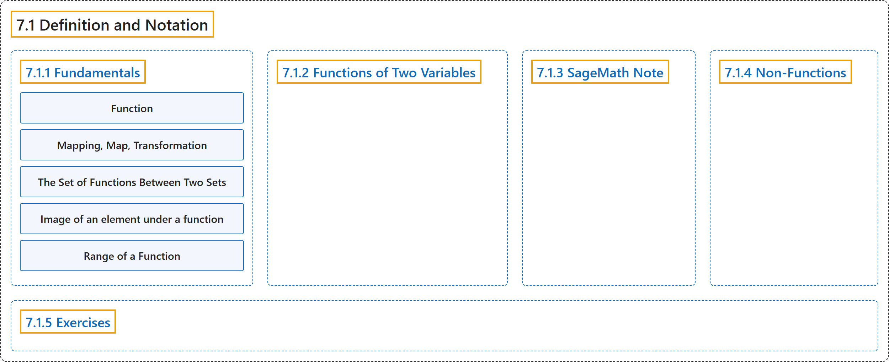

# 7.1 Definition and Notation

## Classification

## Glossary

| Term | Definition | 中文翻译 | Source |
|---|---|---|---|
| **7.1 Definition and Notation** 定义与记号 | (context) "In this chapter we will consider **some basic concepts of the relations that are called functions**." | （语境）“在本章中，我们将讨论**被称为函数的那类关系的一些基本概念**。” | [Doerr & Levasseur, n.d., chapter 7, para. 1](https://discretemath.org/ads/chapter_7.html#chapter_7-2-2) |
| **7.1.1 Fundamentals** 基础 | (No definition) | （无定义） | [Doerr & Levasseur, n.d., subsection 7.1.1](https://discretemath.org/ads/s-function-def-notation.html#ss-fundamentals-functions) |
| **Function** 函数 | "A **function** from a set $A$ into a set $B$ is a **relation from $A$ into $B$ such that each element of $A$ is related to exactly one element of the set $B\text{.}$** The set $A$ is called the **domain** of the function and the set $B$ is called the **codomain**." | 从集合 $A$ 到集合 $B$ 的**函数**是**一个从 $A$ 到 $B$ 的关系，使得 $A$ 的每个元素都恰好与集合 $B$ 的一个元素相关。**集合 $A$ 称为该函数的**定义域**，集合 $B$ 称为**陪域**。 | [Doerr & Levasseur, n.d., Definition 7.1.1](https://discretemath.org/ads/s-function-def-notation.html#def-function) |
| **Mapping, Map, Transformation** 映射、变换 | "The terms **mapping**, **map**, and **transformation** are **also used for functions**." | **映射**（mapping、map）和**变换**（transformation）这些术语**也用来指函数**。 | [Doerr & Levasseur, n.d., subsection 7.1.1, para. 10](https://discretemath.org/ads/s-function-def-notation.html#ss-fundamentals-functions-10) |
| **The Set of Functions Between Two Sets** 两个集合之间的函数集 | "Given two sets, $A$ and $B\text{,}$ the **set of all functions from $A$ into $B$** is denoted **$B^A\text{.}$**" | 给定两个集合 $A$ 和 $B$，**从 $A$ 到 $B$ 的所有函数的集合**记作 **$B^A$。** | [Doerr & Levasseur, n.d., Definition 7.1.5](https://discretemath.org/ads/s-function-def-notation.html#def-set-of-functions) |
| **Image of an element under a function** 元素在函数下的像 | "Let $f:A \rightarrow B\text{,}$ read “Let $f$ be a function from the set $A$ into the set $B\text{.}$” If $a \in A\text{,}$ then $f(a)$ is used to denote that element of $B$ to which $a$ is related. $f(a)$ is called the **image of $a\text{,}$** or, more precisely, the **image of $a$ under $f\text{.}$** We write $f(a) = b$ to indicate that the image of $a$ is $b\text{.}$" | 设 $f:A \rightarrow B$，读作“设 $f$ 是从集合 $A$ 到集合 $B$ 的函数”。若 $a \in A$，则用 $f(a)$ 表示 $B$ 中与 $a$ 有关系的那个元素。$f(a)$ 称为 $a$ 的**像**，更准确地说，称为 $a$ 在 $f$ 下的**像**。我们记 $f(a) = b$ 来表示 $a$ 的像是 $b$。 | [Doerr & Levasseur, n.d., Definition 7.1.7](https://discretemath.org/ads/s-function-def-notation.html#def-image-of-an-element) |
| **Range of a Function** 函数的值域 | "The **range of a function** is the **set of images of its domain**. If $f:X \rightarrow Y\text{,}$ then the range of $f$ is denoted $f(X)\text{,}$ and $f(X) = \{f(a) \mid a \in X\} = \{b \in Y \mid \exists a \in X\textrm{ such that } f(a) = b\}\text{.}$" | 函数的**值域**是**其定义域的像的集合**。若 $f:X \rightarrow Y$，则 $f$ 的值域记作 $f(X)$，并且 $f(X) = \{f(a) \mid a \in X\} = \{b \in Y \mid \exists a \in X\textrm{ such that } f(a) = b\}$。 | [Doerr & Levasseur, n.d., Definition 7.1.8](https://discretemath.org/ads/s-function-def-notation.html#def-range-of-function) |
| **7.1.2 Functions of Two Variables** 二元函数 | (context) "If the **domain of a function is the Cartesian product of two sets**, then our notation and terminology changes slightly." | （语境）“若**函数的定义域是两个集合的笛卡尔积**，我们的记号和术语会略有变化。” | [Doerr & Levasseur, n.d., subsection 7.1.2, para. 1](https://discretemath.org/ads/s-function-def-notation.html#ss-two-variables-3) |
| **7.1.3 SageMath Note** SageMath 注记 | (context) "There are **several ways to define a function in Sage**." | （语境）“在 Sage 中**定义函数有好几种方式**。” | [Doerr & Levasseur, n.d., subsection 7.1.3, para. 1](https://discretemath.org/ads/s-function-def-notation.html#ss-sage-note-functions-3) |
| **7.1.4 Non-Functions** 非函数 | (context) "We close this section with two examples of **relations that are not functions**." | （语境）“我们用两个**不是函数的关系**的例子来结束本节。” | [Doerr & Levasseur, n.d., subsection 7.1.4, para. 1](https://discretemath.org/ads/s-function-def-notation.html#ss-non-functions-2) |
| **7.1.5 Exercises** 练习 | (No definition) | （无定义） | [Doerr & Levasseur, n.d., subsection 7.1.5](https://discretemath.org/ads/s-function-def-notation.html#exercises-7-1) |

## References

Doerr, A., & Levasseur, K. (n.d.). *Applied discrete structures*. Retrieved October 28, 2026, from <https://discretemath.org/ads/index-ads.html>
