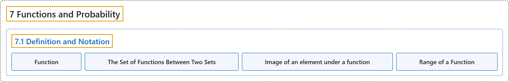

# 7.1 Definition and Notation

## Classification

## Glossary

| Term | Definition | 中文翻译 | Source |
|---|---|---|---|
| **7.1 Definition and Notation** 定义与记号 | (No definition) | （无定义） | [Doerr & Levasseur, n.d., section 7.1](https://discretemath.org/ads/s-function-def-notation.html) |
| **Function** 函数 | "A function is a relation that **uniquely associates members of one set** with **members of another set**." | 函数是一种关系，它把**一个集合的成员唯一地对应**到**另一个集合的成员**。 | [Weisstein, n.d.-d, "Function" entry, para. 1](https://mathworld.wolfram.com/Function.html#:~:text=A%20function%20is%20a%20relation%20that%20uniquely%20associates%20members%20of%20one%20set) |
| **The Set of Functions Between Two Sets** 两个集合之间的函数集 | "Given two sets, $A$ and $B\text{,}$ the **set of all functions from $A$ into $B$** is denoted **$B^A\text{.}$**" | 给定两个集合 $A$ 和 $B$，**从 $A$ 到 $B$ 的所有函数的集合**记作 **$B^A$。** | [Doerr & Levasseur, n.d., Definition 7.1.5](https://discretemath.org/ads/s-function-def-notation.html#def-set-of-functions) |
| **Image of an element under a function** 元素在函数下的像 | "Let $f:A \rightarrow B\text{,}$ read “Let $f$ be a function from the set $A$ into the set $B\text{.}$” If $a \in A\text{,}$ then $f(a)$ is used to denote that element of $B$ to which $a$ is related. $f(a)$ is called the **image of $a\text{,}$** or, more precisely, the **image of $a$ under $f\text{.}$** We write $f(a) = b$ to indicate that the image of $a$ is $b\text{.}$" | 设 $f:A \rightarrow B$，读作“设 $f$ 是从集合 $A$ 到集合 $B$ 的函数”。若 $a \in A$，则用 $f(a)$ 表示 $B$ 中与 $a$ 有关系的那个元素。$f(a)$ 称为 $a$ 的**像**，更准确地说，称为 $a$ 在 $f$ 下的**像**。我们记 $f(a) = b$ 来表示 $a$ 的像是 $b$。 | [Doerr & Levasseur, n.d., Definition 7.1.7](https://discretemath.org/ads/s-function-def-notation.html#def-image-of-an-element) |
| **Range of a Function** 函数的值域 | "The **range of a function** is the **set of images of its domain**. If $f:X \rightarrow Y\text{,}$ then the range of $f$ is denoted $f(X)\text{,}$ and" | 函数的**值域**是**其定义域的像的集合**。若 $f:X \rightarrow Y$，则 $f$ 的值域记作 $f(X)$，并且 | [Doerr & Levasseur, n.d., Definition 7.1.8](https://discretemath.org/ads/s-function-def-notation.html#def-range-of-function) |

## References

Doerr, A., & Levasseur, K. (n.d.). *Applied discrete structures*. Retrieved October 28, 2026, from <https://discretemath.org/ads/index-ads.html>

Weisstein, E. W. (n.d.-d). *Function*. MathWorld: A Wolfram Resource. Retrieved October 27, 2026, from <https://mathworld.wolfram.com/Function.html>
