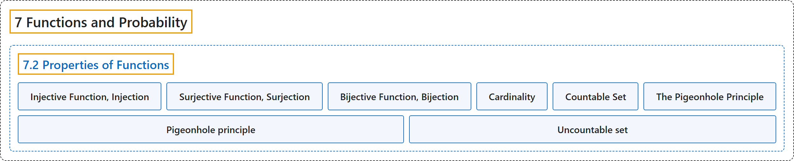

# 7.2 Properties of Functions

## Classification

## Glossary

| Term | Definition | 中文翻译 | Source |
|---|---|---|---|
| **7.2 Properties of Functions** 函数的性质 | (No definition) | （无定义） | [Doerr & Levasseur, n.d., section 7.2](https://discretemath.org/ads/s-properties-of-functions.html) |
| **Injective Function, Injection** 单射函数、单射 | "A function $f: A \rightarrow B$ is **injective** if" | 函数 $f: A \rightarrow B$ 是**单射的**，若 | [Doerr & Levasseur, n.d., Definition 7.2.1](https://discretemath.org/ads/s-properties-of-functions.html#def-injective-function) |
| **Surjective Function, Surjection** 满射函数、满射 | "A function $f: A \rightarrow B$ is **surjective** if its **range, $f(A)\text{,}$ is equal to its codomain, $B\text{.}$** A surjective function is called a **surjection**, or an **onto function**." | 函数 $f: A \rightarrow B$ 是**满射的**，若它的**值域 $f(A)$， 等于它的陪域 $B$。**满射函数称为**满射**，或**映上函数**。 | [Doerr & Levasseur, n.d., Definition 7.2.2](https://discretemath.org/ads/s-properties-of-functions.html#def-surjective-function) |
| **Bijective Function, Bijection** 双射函数、双射 | "A function $f: A \rightarrow B$ is **bijective** if it is **both injective and surjective**. Bijective functions are also called **one-to-one, onto functions**." | 函数 $f: A \rightarrow B$ 是**双射的**，若它**既是单射又是满射**。双射函数也称为**一一映上函数**。 | [Doerr & Levasseur, n.d., Definition 7.2.3](https://discretemath.org/ads/s-properties-of-functions.html#def-bijective-function) |
| **Cardinality** 基数 | "In formal set theory, a cardinal number (also called 'the cardinality') is a **type of number** defined in such a way that **any method of counting sets using it gives the same result**." | 在形式集合论中，基数（也称为 cardinality）是一种**数的类型**，它的定义方式保证**用它计数集合的任何方法都得到相同的结果**。 | [Weisstein, n.d.-a, "Cardinal number" entry, para. 2](https://mathworld.wolfram.com/CardinalNumber.html#:~:text=is%20a%20type%20of%20number%20defined%20in%20such%20a%20way%20that%20any%20method%20of%20counting%20sets) |
| **Countable Set** 可数集 | "A countable set is a set that is **either finite or denumerable**." | 可数集是**有限的或可列的**集合。 | [Weisstein, n.d.-b, "Countable set" entry, para. 1](https://mathworld.wolfram.com/CountableSet.html#:~:text=A%20countable%20set%20is%20a%20set%20that%20is%20either%20finite%20or%20denumerable) |
| **The Pigeonhole Principle** 鸽巢原理 | "Let $f$ be a function from a finite set $X$ into a finite set $Y\text{.}$ If $n\geq 1$ and $\lvert X\rvert > n\lvert Y\rvert\text{,}$ then **there exists an element of $Y$ that is the image under $f$ of at least $n + 1$ elements of X**." | 设 $f$ 是从有限集 $X$ 到有限集 $Y$ 的函数。若 $n\geq 1$ 且 $\lvert X\rvert > n\lvert Y\rvert$，则**存在 $Y$ 的一个元素，它是 $X$ 中至少 $n + 1$ 个元素在 $f$ 下的像**。 | [Doerr & Levasseur, n.d., Theorem 7.2.13](https://discretemath.org/ads/s-properties-of-functions.html#th-pigeonhole-principle) |
| **Pigeonhole principle** 鸽巢原理 | "A.k.a. the pigeonhole principle. Given n boxes and m>n objects, **at least one box must contain more than one object**." | 又称鸽巢原理。给定 n 个盒子和 m>n 个物体，**至少有一个盒子必须装有多于一个物体**。 | [Weisstein, n.d.-c, "Dirichlet's box principle" entry, para. 1](https://mathworld.wolfram.com/DirichletsBoxPrinciple.html#:~:text=at%20least%20one%20box%20must%20contain%20more%20than%20one%20object) |
| **Uncountable set** 不可数集 | "The phrase 'uncountably infinite' describes **an infinite set**, such as the real numbers, which is **not countably infinite**." | “不可数无限”一词描述的是**一个无限集合**（例如实数集），它**不是可数无限的**。 | [Weisstein, n.d.-i, "Uncountably infinite" entry, para. 1](https://mathworld.wolfram.com/UncountablyInfinite.html#:~:text=describes%20an%20infinite%20set) |

## References

Doerr, A., & Levasseur, K. (n.d.). *Applied discrete structures*. Retrieved October 28, 2026, from <https://discretemath.org/ads/index-ads.html>

Weisstein, E. W. (n.d.-a). *Cardinal number*. MathWorld: A Wolfram Resource. Retrieved October 27, 2026, from <https://mathworld.wolfram.com/CardinalNumber.html>

Weisstein, E. W. (n.d.-b). *Countable set*. MathWorld: A Wolfram Resource. Retrieved October 27, 2026, from <https://mathworld.wolfram.com/CountableSet.html>

Weisstein, E. W. (n.d.-c). *Dirichlet's box principle*. MathWorld: A Wolfram Resource. Retrieved October 27, 2026, from <https://mathworld.wolfram.com/DirichletsBoxPrinciple.html>

Weisstein, E. W. (n.d.-i). *Uncountably infinite*. MathWorld: A Wolfram Resource. Retrieved October 27, 2026, from <https://mathworld.wolfram.com/UncountablyInfinite.html>
