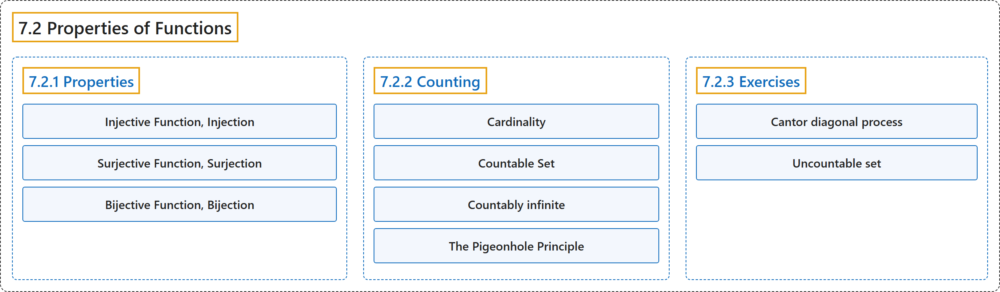

# 7.2 Properties of Functions

## Classification

## Glossary

| Term | Definition | 中文翻译 | Source |
|---|---|---|---|
| **7.2 Properties of Functions** 函数的性质 | (context) "The properties that $f$ has, and $g$ does not have, are **the most basic properties that we look for in a function**. The following definitions summarize the **basic vocabulary for function properties**." | （语境）“$f$ 具有而 $g$ 不具有的那些性质，是**我们在函数中寻找的最基本的性质**。下面的定义总结了**函数性质的基本词汇**。” | [Doerr & Levasseur, n.d., subsection 7.2.1, para. 5](https://discretemath.org/ads/s-properties-of-functions.html#s-properties-of-functions-3-5) |
| **7.2.1 Properties** 性质 | (context) "The properties that $f$ has, and $g$ does not have, are **the most basic properties that we look for in a function**." | （语境）“$f$ 具有而 $g$ 不具有的那些性质，是**我们在函数中寻找的最基本的性质**。” | [Doerr & Levasseur, n.d., subsection 7.2.1, para. 5](https://discretemath.org/ads/s-properties-of-functions.html#s-properties-of-functions-3-5) |
| **Injective Function, Injection** 单射函数、单射 | "A function $f: A \rightarrow B$ is **injective** if $\forall a,b\in A,a\neq b\Rightarrow f(a)\neq f(b)$ An injective function is called an **injection**, or a **one-to-one function**." | 函数 $f: A \rightarrow B$ 是**单射的**，若 $\forall a,b\in A,a\neq b\Rightarrow f(a)\neq f(b)$。单射函数称为**单射**，或**一对一函数**。 | [Doerr & Levasseur, n.d., Definition 7.2.1](https://discretemath.org/ads/s-properties-of-functions.html#def-injective-function) |
| **Surjective Function, Surjection** 满射函数、满射 | "A function $f: A \rightarrow B$ is **surjective** if its **range, $f(A)\text{,}$ is equal to its codomain, $B\text{.}$** A surjective function is called a **surjection**, or an **onto function**." | 函数 $f: A \rightarrow B$ 是**满射的**，若它的**值域 $f(A)$， 等于它的陪域 $B$。**满射函数称为**满射**，或**映上函数**。 | [Doerr & Levasseur, n.d., Definition 7.2.2](https://discretemath.org/ads/s-properties-of-functions.html#def-surjective-function) |
| **Bijective Function, Bijection** 双射函数、双射 | "A function $f: A \rightarrow B$ is **bijective** if it is **both injective and surjective**. Bijective functions are also called **one-to-one, onto functions**." | 函数 $f: A \rightarrow B$ 是**双射的**，若它**既是单射又是满射**。双射函数也称为**一一映上函数**。 | [Doerr & Levasseur, n.d., Definition 7.2.3](https://discretemath.org/ads/s-properties-of-functions.html#def-bijective-function) |
| **7.2.2 Counting** 计数 | (context) "Notice in applying the definition of cardinality, we don’t actually appear to count either set, we just match up the elements. However, **matching the letters in $B$ with the numbers 1, 2, 3, and 4 is precisely how we count the letters**." | （语境）“注意，在应用基数的定义时，我们看上去并没有真的去数任何一个集合，只是把元素配对。然而，**把 $B$ 中的字母与数 1、2、3、4 配对，恰恰就是我们数这些字母的方式**。” | [Doerr & Levasseur, n.d., subsection 7.2.2, para. 5](https://discretemath.org/ads/s-properties-of-functions.html#s-properties-of-functions-4-5) |
| **Cardinality** 基数（势） | "Two sets are said to have the **same cardinality** if **there exists a bijection between them**. If a set has the same cardinality as the set $\{1,2,3,\ldots , n\}\text{,}$ then we say its **cardinality is $n\text{.}$**" | 若两个集合之间**存在一个双射**，则称它们具有**相同的基数**。若一个集合与集合 $\{1,2,3,\ldots , n\}$ 具有相同的基数，则称它的**基数为 $n$。** | [Doerr & Levasseur, n.d., Definition 7.2.7](https://discretemath.org/ads/s-properties-of-functions.html#def-cardinality) |
| **Countable Set** 可数集 | "If a set is **finite or has the same cardinality as the set of positive integers**, it is called a **countable set**." | 若一个集合**是有限的，或与正整数集具有相同的基数**，则称它为**可数集**。 | [Doerr & Levasseur, n.d., Definition 7.2.8](https://discretemath.org/ads/s-properties-of-functions.html#def-countable-set) |
| **Countably infinite** 可数无限 | "A function $f:\mathbb{P}\to A$ is a bijection if the infinite list $f(1), f(2), f(3), \ldots$ contains no duplicates, and every element of $A$ appears once in the list. In this case, we say the $A$ is **countably infinite**, or simply **countable**." | 若无限列表 $f(1), f(2), f(3), \ldots$ 没有重复项，且 $A$ 的每个元素都在列表中出现一次，则函数 $f:\mathbb{P}\to A$ 是一个双射。在这种情况下，我们称 $A$ 是**可数无限的**，或简称**可数的**。 | [Doerr & Levasseur, n.d., subsection 7.2.2, para. 10](https://discretemath.org/ads/s-properties-of-functions.html#s-properties-of-functions-4-10) |
| **The Pigeonhole Principle** 鸽巢原理 | "Let $f$ be a function from a finite set $X$ into a finite set $Y\text{.}$ If $n\geq 1$ and $\lvert X\rvert > n\lvert Y\rvert\text{,}$ then **there exists an element of $Y$ that is the image under $f$ of at least $n + 1$ elements of X**." | 设 $f$ 是从有限集 $X$ 到有限集 $Y$ 的函数。若 $n\geq 1$ 且 $\lvert X\rvert > n\lvert Y\rvert$，则**存在 $Y$ 的一个元素，它是 $X$ 中至少 $n + 1$ 个元素在 $f$ 下的像**。 | [Doerr & Levasseur, n.d., Theorem 7.2.13](https://discretemath.org/ads/s-properties-of-functions.html#th-pigeonhole-principle) |
| **7.2.3 Exercises** 练习 | (No definition) | （无定义） | [Doerr & Levasseur, n.d., subsection 7.2.3](https://discretemath.org/ads/s-properties-of-functions.html#exercises-7-2) |
| **Cantor diagonal process** 康托尔对角线法 | (context) "Prove that the set of all infinite sequences of 0’s and 1’s is not a countable set. Answer. The proof is indirect and follows a technique called the **Cantor diagonal process**." | （语境）证明所有由 0 和 1 组成的无限序列的集合不是可数集。答案：证明是间接的，采用一种称为**康托尔对角线法**的技巧。 | [Doerr & Levasseur, n.d., Exercise 7.2.13](https://discretemath.org/ads/s-properties-of-functions.html#exercises-7-2-14) |
| **Uncountable set** 不可数集 | "The phrase 'uncountably infinite' describes **an infinite set**, such as the real numbers, which is **not countably infinite**." | “不可数无限”一词描述的是**一个无限集合**（例如实数集），它**不是可数无限的**。 | [Weisstein, n.d.-i, "Uncountably infinite" entry, para. 1](https://mathworld.wolfram.com/UncountablyInfinite.html#:~:text=describes%20an%20infinite%20set) |

## References

Doerr, A., & Levasseur, K. (n.d.). *Applied discrete structures*. Retrieved October 28, 2026, from <https://discretemath.org/ads/index-ads.html>

Weisstein, E. W. (n.d.-i). *Uncountably infinite*. MathWorld: A Wolfram Resource. Retrieved October 27, 2026, from <https://mathworld.wolfram.com/UncountablyInfinite.html>
