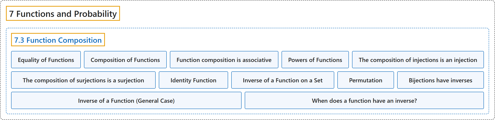

# 7.3 Function Composition

## Classification

## Glossary

| Term | Definition | 中文翻译 | Source |
|---|---|---|---|
| **7.3 Function Composition** 函数的复合 | (No definition) | （无定义） | [Doerr & Levasseur, n.d., section 7.3](https://discretemath.org/ads/s-function-composition.html) |
| **Equality of Functions** 函数相等 | "Let $f, g:A \rightarrow B\text{;}$ that is, let $f$ and $g$ both be functions from $A$ into $B\text{.}$ Then **$f$ is equal to $g$** (denoted $f=g$) if and only if **$f(x) = g(x)$ for all $x \in A\text{.}$**" | 设 $f, g:A \rightarrow B$；即设 $f$ 和 $g$ 都是从 $A$ 到 $B$。 的函数。则 **$f$ 等于 $g$**（记作 $f=g$），当且仅当**对所有 $x \in A$。 有 $f(x) = g(x)$**。 | [Doerr & Levasseur, n.d., Definition 7.3.1](https://discretemath.org/ads/s-function-composition.html#def-equality-of-functions) |
| **Composition of Functions** 函数的复合 | "Let $f:A \rightarrow B$ and $g:B \rightarrow C\text{.}$ Then the **composition of $f$ followed by $g\text{,}$** written $g\circ f\text{,}$ is **a function from $A$ into $C$** defined by $(g \circ f)(x) = g(f(x))\text{,}$ which is read “$g$ of $f$ of $x\text{.}$”" | 设 $f:A \rightarrow B$，$g:B \rightarrow C$。则**先 $f$ 后 $g$ 的复合**，记作 $g\circ f$，是**从 $A$ 到 $C$ 的函数**，定义为 $(g \circ f)(x) = g(f(x))$，读作“$g$ of $f$ of $x$。”。 | [Doerr & Levasseur, n.d., Definition 7.3.2](https://discretemath.org/ads/s-function-composition.html#def-composition-of-functions) |
| **Function composition is associative** 函数复合满足结合律 | "If $f:A\rightarrow B$, $g:B\to C$, and $h:C\rightarrow D$, then **$h\circ (g\circ f) = (h\circ g)\circ f$**." | 若 $f:A\rightarrow B$、$g:B\to C$ 且 $h:C\rightarrow D$，则 **$h\circ (g\circ f) = (h\circ g)\circ f$**。 | [Doerr & Levasseur, n.d., Theorem 7.3.4](https://discretemath.org/ads/s-function-composition.html#function-composition-associative) |
| **Powers of Functions** 函数的幂 | "**Let $f: A\to A\text{.}$**" | **设 $f: A\to A$。**。 | [Doerr & Levasseur, n.d., Definition 7.3.5](https://discretemath.org/ads/s-function-composition.html#def-powers-of-functions) |
| **The composition of injections is an injection** 单射的复合是单射 | "If $f: A \rightarrow B$ and $g : B \rightarrow C$ are injections, then $g\circ f : A \rightarrow C$ **is an injection**." | 若 $f: A \rightarrow B$ 和 $g : B \rightarrow C$ 是单射，则 $g\circ f : A \rightarrow C$ **是单射**。 | [Doerr & Levasseur, n.d., Theorem 7.3.6](https://discretemath.org/ads/s-function-composition.html#theorem-composition-of-injections) |
| **The composition of surjections is a surjection** 满射的复合是满射 | "If $f : A \rightarrow B$ and $g: B \rightarrow C$ are surjections, then $g\circ f: A \rightarrow C$ **is a surjection**." | 若 $f : A \rightarrow B$ 和 $g: B \rightarrow C$ 是满射，则 $g\circ f: A \rightarrow C$ **是满射**。 | [Doerr & Levasseur, n.d., Theorem 7.3.7](https://discretemath.org/ads/s-function-composition.html#theorem-composition-of-surjections) |
| **Identity Function** 恒等函数 | "For any set $A\text{,}$ the **identity function on $A$** is **a function from $A$ onto $A\text{,}$** denoted by $i$ (or, more specifically, $i_A$) such that $i(a) = a$ for all $a\in A\text{.}$" | 对任意集合 $A$，**$A$ 上的恒等函数**是**从 $A$ 到 $A$ 的满射函数**，记作 $i$（或更具体地记作 $i_A$），使得对所有 $a\in A$。 都有 $i(a) = a$。 | [Doerr & Levasseur, n.d., Definition 7.3.8](https://discretemath.org/ads/s-function-composition.html#def-identity-function) |
| **Inverse of a Function on a Set** 集合上函数的逆 | "Let $f: A\rightarrow A\text{.}$ If there exists a function $g: A \rightarrow A$ such that $g\circ f = f\circ g = i\text{,}$ then **$g$ is called the inverse of $f$** and is denoted by $f^{-1}$, read “$f$ inverse.”" | 设 $f: A\rightarrow A$。若存在函数 $g: A \rightarrow A$ 使得 $g\circ f = f\circ g = i$，则称 **$g$ 为 $f$ 的逆**，记作 $f^{-1}$，读作“$f$ inverse”。 | [Doerr & Levasseur, n.d., Definition 7.3.11](https://discretemath.org/ads/s-function-composition.html#def-inverse-function) |
| **Permutation** 排列 | "A permutation of a set S is a **one-to-one correspondence of S with itself**." | 集合 S 的排列是 **S 与它自身之间的一一对应**。 | [Weisstein, n.d.-d, "Permutation" entry, para. 1](https://mathworld.wolfram.com/Permutation.html#:~:text=is%20a%20one%2Dto%2Done%20correspondence%20of) |
| **Bijections have inverses** 双射有逆 | "Let $f: A\rightarrow A$. $f^{-1}$ exists **if and only if f is a bijection**; i. e. f is one-to-one and onto." | 设 $f: A\rightarrow A$。$f^{-1}$ 存在**当且仅当 f 是双射**；即 f 是单射且满射。 | [Doerr & Levasseur, n.d., Theorem 7.3.14](https://discretemath.org/ads/s-function-composition.html#theorem-bijections-have-inverses) |
| **Inverse of a Function (General Case)** 函数的逆（一般情形） | "Let $f:A \rightarrow B\text{,}$ If there exists a function $g:B \rightarrow A$ such that $g \circ f = i_A$ and $f\circ g = i_B$, then **$g$ is called the inverse of $f$** and is denoted by $f^{-1}$, read “$f$ inverse.”" | 设 $f:A \rightarrow B$，若存在函数 $g:B \rightarrow A$ 使得 $g \circ f = i_A$ 且 $f\circ g = i_B$，则称 **$g$ 为 $f$ 的逆**，记作 $f^{-1}$，读作“$f$ inverse”。 | [Doerr & Levasseur, n.d., Definition 7.3.16](https://discretemath.org/ads/s-function-composition.html#def-general-inverse-function) |
| **When does a function have an inverse?** 函数何时有逆？ | "Let $f:A \rightarrow B$. $f^{-1}$ exists **if and only if f is a bijection**." | 设 $f:A \rightarrow B$。$f^{-1}$ 存在**当且仅当 f 是双射**。 | [Doerr & Levasseur, n.d., Theorem 7.3.17](https://discretemath.org/ads/s-function-composition.html#theorem-inverse-function-condition) |

## References

Doerr, A., & Levasseur, K. (n.d.). *Applied discrete structures*. Retrieved October 28, 2026, from <https://discretemath.org/ads/index-ads.html>

Weisstein, E. W. (n.d.-d). *Permutation*. MathWorld: A Wolfram Resource. Retrieved October 27, 2026, from <https://mathworld.wolfram.com/Permutation.html>
