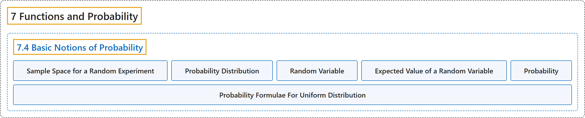

# 7.4 Basic Notions of Probability

## Classification

## Glossary

| Term | Definition | 中文翻译 | Source |
|---|---|---|---|
| **7.4 Basic Notions of Probability** 概率的基本概念 | (No definition) | （无定义） | [Doerr & Levasseur, n.d., section 7.4](https://discretemath.org/ads/s-probability-basics.html) |
| **Sample Space for a Random Experiment** 随机试验的样本空间 | "The **sample space** for a random experiment is the **set of all possible outcomes of the experiment** such that when the outcome is determined, exactly one of the elements of the sample space will have occured." | 随机试验的**样本空间**是该试验**所有可能结果的集合**，使得当结果确定时，样本空间中恰有一个元素出现。 | [Doerr & Levasseur, n.d., Definition 7.4.1](https://discretemath.org/ads/s-probability-basics.html#prob-sample-space) |
| **Probability Distribution** 概率分布 | "Give an experiment with sample space $S\text{,}$ a **probability distribution on $S$** is **a function $Pr:S\rightarrow \mathbb{R}$** such that" | 给定样本空间为 $S$ 的试验，$S$ 上的**概率分布**是**函数 $Pr:S\rightarrow \mathbb{R}$**，使得 | [Doerr & Levasseur, n.d., Definition 7.4.2](https://discretemath.org/ads/s-probability-basics.html#def-probability-distribution) |
| **Random Variable** 随机变量 | "Given a random experiment with sample space $S\text{,}$ a **random variable** is **a function $X:S \rightarrow \mathbb{R}$** that **associates a real number to each outcome**." | 给定样本空间为 $S$， 的随机试验，**随机变量**是**函数 $X:S \rightarrow \mathbb{R}$**，它**为每个结果关联一个实数**。 | [Doerr & Levasseur, n.d., Definition 7.4.3](https://discretemath.org/ads/s-probability-basics.html#def-random-variable) |
| **Expected Value of a Random Variable** 随机变量的期望值 | "Given an experiment with sample space $S$ having probability distribution $Pr:S\rightarrow \mathbb{R}\text{,}$ let $X$ be a random variable: $X: S\rightarrow \mathbb{R}\text{.}$ The **expected value of $X\text{,}$** denoted $E(X)$ is" | 给定样本空间为 $S$、概率分布为 $Pr:S\rightarrow \mathbb{R}$， 的试验，设 $X$ 为随机变量：$X: S\rightarrow \mathbb{R}$。$X$ 的**期望值**，记作 $E(X)$，为 | [Doerr & Levasseur, n.d., Definition 7.4.6](https://discretemath.org/ads/s-probability-basics.html#def-expected-value) |
| **Probability** 概率 | "In general, the **probability** of an outcome is a measurement of the the likelihood of that outcome occurring in an experiment." | 一般而言，一个结果的**概率**是对该结果在一次试验中发生的可能性的度量。 | [Doerr & Levasseur, n.d., section 7.4](https://discretemath.org/ads/s-probability-basics.html#s-probability-basics-2-5) |
| **Probability Formulae For Uniform Distribution** 均匀分布的概率公式 | "Based on formulas for the truth sets of compound propositions over a universe $S$ with cardinality $n$, we can derive the following. If $p(s)$ and $q(s)$ are propositions over a sample space, $Pr(\neg p(s))= 1-Pr(p(s))$ $Pr(p(s) \land q(s)) = \frac{\lvert T_{p(s)} \cap T_{q(s)} \rvert}{n}$ $Pr(p(s) \lor q(s)) = \frac{\lvert T_{p(s)} \cup T_{q(s)} \rvert}{n}$" | 根据基数为 $n$ 的论域 $S$ 上复合命题真值集的公式，可以推出以下结论。若 $p(s)$ 和 $q(s)$ 是样本空间上的命题，$Pr(\neg p(s))= 1-Pr(p(s))$ $Pr(p(s) \land q(s)) = \frac{\lvert T_{p(s)} \cap T_{q(s)} \rvert}{n}$ $Pr(p(s) \lor q(s)) = \frac{\lvert T_{p(s)} \cup T_{q(s)} \rvert}{n}$ | [Doerr & Levasseur, n.d., Theorem 7.4.7](https://discretemath.org/ads/s-probability-basics.html#s-probability-basics-3-5) |

## References

Doerr, A., & Levasseur, K. (n.d.). *Applied discrete structures*. Retrieved October 28, 2026, from <https://discretemath.org/ads/index-ads.html>
