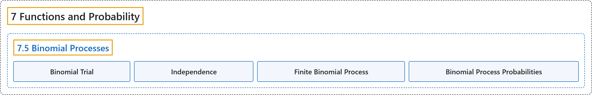

# 7.5 Binomial Processes

## Classification

## Glossary

| Term | Definition | 中文翻译 | Source |
|---|---|---|---|
| **7.5 Binomial Processes** 二项过程 | (No definition) | （无定义） | [Doerr & Levasseur, n.d., section 7.5](https://discretemath.org/ads/sec-binomial-processes.html) |
| **Binomial Trial** 二项试验 | "A **binomial trial** is **an experiment with a sample space having two elements $\{\textrm{success},\textrm{failure}\}$** with probability distribution $Pr(\textrm{success})=p$ and $Pr(\textrm{failure}))=1-p$ for some real number $p\text{,}$ $0 \lt p \lt 1\text{.}$" | **二项试验**是**样本空间有两个元素 $\{\textrm{success},\textrm{failure}\}$ 的试验**，其概率分布为 $Pr(\textrm{success})=p$ 且 $Pr(\textrm{failure}))=1-p$，其中 $p$， 为某个实数，$0 \lt p \lt 1$。 | [Doerr & Levasseur, n.d., Definition 7.5.1](https://discretemath.org/ads/sec-binomial-processes.html#def-binomial-trial) |
| **Independence** 独立性 | "Two logical conditions associated with a random experiment, $A$ and $B\text{,}$ are **independent** if" | 与随机试验相关的两个逻辑条件 $A$ 和 $B$，若满足下式，则称它们**独立** | [Doerr & Levasseur, n.d., Definition 7.5.2](https://discretemath.org/ads/sec-binomial-processes.html#def-independence) |
| **Finite Binomial Process** 有限二项过程 | "A **finite binomial process** is **a sequence of identical independent Bernoulli trials** $X_1\text{,}$ $X_2\text{,}$ $X_3\text{,}$ $\dots\text{,}$ $X_n$ with probability of success $p\text{.}$ We use the notation $B(n,p)$ for an $n$ step binomial process with probability of success $p\text{.}$" | **有限二项过程**是**一列相同且独立的伯努利试验** $X_1$，, $X_2$，, $X_3$，, $\dots$，, $X_n$，成功概率为 $p$。我们用记号 $B(n,p)$ 表示成功概率为 $p$。 的 $n$ 步二项过程。 | [Doerr & Levasseur, n.d., Definition 7.5.3](https://discretemath.org/ads/sec-binomial-processes.html#def-binomial-process) |
| **Binomial Process Probabilities** 二项过程的概率 | "Given a finite binomial process, $B(n,p)\text{,}$ the **probability of exactly $k$ successes**, $0\leq k \leq n$ is" | 给定有限二项过程 $B(n,p)$，**恰好 $k$ 次成功的概率**（$0\leq k \leq n$）为 | [Doerr & Levasseur, n.d., Theorem 7.5.4](https://discretemath.org/ads/sec-binomial-processes.html#theorem-binomial-process-probabilities) |

## References

Doerr, A., & Levasseur, K. (n.d.). *Applied discrete structures*. Retrieved October 28, 2026, from <https://discretemath.org/ads/index-ads.html>
