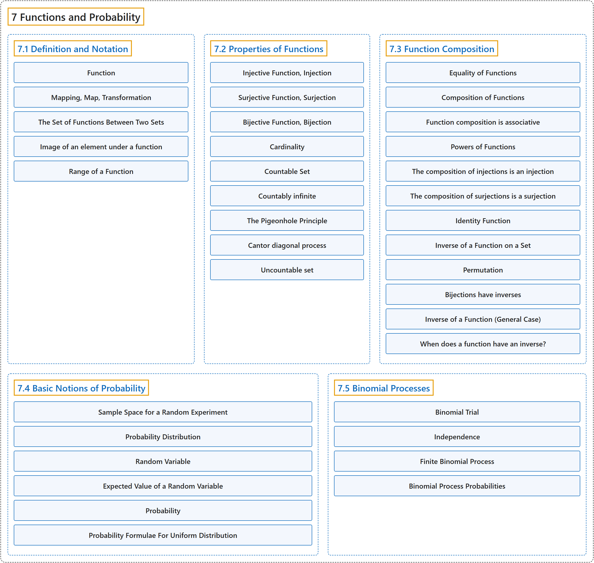

# 7 Functions and Probability

## Classification

## Glossary

| Term | Definition | 中文翻译 | Source |
|---|---|---|---|
| **7 Functions and Probability** 函数与概率 | (context) "In this chapter we will consider some **basic concepts of the relations that are called functions**. A large variety of mathematical ideas and applications can be more completely understood when expressed through the function concept." "In addition we will introduce some **basic probability theory**." | （语境）“在本章中，我们将讨论**被称为函数的那类关系的一些基本概念**。许多数学思想和应用，通过函数概念来表达时，能被理解得更完整。”“此外，我们将介绍一些**基本的概率论**。” | [Doerr & Levasseur, n.d., chapter 7, para. 1 and 2](https://discretemath.org/ads/chapter_7.html#chapter_7-2-2) |
| **[7.1 Definition and Notation](7-1-definition-and-notation.md)** 定义与记号 | (context) "In this chapter we will consider **some basic concepts of the relations that are called functions**." | （语境）“在本章中，我们将讨论**被称为函数的那类关系的一些基本概念**。” | [Doerr & Levasseur, n.d., chapter 7, para. 1](https://discretemath.org/ads/chapter_7.html#chapter_7-2-2) |
| **[7.2 Properties of Functions](7-2-properties-of-functions.md)** 函数的性质 | (context) "The properties that $f$ has, and $g$ does not have, are **the most basic properties that we look for in a function**. The following definitions summarize the **basic vocabulary for function properties**." | （语境）“$f$ 具有而 $g$ 不具有的那些性质，是**我们在函数中寻找的最基本的性质**。下面的定义总结了**函数性质的基本词汇**。” | [Doerr & Levasseur, n.d., subsection 7.2.1, para. 5](https://discretemath.org/ads/s-properties-of-functions.html#s-properties-of-functions-3-5) |
| **[7.3 Function Composition](7-3-function-composition.md)** 函数的复合 | (context) "Now that we have a good understanding of what a function is, our next step is to consider **an important operation on functions**." | （语境）“既然我们已经很好地理解了函数是什么，下一步就是讨论**函数上的一种重要运算**。” | [Doerr & Levasseur, n.d., section 7.3, para. 1](https://discretemath.org/ads/s-function-composition.html#s-function-composition-2-1) |
| **[7.4 Basic Notions of Probability](7-4-basic-notions-of-probability.md)** 概率的基本概念 | (context) "We start by **defining finite probability distributions, random variables and their expected value**." | （语境）“我们首先**定义有限概率分布、随机变量及其期望值**。” | [Doerr & Levasseur, n.d., chapter 7, para. 2](https://discretemath.org/ads/chapter_7.html#chapter_7-2-3) |
| **[7.5 Binomial Processes](7-5-binomial-processes.md)** 二项过程 | (context) "In this section we will concentrate of **random processes that will involve one or more identical random experiments with two possible outcomes**." | （语境）“在本节中，我们将集中讨论**包含一次或多次相同随机试验、且每次试验有两个可能结果的随机过程**。” | [Doerr & Levasseur, n.d., section 7.5, para. 1](https://discretemath.org/ads/sec-binomial-processes.html#sec-binomial-processes-2-1) |

## References

Doerr, A., & Levasseur, K. (n.d.). *Applied discrete structures*. Retrieved October 28, 2026, from <https://discretemath.org/ads/index-ads.html>
