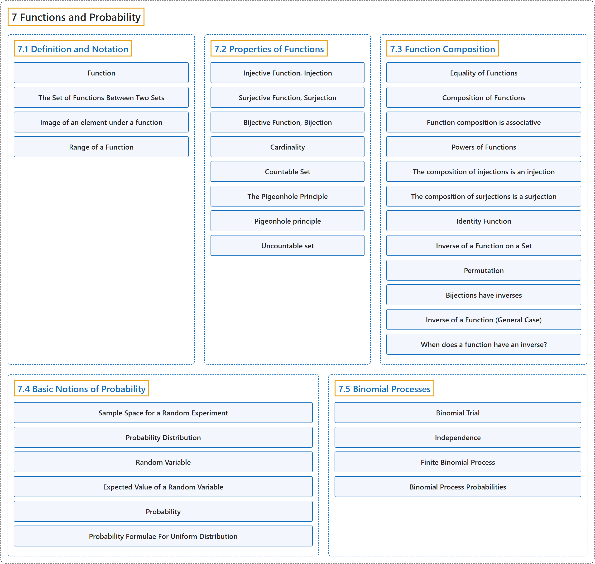

# 7 Functions and Probability

## Classification

## Glossary

| Term | Definition | 中文翻译 | Source |
|---|---|---|---|
| **7 Functions and Probability** 函数与概率 | (No definition) | （无定义） | [Doerr & Levasseur, n.d., chapter 7](https://discretemath.org/ads/chapter_7.html) |
| **[7.1 Definition and Notation](7-1-definition-and-notation.md)** 定义与记号 | (No definition) | （无定义） | [Doerr & Levasseur, n.d., section 7.1](https://discretemath.org/ads/s-function-def-notation.html) |
| **[7.2 Properties of Functions](7-2-properties-of-functions.md)** 函数的性质 | (No definition) | （无定义） | [Doerr & Levasseur, n.d., section 7.2](https://discretemath.org/ads/s-properties-of-functions.html) |
| **[7.3 Function Composition](7-3-function-composition.md)** 函数的复合 | (No definition) | （无定义） | [Doerr & Levasseur, n.d., section 7.3](https://discretemath.org/ads/s-function-composition.html) |
| **[7.4 Basic Notions of Probability](7-4-basic-notions-of-probability.md)** 概率的基本概念 | (No definition) | （无定义） | [Doerr & Levasseur, n.d., section 7.4](https://discretemath.org/ads/s-probability-basics.html) |
| **[7.5 Binomial Processes](7-5-binomial-processes.md)** 二项过程 | (No definition) | （无定义） | [Doerr & Levasseur, n.d., section 7.5](https://discretemath.org/ads/sec-binomial-processes.html) |

## References

Doerr, A., & Levasseur, K. (n.d.). *Applied discrete structures*. Retrieved October 28, 2026, from <https://discretemath.org/ads/index-ads.html>
