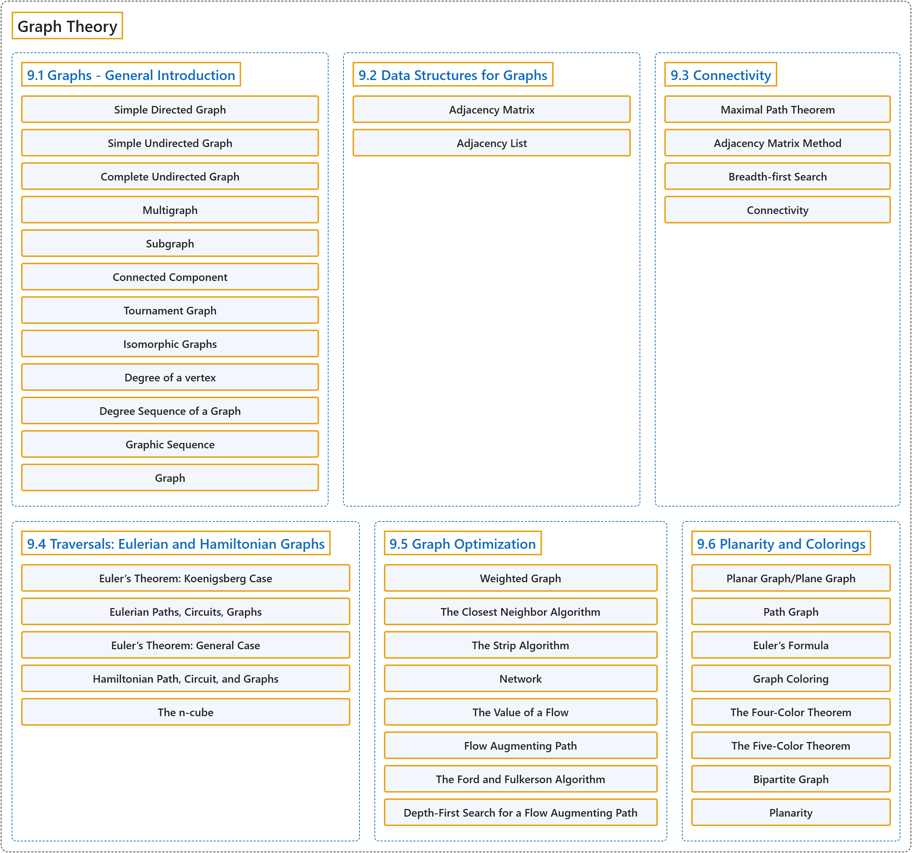

# 9 Graph Theory

## Classification

## Glossary

| Term | Definition | 中文翻译 | Source |
|---|---|---|---|
| **9 Graph Theory** 图论 | (No definition) | （无定义） | [Doerr & Levasseur, n.d., chapter 9](https://discretemath.org/ads/chapter_9.html) |
| **9.1 Graphs - General Introduction** 图：概述 | (No definition) | （无定义） | [Doerr & Levasseur, n.d., section 9.1](https://discretemath.org/ads/s-graphs-introduction.html) |
| **Simple Directed Graph** 简单有向图 | "A **simple directed graph** consists of **a nonempty set of vertices, $V\text{,}$ and a set of edges, $E\text{,}$** that is a subset of the set $V \times V\text{.}$" | **简单有向图**由**非空顶点集 $V$， 和边集 $E$，** 组成，其中 $E$， 是集合 $V \times V$。 的子集。 | [Doerr & Levasseur, n.d., Definition 9.1.1](https://discretemath.org/ads/s-graphs-introduction.html#def-simple-directed-graph) |
| **Simple Undirected Graph** 简单无向图 | "A **simple undirected graph** consists of a nonempty set $V\text{,}$ called a **vertex set**, and a set $E$ of **two-element subsets of $V\text{,}$** called the edge set." | **简单无向图**由称为**顶点集**的非空集合 $V$， 和 $V$， 的若干**二元子集**构成的集合 $E$ 组成，$E$ 称为边集。 | [Doerr & Levasseur, n.d., Definition 9.1.5](https://discretemath.org/ads/s-graphs-introduction.html#def-undirected-graph) |
| **Complete Undirected Graph** 完全无向图 | "A **complete undirected graph** on $n$ vertices is an undirected graph with the property that **each pair of distinct vertices are connected to one another**. Such a graph is usually denoted by $K_n\text{.}$" | $n$ 个顶点上的**完全无向图**是具有如下性质的无向图：**每一对不同的顶点都彼此相连**。这样的图通常记作 $K_n$。 | [Doerr & Levasseur, n.d., Definition 9.1.10](https://discretemath.org/ads/s-graphs-introduction.html#def-complete-undirected-graph) |
| **Multigraph** 多重图 | "A **multigraph** is a set of vertices $V$ with a set of edges that can contain **more than one edge between the vertices**." | **多重图**是顶点集 $V$ 连同一个边集，**该边集可以在顶点之间含有多于一条边**。 | [Doerr & Levasseur, n.d., Definition 9.1.11](https://discretemath.org/ads/s-graphs-introduction.html#def-multigraph) |
| **Subgraph** 子图 | "Let $G=(V,E)$ be a graph of any kind: directed, directed multigraph, or undirected. **$G'=(V',E')$ is a subgraph of $G$** if $V' \neq \emptyset\text{,}$ $V' \subseteq V$ and $e \in E'$ only if $e \in E$ and the vertices of $e$ are in $V'\text{.}$ You create a subgraph of $G$ by **removing zero or more vertices** and all edges that include the removed vertices and then you possibly remove some other edges." | 设 $G=(V,E)$ 为任意一种图：有向图、有向多重图或无向图。若 $V' \neq \emptyset$，$V' \subseteq V$，且仅当 $e \in E$ 且 $e$ 的顶点在 $V'$。 中时 $e \in E'$，则 **$G'=(V',E')$ 是 $G$ 的子图**。要得到 $G$ 的子图，可以**删去零个或多个顶点**以及所有含被删顶点的边，然后再可能删去其他一些边。 | [Doerr & Levasseur, n.d., Definition 9.1.17](https://discretemath.org/ads/s-graphs-introduction.html#def-subgraph) |
| **Connected Component** 连通分量 | "Given a graph $G=(V,E)\text{,}$ let $C$ be the relation “is connected to” on $V\text{.}$ Then the **connected components** of $G$ are the **induced subgraphs** of $G$ each with a vertex set that is an equivalence class with respect to $C\text{.}$" | 给定图 $G=(V,E)$，设 $C$ 为 $V$。 上的关系“与……相连”。则 $G$ 的**连通分量**是 $G$ 的**导出子图**，其顶点集是关于 $C$ 的一个等价类。 | [Doerr & Levasseur, n.d., Definition 9.1.20](https://discretemath.org/ads/s-graphs-introduction.html#def-connected-component) |
| **Tournament Graph** 竞赛图 | "A **tournament graph** is **a directed graph** with the property that no edge connects a vertex to itself, and between any two vertices there is at most one edge." | **竞赛图**是**有向图**，具有如下性质：没有边把顶点连到它自身，且任意两个顶点之间至多有一条边。 | [Doerr & Levasseur, n.d., Definition 9.1.25](https://discretemath.org/ads/s-graphs-introduction.html#def-tournament-graph) |
| **Isomorphic Graphs** 同构图 | "Two graphs $(V, E)$ and $(V', E')$ are **isomorphic** if there exists **a bijection $f:V\to V'$** such that $\left(v_i,v_j\right)\in E$ if and only if $\left(f\left(v_i\right),f\left(v_j\right)\right)\in E'\text{.}$ For multigraphs, we add that the number of edges connecting $v_i$ to $v_j$ must equal the number of edges from $f\left(v_i\right)$ to $f\left(v_j\right)\text{.}$" | 若**存在双射 $f:V\to V'$**，使得 $\left(v_i,v_j\right)\in E$ 当且仅当 $\left(f\left(v_i\right),f\left(v_j\right)\right)\in E'$，则两个图 $(V, E)$ 和 $(V', E')$ **同构**。对于多重图，我们补充：连接 $v_i$ 与 $v_j$ 的边数必须等于从 $f\left(v_i\right)$ 到 $f\left(v_j\right)$。 的边数。 | [Doerr & Levasseur, n.d., Definition 9.1.31](https://discretemath.org/ads/s-graphs-introduction.html#def-isomorphic-graphs) |
| **Degree of a vertex** 顶点的度 | "Let $v$ be a vertex of an undirected graph. The **degree of $v\text{,}$** denoted $deg(v)\text{,}$ is the **number of edges that connect $v$ to the other vertices** in the graph." | 设 $v$ 为无向图的顶点。$v$ 的**度**，记作 $deg(v)$，是图中**连接 $v$ 与其他顶点的边数**。 | [Doerr & Levasseur, n.d., Definition 9.1.32](https://discretemath.org/ads/s-graphs-introduction.html#def-degree-of-a-vertex) |
| **Degree Sequence of a Graph** 图的度序列 | "The **degree sequence** of a simple undirected graph is the **non-increasing sequence of its vertex degrees**." | 简单无向图的**度序列**是其**顶点度数的非递增序列**。 | [Doerr & Levasseur, n.d., Definition 9.1.33](https://discretemath.org/ads/s-graphs-introduction.html#def-degree-sequence) |
| **Graphic Sequence** 图序列 | "A finite nonincreasing sequence of integers $d_1,d_2, \ldots, d_n$ is **graphic** if there exists a **simple undirected graph with $n$ vertices having the sequence as its degree sequence**." | 若存在一个 $n$ 个顶点的**简单无向图**，其度序列恰为整数的有限非递增序列 $d_1,d_2, \ldots, d_n$，则该序列是**可图的**。 | [Doerr & Levasseur, n.d., Definition 9.1.36](https://discretemath.org/ads/s-graphs-introduction.html#def-graphic-sequence) |
| **Graph** 图 | "In a mathematician's terminology, a graph is a **collection of points and lines** connecting **some (possibly empty) subset of them**." | 按数学家的术语，图是**点和线的集合**，这些线连接**其中某个子集的点**（子集可能为空）。 | [Weisstein, n.d.-a, "Graph" entry, para. 3](https://mathworld.wolfram.com/Graph.html#:~:text=a%20graph%20is%20a%20collection%20of%20points%20and%20lines) |
| **9.2 Data Structures for Graphs** 图的数据结构 | (No definition) | （无定义） | [Doerr & Levasseur, n.d., section 9.2](https://discretemath.org/ads/s-data-structures-for-graphs.html) |
| **Adjacency Matrix** 邻接矩阵 | "As we saw in Chapter 6, the information about edges in a graph can be summarized with a matrix, $G\text{,}$ where $G_{ij}=1$ if and only if vertex $i$ is connected to vertex $j$ in the graph. Matrices of this type were called relation matrices, but for graphs they are more commonly referred to as **adjacency matrices**." | 正如我们在第 6 章中看到的，图中关于边的信息可以用一个矩阵 $G$， 来概括，其中当且仅当图中顶点 $i$ 与顶点 $j$ 相连时 $G_{ij}=1$。这类矩阵曾被称为关系矩阵，但对于图而言，它们更常被称为**邻接矩阵**。 | [Doerr & Levasseur, n.d., section 9.2](https://discretemath.org/ads/s-data-structures-for-graphs.html#ss-graph-data-structures-2-3-1-2) |
| **Adjacency List** 邻接表 | (Definition pending) | （定义待补） | [Doerr & Levasseur, n.d., section 9.2](https://discretemath.org/ads/s-data-structures-for-graphs.html) |
| **9.3 Connectivity** 连通性 | (No definition) | （无定义） | [Doerr & Levasseur, n.d., section 9.3](https://discretemath.org/ads/s-Connectivity.html) |
| **Maximal Path Theorem** 极大路径定理 | "If a graph has $n$ vertices and vertex $u$ is connected to vertex $w\text{,}$ then **there exists a path from $u$ to $w$ of length no more than $n\text{.}$**" | 若图有 $n$ 个顶点且顶点 $u$ 与顶点 $w$ 相连，则**存在从 $u$ 到 $w$ 长度不超过 $n$ 的路径**。 | [Doerr & Levasseur, n.d., Theorem 9.3.2](https://discretemath.org/ads/s-Connectivity.html#theorem-9-3-1) |
| **Adjacency Matrix Method** 邻接矩阵法 | "Suppose that the information about edges in a graph is stored in an **adjacency matrix**, $G\text{.}$ The relation, $r\text{,}$ that $G$ defines is $v r w$ if there is an edge connecting $v$ to $w\text{.}$ Recall that the composition of $r$ with itself, $r^2\text{,}$ is defined by $v r^2 w$ if there exists a vertex $y$ such that $v r y$ and $y r w\text{;}$ that is, $v$ is connected to $w$ by a path of length 2. We could prove by induction that the relation $r^k\text{,}$ $k\geq 1\text{,}$ is defined by $v r^k w$ if and only if there is a path of length $k$ from $v$ to $w\text{.}$ Since the transitive closure, $r^+\text{,}$ is the union of $r\text{,}$ $r^2$ $,r^3,\ldots\text{,}$ we can answer our connectivity question by determining the **transitive closure of $r\text{,}$** which can be done most easily by keeping our relation in matrix form. Theorem 9.3.2 is significant in our calculations because it tells us that we need only go as far as $G^n$ to determine the matrix of the transitive closure." | 设图中的边信息存储在**邻接矩阵** $G$ 中。$G$ 所定义的关系 $r$ 为：若有边连接 $v$ 与 $w$，则 $v r w$。回忆 $r$ 与自身的复合 $r^2$ 定义为：若存在顶点 $y$ 使得 $v r y$ 且 $y r w$，则 $v r^2 w$；也就是说，$v$ 通过长度为 2 的路径与 $w$ 相连。我们可以用归纳法证明，关系 $r^k$，（$k\geq 1$）定义为：$v r^k w$ 当且仅当存在从 $v$ 到 $w$ 长度为 $k$ 的路径。由于传递闭包 $r^+$， 是 $r$, $r^2$ $,r^3,\ldots$， 的并，我们可以通过求 **$r$ 的传递闭包**来回答连通性问题，而这在把关系保存为矩阵形式时最容易做到。定理 9.3.2 对我们的计算很重要，因为它告诉我们，只需计算到 $G^n$ 就能确定传递闭包的矩阵。 | [Doerr & Levasseur, n.d., Algorithm 9.3.3](https://discretemath.org/ads/s-Connectivity.html#ss-adjacency-matrix-method-3) |
| **Breadth-first Search** 广度优先搜索 | "A **broadcasting algorithm for finding a path between vertex $i$ and vertex $j$** of a graph having $n$ vertices. Each item $V_k$ of a list $V=\left\{V_1, V_2, \ldots, V_n\right\}\text{,}$ consists of a Boolean field $V_k.\text{found}$ and an integer field $V_k.\text{from}\text{.}$ The sets $D_1\text{,}$ $D_2, \dots\text{,}$ called **depth sets**, have the property that if $k \in D_r\text{,}$ then the shortest path from vertex $i$ to vertex $k$ is of length $r\text{.}$ In Step 5, a stack is used to put the vertex list for the path from the vertex $i$ to vertex $j$ in the proper order. That stack is the output of the algorithm." | 一种在有 $n$ 个顶点的图中**寻找顶点 $i$ 与顶点 $j$ 之间路径的广播算法**。列表 $V=\left\{V_1, V_2, \ldots, V_n\right\}$， 的每一项 $V_k$ 由一个布尔字段 $V_k.\text{found}$ 和一个整数字段 $V_k.\text{from}$。 组成。集合 $D_1$，, $D_2, \dots$，称为**深度集**，具有如下性质：若 $k \in D_r$，则从顶点 $i$ 到顶点 $k$ 的最短路径长度为 $r$。在第 5 步中，用栈把从顶点 $i$ 到顶点 $j$ 的路径顶点表按正确顺序排列。该栈就是算法的输出。 | [Doerr & Levasseur, n.d., Algorithm 9.3.8](https://discretemath.org/ads/s-Connectivity.html#alg-breadth-first) |
| **Connectivity** 连通性 | "Vertex $v$ is **connected** to vertex $w$ if there is a path from $v$ to $w\text{.}$ Two vertices are **strongly connected** if they are connected in both directions to one another." | 如果存在从 $v$ 到 $w$ 的路径，则顶点 $v$ 与顶点 $w$ **连通**。如果两个顶点彼此在两个方向上都连通，则它们**强连通**。 | [Doerr & Levasseur, n.d., section 9.3](https://discretemath.org/ads/s-Connectivity.html#ss-connectivity-prelim-3-2) |
| **9.4 Traversals: Eulerian and Hamiltonian Graphs** 遍历：欧拉图与哈密顿图 | (No definition) | （无定义） | [Doerr & Levasseur, n.d., section 9.4](https://discretemath.org/ads/s-traversals.html) |
| **Euler’s Theorem: Koenigsberg Case** 欧拉定理：柯尼斯堡情形 | "**No walking tour of Koenigsberg** can be designed so that each bridge is used exactly once." | **哥尼斯堡的任何步行游览路线都不可能设计成每座桥恰好走一次**。 | [Doerr & Levasseur, n.d., Theorem 9.4.3](https://discretemath.org/ads/s-traversals.html#th-euler-theorem-koenigsberg-case) |
| **Eulerian Paths, Circuits, Graphs** 欧拉路径、欧拉回路、欧拉图 | "An **Eulerian path** through a graph is **a path whose edge list contains each edge of the graph exactly once**. If the path is a circuit, then it is called an **Eulerian circuit**. An **Eulerian graph** is a graph that possesses an Eulerian circuit." | 图的**欧拉路径**是**边表恰好含图的每条边一次的路径**。若该路径是回路，则称为**欧拉回路**。**欧拉图**是具有欧拉回路的图。 | [Doerr & Levasseur, n.d., Definition 9.4.4](https://discretemath.org/ads/s-traversals.html#def-eulerian-paths-circuits-graphs) |
| **Euler’s Theorem: General Case** 欧拉定理：一般情形 | "An undirected graph **has an Eulerian path if and only if it is connected and has either zero or two vertices with an odd degree**. If no vertex has an odd degree, then the graph is Eulerian." | 无向图**有欧拉路径当且仅当它连通且奇度顶点的个数为零或二**。若没有奇度顶点，则该图是欧拉图。 | [Doerr & Levasseur, n.d., Theorem 9.4.7](https://discretemath.org/ads/s-traversals.html#theorem-euler-theorem-general) |
| **Hamiltonian Path, Circuit, and Graphs** 哈密顿路径、哈密顿回路与哈密顿图 | "A **Hamiltonian path** through a graph is **a path whose vertex list contains each vertex of the graph exactly once**, except if the path is a circuit, in which case the initial vertex appears a second time as the terminal vertex. If the path is a circuit, then it is called a **Hamiltonian circuit**. A **Hamiltonian graph** is a graph that possesses a Hamiltonian circuit." | 图的**哈密顿路径**是**顶点表恰好含图的每个顶点一次的路径**，但若该路径是回路，则起点作为终点再出现一次。若该路径是回路，则称为**哈密顿回路**。**哈密顿图**是具有哈密顿回路的图。 | [Doerr & Levasseur, n.d., Definition 9.4.11](https://discretemath.org/ads/s-traversals.html#def-hamiltonian-path-circuit-graph) |
| **The n-cube** n 维立方体 | "Let $n \geq 1\text{,}$ and let $B^n$ be the set of strings of 0’s and 1’s with length $n\text{.}$ The **$n$-cube** is the **undirected graph** with a vertex for each string in $B^n$ and an edge connecting each pair of strings that differ in exactly one position. The $n$-cube is normally denoted $Q_n\text{.}$" | 设 $n \geq 1$，$B^n$ 为长度为 $n$ 的 0 和 1 的串的集合。**$n$-立方体**是这样的**无向图**：$B^n$ 中每个串对应一个顶点，且每一对恰好在一个位置上不同的串之间有一条边相连。$n$-立方体通常记作 $Q_n$。 | [Doerr & Levasseur, n.d., Definition 9.4.17](https://discretemath.org/ads/s-traversals.html#def-n-cube) |
| **9.5 Graph Optimization** 图的优化 | (No definition) | （无定义） | [Doerr & Levasseur, n.d., section 9.5](https://discretemath.org/ads/s-graph-optimization.html) |
| **Weighted Graph** 带权图 | "A **weighted graph**, $(V, E, w)\text{,}$ is a graph $(V, E)$ together with **a weight function** $w: E \to \mathbb{R}\text{.}$ If $e \in E\text{,}$ $w(e)$ is the weight on edge $e\text{.}$" | **带权图** $(V, E, w)$， 是图 $(V, E)$ 连同**权函数** $w: E \to \mathbb{R}$。若 $e \in E$，则 $w(e)$ 是边 $e$。 上的权。 | [Doerr & Levasseur, n.d., Definition 9.5.1](https://discretemath.org/ads/s-graph-optimization.html#def-weighted-graph) |
| **The Closest Neighbor Algorithm** 最近邻算法 | "Let $G = (V, E, w)$ be a complete weighted graph with $\vert V\vert = n\text{.}$ The **closest neighbor circuit** through G starting at $v_1$ is $\left(v_1, v_2,\ldots,v_n\right)\text{,}$ defined by the steps:" | 设 $G = (V, E, w)$ 为 $\vert V\vert = n$。 的完全带权图。经过 G 且从 $v_1$ 出发的**最近邻回路**为 $\left(v_1, v_2,\ldots,v_n\right)$，由如下步骤定义： | [Doerr & Levasseur, n.d., Algorithm 9.5.5](https://discretemath.org/ads/s-graph-optimization.html#alg-closest-neighbor) |
| **The Strip Algorithm** 条带算法 | "Given **$n$ points in the unit square**:" | 给定**单位正方形中的 $n$ 个点**： | [Doerr & Levasseur, n.d., Heuristic 9.5.13](https://discretemath.org/ads/s-graph-optimization.html#alg-strip-algorithm) |
| **Network** 网络 | "A **network** is **a simple weighted directed graph** that contains two distinguished vertices called the **source and the sink** with the properties that the indegree of the source and outdegree of the sink are both zero, and source is connected to sink. The weight function on a network is the **capacity function**, which has positive weights." | **网络**是**简单带权有向图**，含有两个特殊顶点，分别称为**源点和汇点**，且满足：源点的入度和汇点的出度均为零，并且源点与汇点相连。网络上的权函数是**容量函数**，其权为正。 | [Doerr & Levasseur, n.d., Definition 9.5.15](https://discretemath.org/ads/s-graph-optimization.html#def-network) |
| **The Value of a Flow** 流的值 | "The two values flow into the sink and flow out of the source were proved to be equal in Theorem 9.5.20 and this common value is called the **value of the flow**. It is denoted by $V(f)\text{.}$ The value of a flow represents the amount of material that passes through the network with that flow." | 流入汇点的值与流出源点的值已在定理 9.5.20 中证明相等，这个共同的值称为**流的值**，记作 $V(f)$。流的值表示在该流下通过网络的物质的量。 | [Doerr & Levasseur, n.d., Definition 9.5.21](https://discretemath.org/ads/s-graph-optimization.html#def-value-of-flow) |
| **Flow Augmenting Path** 增广路径 | "Given a flow $f$ in a network $(V, E)\text{,}$ a **flow augmenting path** with respect to $f$ is **a simple path from the source to the sink** using edges both in their forward and their reverse directions such that for each edge $e$ in the path, $w(e) - f(e) > 0$ if $e$ is used in its forward direction and $f(e) > 0$ if $e$ is used in the reverse direction." | 给定网络 $(V, E)$， 中的流 $f$，关于 $f$ 的**增广路**是**从源点到汇点的简单路径**，它同时按正向和反向使用边，使得对路径中的每条边 $e$，若按正向使用 $e$ 则 $w(e) - f(e) > 0$，若按反向使用 $e$ 则 $f(e) > 0$。 | [Doerr & Levasseur, n.d., Definition 9.5.22](https://discretemath.org/ads/s-graph-optimization.html#def-flow-augmenting-path) |
| **The Ford and Fulkerson Algorithm** Ford-Fulkerson 算法 | "**Define the flow function** $f_0$ by $f_0(e)=0$ for each edge $e \in E\text{.}$" | **定义流函数** $f_0$：对每条边 $e \in E$，令 $f_0(e)=0$。 | [Doerr & Levasseur, n.d., Algorithm 9.5.24](https://discretemath.org/ads/s-graph-optimization.html#alg-ford-fulkerson) |
| **Depth-First Search for a Flow Augmenting Path** 搜索增广路径的深度优先搜索 | "This is a **depth-first search for the Sink Initiating at the Source**. Let $E'$ be the set of directed edges that can be used in producing a flow augmenting path. Add to the network a vertex called start and the edge $(\text{start}, \text{source}).$" | 这是一种**从源点出发搜索汇点的深度优先搜索**。设 $E'$ 为可用于产生增广路的有向边的集合。向网络中添加一个称为 start 的顶点和边 (start, source)。 | [Doerr & Levasseur, n.d., Algorithm 9.5.26](https://discretemath.org/ads/s-graph-optimization.html#alg-depth-first-search) |
| **9.6 Planarity and Colorings** 平面性与着色 | (No definition) | （无定义） | [Doerr & Levasseur, n.d., section 9.6](https://discretemath.org/ads/s-planarity-and-colorings.html) |
| **Planar Graph/Plane Graph** 平面图／平面嵌入图 | "A graph is **planar** if it can be drawn in a plane so that **no edges cross**. A drawing of a graph on the plane such that there are no edge crossings is called a **planar embedding** of the graph, or a **plane graph** for short." | 若图可以画在平面上使得**没有边相交**，则称它是**平面图**。图在平面上没有边相交的画法称为图的**平面嵌入**，简称**平面图形**。 | [Doerr & Levasseur, n.d., Definition 9.6.1](https://discretemath.org/ads/s-planarity-and-colorings.html#def-planar-graph) |
| **Path Graph** 路径图 | "A **path graph of length $n\text{,}$** denoted $P_n\text{,}$ is an undirected graph with $n+1$ vertices $v_0, v_1,\dots, v_n$ having $n$ edges $\{v_i,v_{i+1}\}\text{,}$ $i=0, 1, \dots, n-1\text{.}$" | 长度为 $n$ 的**路径图**，记作 $P_n$，是有 $n+1$ 个顶点 $v_0, v_1,\dots, v_n$ 和 $n$ 条边 $\{v_i,v_{i+1}\}$，（$i=0, 1, \dots, n-1$）的无向图。 | [Doerr & Levasseur, n.d., Definition 9.6.4](https://discretemath.org/ads/s-planarity-and-colorings.html#def-def-path-graph) |
| **Euler’s Formula** 欧拉公式 | "If $G = (V, E)$ is a **connected planar graph with $r$ regions, $v$ vertices, and $e$ edges**, then" | 若 $G = (V, E)$ 是有 $r$ 个区域、$v$ 个顶点和 $e$ 条边的**连通平面图**，则 | [Doerr & Levasseur, n.d., Theorem 9.6.8](https://discretemath.org/ads/s-planarity-and-colorings.html#theorem-euler-formula) |
| **Graph Coloring** 图着色 | "Given an undirected graph $G = (V, E)\text{,}$ a “**coloring function**” is a function $f$ from $V$ into a set of colors $H$ such that $\{v_i,v_j\} \in E \Rightarrow f\left(v_i\right)\neq f\left(v_j\right)\text{.}$ If $H$ has the smallest possible cardinality, its cardinality is called the **chromatic number of $G\text{,}$** $\chi(G)\text{.}$" | 给定无向图 $G = (V, E)$，“**着色函数**”是从 $V$ 到颜色集 $H$ 的函数 $f$，使得 $\{v_i,v_j\} \in E \Rightarrow f\left(v_i\right)\neq f\left(v_j\right)$。若 $H$ 的基数是可能的最小值，则该基数称为 $G$， 的**色数**，记作 $\chi(G)$。 | [Doerr & Levasseur, n.d., Definition 9.6.15](https://discretemath.org/ads/s-planarity-and-colorings.html#def-graph-coloring) |
| **The Four-Color Theorem** 四色定理 | "**If $G$ is a planar graph**, then $\chi (G)\leq 4\text{.}$" | **若 $G$ 是平面图**，则 $\chi (G)\leq 4$。 | [Doerr & Levasseur, n.d., Theorem 9.6.16](https://discretemath.org/ads/s-planarity-and-colorings.html#theorem-four-color-theorem) |
| **The Five-Color Theorem** 五色定理 | "**If $G$ is a planar graph**, then $\chi (G)\leq 5\text{.}$" | **若 $G$ 是平面图**，则 $\chi (G)\leq 5$。 | [Doerr & Levasseur, n.d., Theorem 9.6.17](https://discretemath.org/ads/s-planarity-and-colorings.html#theorem-five-color-theorem) |
| **Bipartite Graph** 二分图 | "A **bipartite graph** is a graph that has **a 2-coloring**. Equivalently, a graph is bipartite if its vertices can be **partitioned into two nonempty subsets so that no edge connects vertices from the same subset**." | **二部图**是**具有 2-着色的图**。等价地，若图的顶点可以**划分为两个非空子集，使得没有边连接同一子集中的顶点**，则该图是二部图。 | [Doerr & Levasseur, n.d., Definition 9.6.19](https://discretemath.org/ads/s-planarity-and-colorings.html#def-bipartite-graph) |
| **Planarity** 平面性 | (context) "A graph is **planar** if it can be drawn in a plane so that no edges cross." | （语境）如果一个图可以画在平面上而使任何边都不相交，则该图是**平面图**。 | [Doerr & Levasseur, n.d., section 9.6](https://discretemath.org/ads/s-planarity-and-colorings.html#def-planar-graph-5-1) |

## References

Doerr, A., & Levasseur, K. (n.d.). *Applied discrete structures*. Retrieved October 28, 2026, from <https://discretemath.org/ads/index-ads.html>

Weisstein, E. W. (n.d.-a). *Graph*. MathWorld: A Wolfram Resource. Retrieved October 27, 2026, from <https://mathworld.wolfram.com/Graph.html>
