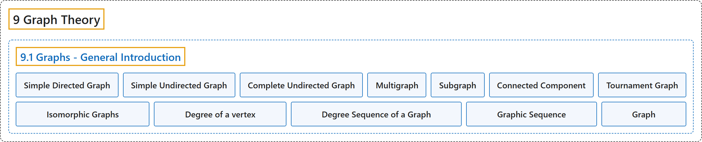

# 9.1 Graphs - General Introduction

## Classification

## Glossary

| Term | Definition | 中文翻译 | Source |
|---|---|---|---|
| **9.1 Graphs - General Introduction** 图：概述 | (No definition) | （无定义） | [Doerr & Levasseur, n.d., section 9.1](https://discretemath.org/ads/s-graphs-introduction.html) |
| **Simple Directed Graph** 简单有向图 | "A **simple directed graph** consists of **a nonempty set of vertices, $V\text{,}$ and a set of edges, $E\text{,}$** that is a subset of the set $V \times V\text{.}$" | **简单有向图**由**非空顶点集 $V$， 和边集 $E$，** 组成，其中 $E$， 是集合 $V \times V$。 的子集。 | [Doerr & Levasseur, n.d., Definition 9.1.1](https://discretemath.org/ads/s-graphs-introduction.html#def-simple-directed-graph) |
| **Simple Undirected Graph** 简单无向图 | "A **simple undirected graph** consists of a nonempty set $V\text{,}$ called a **vertex set**, and a set $E$ of **two-element subsets of $V\text{,}$** called the edge set." | **简单无向图**由称为**顶点集**的非空集合 $V$， 和 $V$， 的若干**二元子集**构成的集合 $E$ 组成，$E$ 称为边集。 | [Doerr & Levasseur, n.d., Definition 9.1.5](https://discretemath.org/ads/s-graphs-introduction.html#def-undirected-graph) |
| **Complete Undirected Graph** 完全无向图 | "A **complete undirected graph** on $n$ vertices is an undirected graph with the property that **each pair of distinct vertices are connected to one another**. Such a graph is usually denoted by $K_n\text{.}$" | $n$ 个顶点上的**完全无向图**是具有如下性质的无向图：**每一对不同的顶点都彼此相连**。这样的图通常记作 $K_n$。 | [Doerr & Levasseur, n.d., Definition 9.1.10](https://discretemath.org/ads/s-graphs-introduction.html#def-complete-undirected-graph) |
| **Multigraph** 多重图 | "A **multigraph** is a set of vertices $V$ with a set of edges that can contain **more than one edge between the vertices**." | **多重图**是顶点集 $V$ 连同一个边集，**该边集可以在顶点之间含有多于一条边**。 | [Doerr & Levasseur, n.d., Definition 9.1.11](https://discretemath.org/ads/s-graphs-introduction.html#def-multigraph) |
| **Subgraph** 子图 | "Let $G=(V,E)$ be a graph of any kind: directed, directed multigraph, or undirected. **$G'=(V',E')$ is a subgraph of $G$** if $V' \neq \emptyset\text{,}$ $V' \subseteq V$ and $e \in E'$ only if $e \in E$ and the vertices of $e$ are in $V'\text{.}$ You create a subgraph of $G$ by **removing zero or more vertices** and all edges that include the removed vertices and then you possibly remove some other edges." | 设 $G=(V,E)$ 为任意一种图：有向图、有向多重图或无向图。若 $V' \neq \emptyset$，$V' \subseteq V$，且仅当 $e \in E$ 且 $e$ 的顶点在 $V'$。 中时 $e \in E'$，则 **$G'=(V',E')$ 是 $G$ 的子图**。要得到 $G$ 的子图，可以**删去零个或多个顶点**以及所有含被删顶点的边，然后再可能删去其他一些边。 | [Doerr & Levasseur, n.d., Definition 9.1.17](https://discretemath.org/ads/s-graphs-introduction.html#def-subgraph) |
| **Connected Component** 连通分量 | "Given a graph $G=(V,E)\text{,}$ let $C$ be the relation “is connected to” on $V\text{.}$ Then the **connected components** of $G$ are the **induced subgraphs** of $G$ each with a vertex set that is an equivalence class with respect to $C\text{.}$" | 给定图 $G=(V,E)$，设 $C$ 为 $V$。 上的关系“与……相连”。则 $G$ 的**连通分量**是 $G$ 的**导出子图**，其顶点集是关于 $C$ 的一个等价类。 | [Doerr & Levasseur, n.d., Definition 9.1.20](https://discretemath.org/ads/s-graphs-introduction.html#def-connected-component) |
| **Tournament Graph** 竞赛图 | "A **tournament graph** is **a directed graph** with the property that no edge connects a vertex to itself, and between any two vertices there is at most one edge." | **竞赛图**是**有向图**，具有如下性质：没有边把顶点连到它自身，且任意两个顶点之间至多有一条边。 | [Doerr & Levasseur, n.d., Definition 9.1.25](https://discretemath.org/ads/s-graphs-introduction.html#def-tournament-graph) |
| **Isomorphic Graphs** 同构图 | "Two graphs $(V, E)$ and $(V', E')$ are **isomorphic** if there exists **a bijection $f:V\to V'$** such that $\left(v_i,v_j\right)\in E$ if and only if $\left(f\left(v_i\right),f\left(v_j\right)\right)\in E'\text{.}$ For multigraphs, we add that the number of edges connecting $v_i$ to $v_j$ must equal the number of edges from $f\left(v_i\right)$ to $f\left(v_j\right)\text{.}$" | 若**存在双射 $f:V\to V'$**，使得 $\left(v_i,v_j\right)\in E$ 当且仅当 $\left(f\left(v_i\right),f\left(v_j\right)\right)\in E'$，则两个图 $(V, E)$ 和 $(V', E')$ **同构**。对于多重图，我们补充：连接 $v_i$ 与 $v_j$ 的边数必须等于从 $f\left(v_i\right)$ 到 $f\left(v_j\right)$。 的边数。 | [Doerr & Levasseur, n.d., Definition 9.1.31](https://discretemath.org/ads/s-graphs-introduction.html#def-isomorphic-graphs) |
| **Degree of a vertex** 顶点的度 | "Let $v$ be a vertex of an undirected graph. The **degree of $v\text{,}$** denoted $deg(v)\text{,}$ is the **number of edges that connect $v$ to the other vertices** in the graph." | 设 $v$ 为无向图的顶点。$v$ 的**度**，记作 $deg(v)$，是图中**连接 $v$ 与其他顶点的边数**。 | [Doerr & Levasseur, n.d., Definition 9.1.32](https://discretemath.org/ads/s-graphs-introduction.html#def-degree-of-a-vertex) |
| **Degree Sequence of a Graph** 图的度序列 | "The **degree sequence** of a simple undirected graph is the **non-increasing sequence of its vertex degrees**." | 简单无向图的**度序列**是其**顶点度数的非递增序列**。 | [Doerr & Levasseur, n.d., Definition 9.1.33](https://discretemath.org/ads/s-graphs-introduction.html#def-degree-sequence) |
| **Graphic Sequence** 图序列 | "A finite nonincreasing sequence of integers $d_1,d_2, \ldots, d_n$ is **graphic** if there exists a **simple undirected graph with $n$ vertices having the sequence as its degree sequence**." | 若存在一个 $n$ 个顶点的**简单无向图**，其度序列恰为整数的有限非递增序列 $d_1,d_2, \ldots, d_n$，则该序列是**可图的**。 | [Doerr & Levasseur, n.d., Definition 9.1.36](https://discretemath.org/ads/s-graphs-introduction.html#def-graphic-sequence) |
| **Graph** 图 | "In a mathematician's terminology, a graph is a **collection of points and lines** connecting **some (possibly empty) subset of them**." | 按数学家的术语，图是**点和线的集合**，这些线连接**其中某个子集的点**（子集可能为空）。 | [Weisstein, n.d.-a, "Graph" entry, para. 3](https://mathworld.wolfram.com/Graph.html#:~:text=a%20graph%20is%20a%20collection%20of%20points%20and%20lines) |

## References

Doerr, A., & Levasseur, K. (n.d.). *Applied discrete structures*. Retrieved October 28, 2026, from <https://discretemath.org/ads/index-ads.html>

Weisstein, E. W. (n.d.-a). *Graph*. MathWorld: A Wolfram Resource. Retrieved October 27, 2026, from <https://mathworld.wolfram.com/Graph.html>
