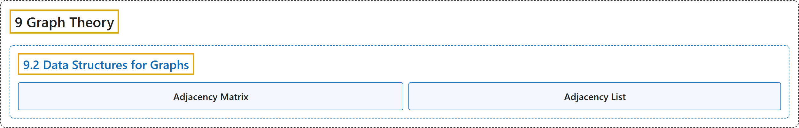

# 9.2 Data Structures for Graphs

## Classification

## Glossary

| Term | Definition | 中文翻译 | Source |
|---|---|---|---|
| **9.2 Data Structures for Graphs** 图的数据结构 | (No definition) | （无定义） | [Doerr & Levasseur, n.d., section 9.2](https://discretemath.org/ads/s-data-structures-for-graphs.html) |
| **Adjacency Matrix** 邻接矩阵 | "As we saw in Chapter 6, the information about edges in a graph can be summarized with a matrix, $G\text{,}$ where $G_{ij}=1$ if and only if vertex $i$ is connected to vertex $j$ in the graph. Matrices of this type were called relation matrices, but for graphs they are more commonly referred to as **adjacency matrices**." | 正如我们在第 6 章中看到的，图中关于边的信息可以用一个矩阵 $G$， 来概括，其中当且仅当图中顶点 $i$ 与顶点 $j$ 相连时 $G_{ij}=1$。这类矩阵曾被称为关系矩阵，但对于图而言，它们更常被称为**邻接矩阵**。 | [Doerr & Levasseur, n.d., section 9.2](https://discretemath.org/ads/s-data-structures-for-graphs.html#ss-graph-data-structures-2-3-1-2) |
| **Adjacency List** 邻接表 | (Definition pending) | （定义待补） | [Doerr & Levasseur, n.d., section 9.2](https://discretemath.org/ads/s-data-structures-for-graphs.html) |

## References

Doerr, A., & Levasseur, K. (n.d.). *Applied discrete structures*. Retrieved October 28, 2026, from <https://discretemath.org/ads/index-ads.html>
