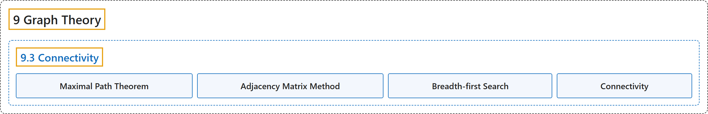

# 9.3 Connectivity

## Classification

## Glossary

| Term | Definition | 中文翻译 | Source |
|---|---|---|---|
| **9.3 Connectivity** 连通性 | (No definition) | （无定义） | [Doerr & Levasseur, n.d., section 9.3](https://discretemath.org/ads/s-Connectivity.html) |
| **Maximal Path Theorem** 极大路径定理 | "If a graph has $n$ vertices and vertex $u$ is connected to vertex $w\text{,}$ then **there exists a path from $u$ to $w$ of length no more than $n\text{.}$**" | 若图有 $n$ 个顶点且顶点 $u$ 与顶点 $w$ 相连，则**存在从 $u$ 到 $w$ 长度不超过 $n$ 的路径**。 | [Doerr & Levasseur, n.d., Theorem 9.3.2](https://discretemath.org/ads/s-Connectivity.html#theorem-9-3-1) |
| **Adjacency Matrix Method** 邻接矩阵法 | "Suppose that the information about edges in a graph is stored in an **adjacency matrix**, $G\text{.}$ The relation, $r\text{,}$ that $G$ defines is $v r w$ if there is an edge connecting $v$ to $w\text{.}$ Recall that the composition of $r$ with itself, $r^2\text{,}$ is defined by $v r^2 w$ if there exists a vertex $y$ such that $v r y$ and $y r w\text{;}$ that is, $v$ is connected to $w$ by a path of length 2. We could prove by induction that the relation $r^k\text{,}$ $k\geq 1\text{,}$ is defined by $v r^k w$ if and only if there is a path of length $k$ from $v$ to $w\text{.}$ Since the transitive closure, $r^+\text{,}$ is the union of $r\text{,}$ $r^2$ $,r^3,\ldots\text{,}$ we can answer our connectivity question by determining the **transitive closure of $r\text{,}$** which can be done most easily by keeping our relation in matrix form. Theorem 9.3.2 is significant in our calculations because it tells us that we need only go as far as $G^n$ to determine the matrix of the transitive closure." | 设图中的边信息存储在**邻接矩阵** $G$ 中。$G$ 所定义的关系 $r$ 为：若有边连接 $v$ 与 $w$，则 $v r w$。回忆 $r$ 与自身的复合 $r^2$ 定义为：若存在顶点 $y$ 使得 $v r y$ 且 $y r w$，则 $v r^2 w$；也就是说，$v$ 通过长度为 2 的路径与 $w$ 相连。我们可以用归纳法证明，关系 $r^k$，（$k\geq 1$）定义为：$v r^k w$ 当且仅当存在从 $v$ 到 $w$ 长度为 $k$ 的路径。由于传递闭包 $r^+$， 是 $r$, $r^2$ $,r^3,\ldots$， 的并，我们可以通过求 **$r$ 的传递闭包**来回答连通性问题，而这在把关系保存为矩阵形式时最容易做到。定理 9.3.2 对我们的计算很重要，因为它告诉我们，只需计算到 $G^n$ 就能确定传递闭包的矩阵。 | [Doerr & Levasseur, n.d., Algorithm 9.3.3](https://discretemath.org/ads/s-Connectivity.html#ss-adjacency-matrix-method-3) |
| **Breadth-first Search** 广度优先搜索 | "A **broadcasting algorithm for finding a path between vertex $i$ and vertex $j$** of a graph having $n$ vertices. Each item $V_k$ of a list $V=\left\{V_1, V_2, \ldots, V_n\right\}\text{,}$ consists of a Boolean field $V_k.\text{found}$ and an integer field $V_k.\text{from}\text{.}$ The sets $D_1\text{,}$ $D_2, \dots\text{,}$ called **depth sets**, have the property that if $k \in D_r\text{,}$ then the shortest path from vertex $i$ to vertex $k$ is of length $r\text{.}$ In Step 5, a stack is used to put the vertex list for the path from the vertex $i$ to vertex $j$ in the proper order. That stack is the output of the algorithm." | 一种在有 $n$ 个顶点的图中**寻找顶点 $i$ 与顶点 $j$ 之间路径的广播算法**。列表 $V=\left\{V_1, V_2, \ldots, V_n\right\}$， 的每一项 $V_k$ 由一个布尔字段 $V_k.\text{found}$ 和一个整数字段 $V_k.\text{from}$。 组成。集合 $D_1$，, $D_2, \dots$，称为**深度集**，具有如下性质：若 $k \in D_r$，则从顶点 $i$ 到顶点 $k$ 的最短路径长度为 $r$。在第 5 步中，用栈把从顶点 $i$ 到顶点 $j$ 的路径顶点表按正确顺序排列。该栈就是算法的输出。 | [Doerr & Levasseur, n.d., Algorithm 9.3.8](https://discretemath.org/ads/s-Connectivity.html#alg-breadth-first) |
| **Connectivity** 连通性 | "Vertex $v$ is **connected** to vertex $w$ if there is a path from $v$ to $w\text{.}$ Two vertices are **strongly connected** if they are connected in both directions to one another." | 如果存在从 $v$ 到 $w$ 的路径，则顶点 $v$ 与顶点 $w$ **连通**。如果两个顶点彼此在两个方向上都连通，则它们**强连通**。 | [Doerr & Levasseur, n.d., section 9.3](https://discretemath.org/ads/s-Connectivity.html#ss-connectivity-prelim-3-2) |

## References

Doerr, A., & Levasseur, K. (n.d.). *Applied discrete structures*. Retrieved October 28, 2026, from <https://discretemath.org/ads/index-ads.html>
