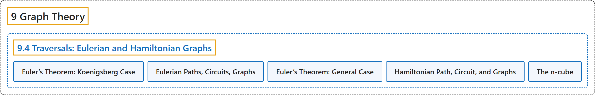

# 9.4 Traversals: Eulerian and Hamiltonian Graphs

## Classification

## Glossary

| Term | Definition | 中文翻译 | Source |
|---|---|---|---|
| **9.4 Traversals: Eulerian and Hamiltonian Graphs** 遍历：欧拉图与哈密顿图 | (No definition) | （无定义） | [Doerr & Levasseur, n.d., section 9.4](https://discretemath.org/ads/s-traversals.html) |
| **Euler’s Theorem: Koenigsberg Case** 欧拉定理：柯尼斯堡情形 | "**No walking tour of Koenigsberg** can be designed so that each bridge is used exactly once." | **哥尼斯堡的任何步行游览路线都不可能设计成每座桥恰好走一次**。 | [Doerr & Levasseur, n.d., Theorem 9.4.3](https://discretemath.org/ads/s-traversals.html#th-euler-theorem-koenigsberg-case) |
| **Eulerian Paths, Circuits, Graphs** 欧拉路径、欧拉回路、欧拉图 | "An **Eulerian path** through a graph is **a path whose edge list contains each edge of the graph exactly once**. If the path is a circuit, then it is called an **Eulerian circuit**. An **Eulerian graph** is a graph that possesses an Eulerian circuit." | 图的**欧拉路径**是**边表恰好含图的每条边一次的路径**。若该路径是回路，则称为**欧拉回路**。**欧拉图**是具有欧拉回路的图。 | [Doerr & Levasseur, n.d., Definition 9.4.4](https://discretemath.org/ads/s-traversals.html#def-eulerian-paths-circuits-graphs) |
| **Euler’s Theorem: General Case** 欧拉定理：一般情形 | "An undirected graph **has an Eulerian path if and only if it is connected and has either zero or two vertices with an odd degree**. If no vertex has an odd degree, then the graph is Eulerian." | 无向图**有欧拉路径当且仅当它连通且奇度顶点的个数为零或二**。若没有奇度顶点，则该图是欧拉图。 | [Doerr & Levasseur, n.d., Theorem 9.4.7](https://discretemath.org/ads/s-traversals.html#theorem-euler-theorem-general) |
| **Hamiltonian Path, Circuit, and Graphs** 哈密顿路径、哈密顿回路与哈密顿图 | "A **Hamiltonian path** through a graph is **a path whose vertex list contains each vertex of the graph exactly once**, except if the path is a circuit, in which case the initial vertex appears a second time as the terminal vertex. If the path is a circuit, then it is called a **Hamiltonian circuit**. A **Hamiltonian graph** is a graph that possesses a Hamiltonian circuit." | 图的**哈密顿路径**是**顶点表恰好含图的每个顶点一次的路径**，但若该路径是回路，则起点作为终点再出现一次。若该路径是回路，则称为**哈密顿回路**。**哈密顿图**是具有哈密顿回路的图。 | [Doerr & Levasseur, n.d., Definition 9.4.11](https://discretemath.org/ads/s-traversals.html#def-hamiltonian-path-circuit-graph) |
| **The n-cube** n 维立方体 | "Let $n \geq 1\text{,}$ and let $B^n$ be the set of strings of 0’s and 1’s with length $n\text{.}$ The **$n$-cube** is the **undirected graph** with a vertex for each string in $B^n$ and an edge connecting each pair of strings that differ in exactly one position. The $n$-cube is normally denoted $Q_n\text{.}$" | 设 $n \geq 1$，$B^n$ 为长度为 $n$ 的 0 和 1 的串的集合。**$n$-立方体**是这样的**无向图**：$B^n$ 中每个串对应一个顶点，且每一对恰好在一个位置上不同的串之间有一条边相连。$n$-立方体通常记作 $Q_n$。 | [Doerr & Levasseur, n.d., Definition 9.4.17](https://discretemath.org/ads/s-traversals.html#def-n-cube) |

## References

Doerr, A., & Levasseur, K. (n.d.). *Applied discrete structures*. Retrieved October 28, 2026, from <https://discretemath.org/ads/index-ads.html>
