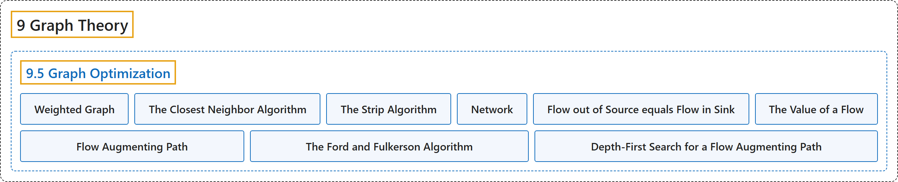

# 9.5 Graph Optimization

## Classification

## Glossary

| Term | Definition | 中文翻译 | Source |
|---|---|---|---|
| **9.5 Graph Optimization** 图的优化 | (No definition) | （无定义） | [Doerr & Levasseur, n.d., section 9.5](https://discretemath.org/ads/s-graph-optimization.html) |
| **Weighted Graph** 带权图 | "A **weighted graph**, $(V, E, w)\text{,}$ is a graph $(V, E)$ together with **a weight function** $w: E \to \mathbb{R}\text{.}$ If $e \in E\text{,}$ $w(e)$ is the weight on edge $e\text{.}$" | **带权图** $(V, E, w)$， 是图 $(V, E)$ 连同**权函数** $w: E \to \mathbb{R}$。若 $e \in E$，则 $w(e)$ 是边 $e$。 上的权。 | [Doerr & Levasseur, n.d., Definition 9.5.1](https://discretemath.org/ads/s-graph-optimization.html#def-weighted-graph) |
| **The Closest Neighbor Algorithm** 最近邻算法 | "Let $G = (V, E, w)$ be a complete weighted graph with $\vert V\vert = n\text{.}$ The **closest neighbor circuit** through G starting at $v_1$ is $\left(v_1, v_2,\ldots,v_n\right)\text{,}$ defined by the steps:" | 设 $G = (V, E, w)$ 为 $\vert V\vert = n$。 的完全带权图。经过 G 且从 $v_1$ 出发的**最近邻回路**为 $\left(v_1, v_2,\ldots,v_n\right)$，由如下步骤定义： | [Doerr & Levasseur, n.d., Algorithm 9.5.5](https://discretemath.org/ads/s-graph-optimization.html#alg-closest-neighbor) |
| **The Strip Algorithm** 条带算法 | "Given **$n$ points in the unit square**:" | 给定**单位正方形中的 $n$ 个点**： | [Doerr & Levasseur, n.d., Heuristic 9.5.13](https://discretemath.org/ads/s-graph-optimization.html#alg-strip-algorithm) |
| **Network** 网络 | "A **network** is **a simple weighted directed graph** that contains two distinguished vertices called the **source and the sink** with the properties that the indegree of the source and outdegree of the sink are both zero, and source is connected to sink. The weight function on a network is the **capacity function**, which has positive weights." | **网络**是**简单带权有向图**，含有两个特殊顶点，分别称为**源点和汇点**，且满足：源点的入度和汇点的出度均为零，并且源点与汇点相连。网络上的权函数是**容量函数**，其权为正。 | [Doerr & Levasseur, n.d., Definition 9.5.15](https://discretemath.org/ads/s-graph-optimization.html#def-network) |
| **Flow out of Source equals Flow in Sink** 源点流出量等于汇点流入量 | "If $f$ is a flow, then **$\sum_{(\text{source},v)\in E} f(\text{source},v)\text{ }=\sum_{(v,\text{sink})\in E} f(v,\text{sink})$**" | 若 $f$ 是一个流，则 **$\sum_{(\text{source},v)\in E} f(\text{source},v)\text{ }=\sum_{(v,\text{sink})\in E} f(v,\text{sink})$** | [Doerr & Levasseur, n.d., Theorem 9.5.20](https://discretemath.org/ads/s-graph-optimization.html#theorem-flow-inout) |
| **The Value of a Flow** 流的值 | "The two values flow into the sink and flow out of the source were proved to be equal in Theorem 9.5.20 and this common value is called the **value of the flow**. It is denoted by $V(f)\text{.}$ The value of a flow represents the amount of material that passes through the network with that flow." | 流入汇点的值与流出源点的值已在定理 9.5.20 中证明相等，这个共同的值称为**流的值**，记作 $V(f)$。流的值表示在该流下通过网络的物质的量。 | [Doerr & Levasseur, n.d., Definition 9.5.21](https://discretemath.org/ads/s-graph-optimization.html#def-value-of-flow) |
| **Flow Augmenting Path** 增广路径 | "Given a flow $f$ in a network $(V, E)\text{,}$ a **flow augmenting path** with respect to $f$ is **a simple path from the source to the sink** using edges both in their forward and their reverse directions such that for each edge $e$ in the path, $w(e) - f(e) > 0$ if $e$ is used in its forward direction and $f(e) > 0$ if $e$ is used in the reverse direction." | 给定网络 $(V, E)$， 中的流 $f$，关于 $f$ 的**增广路**是**从源点到汇点的简单路径**，它同时按正向和反向使用边，使得对路径中的每条边 $e$，若按正向使用 $e$ 则 $w(e) - f(e) > 0$，若按反向使用 $e$ 则 $f(e) > 0$。 | [Doerr & Levasseur, n.d., Definition 9.5.22](https://discretemath.org/ads/s-graph-optimization.html#def-flow-augmenting-path) |
| **The Ford and Fulkerson Algorithm** Ford-Fulkerson 算法 | "**Define the flow function** $f_0$ by $f_0(e)=0$ for each edge $e \in E\text{.}$" | **定义流函数** $f_0$：对每条边 $e \in E$，令 $f_0(e)=0$。 | [Doerr & Levasseur, n.d., Algorithm 9.5.24](https://discretemath.org/ads/s-graph-optimization.html#alg-ford-fulkerson) |
| **Depth-First Search for a Flow Augmenting Path** 搜索增广路径的深度优先搜索 | "This is a **depth-first search for the Sink Initiating at the Source**. Let $E'$ be the set of directed edges that can be used in producing a flow augmenting path. Add to the network a vertex called start and the edge $(\text{start}, \text{source}).$" | 这是一种**从源点出发搜索汇点的深度优先搜索**。设 $E'$ 为可用于产生增广路的有向边的集合。向网络中添加一个称为 start 的顶点和边 (start, source)。 | [Doerr & Levasseur, n.d., Algorithm 9.5.26](https://discretemath.org/ads/s-graph-optimization.html#alg-depth-first-search) |

## References

Doerr, A., & Levasseur, K. (n.d.). *Applied discrete structures*. Retrieved October 28, 2026, from <https://discretemath.org/ads/index-ads.html>
