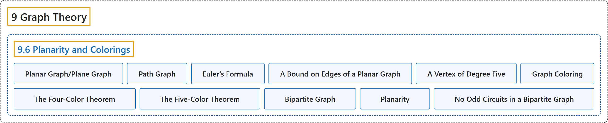

# 9.6 Planarity and Colorings

## Classification

## Glossary

| Term | Definition | 中文翻译 | Source |
|---|---|---|---|
| **9.6 Planarity and Colorings** 平面性与着色 | (No definition) | （无定义） | [Doerr & Levasseur, n.d., section 9.6](https://discretemath.org/ads/s-planarity-and-colorings.html) |
| **Planar Graph/Plane Graph** 平面图／平面嵌入图 | "A graph is **planar** if it can be drawn in a plane so that **no edges cross**. A drawing of a graph on the plane such that there are no edge crossings is called a **planar embedding** of the graph, or a **plane graph** for short." | 若图可以画在平面上使得**没有边相交**，则称它是**平面图**。图在平面上没有边相交的画法称为图的**平面嵌入**，简称**平面图形**。 | [Doerr & Levasseur, n.d., Definition 9.6.1](https://discretemath.org/ads/s-planarity-and-colorings.html#def-planar-graph) |
| **Path Graph** 路径图 | "A **path graph of length $n\text{,}$** denoted $P_n\text{,}$ is an undirected graph with $n+1$ vertices $v_0, v_1,\dots, v_n$ having $n$ edges $\{v_i,v_{i+1}\}\text{,}$ $i=0, 1, \dots, n-1\text{.}$" | 长度为 $n$ 的**路径图**，记作 $P_n$，是有 $n+1$ 个顶点 $v_0, v_1,\dots, v_n$ 和 $n$ 条边 $\{v_i,v_{i+1}\}$，（$i=0, 1, \dots, n-1$）的无向图。 | [Doerr & Levasseur, n.d., Definition 9.6.4](https://discretemath.org/ads/s-planarity-and-colorings.html#def-def-path-graph) |
| **Euler’s Formula** 欧拉公式 | "If $G = (V, E)$ is a **connected planar graph with $r$ regions, $v$ vertices, and $e$ edges**, then" | 若 $G = (V, E)$ 是有 $r$ 个区域、$v$ 个顶点和 $e$ 条边的**连通平面图**，则 | [Doerr & Levasseur, n.d., Theorem 9.6.8](https://discretemath.org/ads/s-planarity-and-colorings.html#theorem-euler-formula) |
| **A Bound on Edges of a Planar Graph** 平面图边数的上界 | "If $G = (V, E)$ is a connected planar graph with $v$ vertices, $v\geq 3$, and $e$ edges, then **$e \leq 3v - 6$**" | 若 $G = (V, E)$ 是有 $v$ 个顶点（$v\geq 3$）、$e$ 条边的连通平面图，则 **$e \leq 3v - 6$** | [Doerr & Levasseur, n.d., Theorem 9.6.10](https://discretemath.org/ads/s-planarity-and-colorings.html#theorem-edge-bound) |
| **A Vertex of Degree Five** 度数为五的顶点 | "If $G$ is a connected planar graph, then it **has a vertex with degree 5 or less**." | 若 $G$ 是连通平面图，则它**有一个度数不超过 5 的顶点**。 | [Doerr & Levasseur, n.d., Theorem 9.6.12](https://discretemath.org/ads/s-planarity-and-colorings.html#theorem-degree-5) |
| **Graph Coloring** 图着色 | "Given an undirected graph $G = (V, E)\text{,}$ a “**coloring function**” is a function $f$ from $V$ into a set of colors $H$ such that $\{v_i,v_j\} \in E \Rightarrow f\left(v_i\right)\neq f\left(v_j\right)\text{.}$ If $H$ has the smallest possible cardinality, its cardinality is called the **chromatic number of $G\text{,}$** $\chi(G)\text{.}$" | 给定无向图 $G = (V, E)$，“**着色函数**”是从 $V$ 到颜色集 $H$ 的函数 $f$，使得 $\{v_i,v_j\} \in E \Rightarrow f\left(v_i\right)\neq f\left(v_j\right)$。若 $H$ 的基数是可能的最小值，则该基数称为 $G$， 的**色数**，记作 $\chi(G)$。 | [Doerr & Levasseur, n.d., Definition 9.6.15](https://discretemath.org/ads/s-planarity-and-colorings.html#def-graph-coloring) |
| **The Four-Color Theorem** 四色定理 | "**If $G$ is a planar graph**, then $\chi (G)\leq 4\text{.}$" | **若 $G$ 是平面图**，则 $\chi (G)\leq 4$。 | [Doerr & Levasseur, n.d., Theorem 9.6.16](https://discretemath.org/ads/s-planarity-and-colorings.html#theorem-four-color-theorem) |
| **The Five-Color Theorem** 五色定理 | "**If $G$ is a planar graph**, then $\chi (G)\leq 5\text{.}$" | **若 $G$ 是平面图**，则 $\chi (G)\leq 5$。 | [Doerr & Levasseur, n.d., Theorem 9.6.17](https://discretemath.org/ads/s-planarity-and-colorings.html#theorem-five-color-theorem) |
| **Bipartite Graph** 二分图 | "A **bipartite graph** is a graph that has **a 2-coloring**. Equivalently, a graph is bipartite if its vertices can be **partitioned into two nonempty subsets so that no edge connects vertices from the same subset**." | **二部图**是**具有 2-着色的图**。等价地，若图的顶点可以**划分为两个非空子集，使得没有边连接同一子集中的顶点**，则该图是二部图。 | [Doerr & Levasseur, n.d., Definition 9.6.19](https://discretemath.org/ads/s-planarity-and-colorings.html#def-bipartite-graph) |
| **Planarity** 平面性 | (context) "A graph is **planar** if it can be drawn in a plane so that no edges cross." | （语境）如果一个图可以画在平面上而使任何边都不相交，则该图是**平面图**。 | [Doerr & Levasseur, n.d., section 9.6](https://discretemath.org/ads/s-planarity-and-colorings.html#def-planar-graph-5-1) |
| **No Odd Circuits in a Bipartite Graph** 二部图中没有奇回路 | "An undirected graph is bipartite if and only if it **has no circuit of odd length**." | 无向图是二部图，当且仅当它**没有长度为奇数的回路**。 | [Doerr & Levasseur, n.d., Theorem 9.6.21](https://discretemath.org/ads/s-planarity-and-colorings.html#theorem-no-odd) |

## References

Doerr, A., & Levasseur, K. (n.d.). *Applied discrete structures*. Retrieved October 28, 2026, from <https://discretemath.org/ads/index-ads.html>
