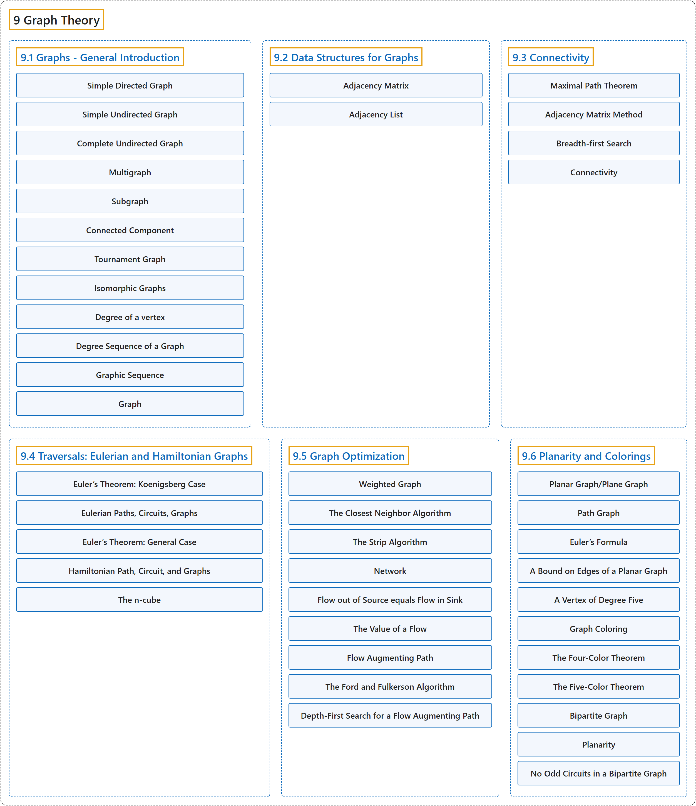

# 9 Graph Theory

## Classification

## Glossary

| Term | Definition | 中文翻译 | Source |
|---|---|---|---|
| **9 Graph Theory** 图论 | (No definition) | （无定义） | [Doerr & Levasseur, n.d., chapter 9](https://discretemath.org/ads/chapter_9.html) |
| **[9.1 Graphs - General Introduction](9-1-graphs-general-introduction.md)** 图：概述 | (No definition) | （无定义） | [Doerr & Levasseur, n.d., section 9.1](https://discretemath.org/ads/s-graphs-introduction.html) |
| **[9.2 Data Structures for Graphs](9-2-data-structures-for-graphs.md)** 图的数据结构 | (No definition) | （无定义） | [Doerr & Levasseur, n.d., section 9.2](https://discretemath.org/ads/s-data-structures-for-graphs.html) |
| **[9.3 Connectivity](9-3-connectivity.md)** 连通性 | (No definition) | （无定义） | [Doerr & Levasseur, n.d., section 9.3](https://discretemath.org/ads/s-Connectivity.html) |
| **[9.4 Traversals: Eulerian and Hamiltonian Graphs](9-4-traversals-eulerian-and-hamiltonian-graphs.md)** 遍历：欧拉图与哈密顿图 | (No definition) | （无定义） | [Doerr & Levasseur, n.d., section 9.4](https://discretemath.org/ads/s-traversals.html) |
| **[9.5 Graph Optimization](9-5-graph-optimization.md)** 图的优化 | (No definition) | （无定义） | [Doerr & Levasseur, n.d., section 9.5](https://discretemath.org/ads/s-graph-optimization.html) |
| **[9.6 Planarity and Colorings](9-6-planarity-and-colorings.md)** 平面性与着色 | (No definition) | （无定义） | [Doerr & Levasseur, n.d., section 9.6](https://discretemath.org/ads/s-planarity-and-colorings.html) |

## References

Doerr, A., & Levasseur, K. (n.d.). *Applied discrete structures*. Retrieved October 28, 2026, from <https://discretemath.org/ads/index-ads.html>
