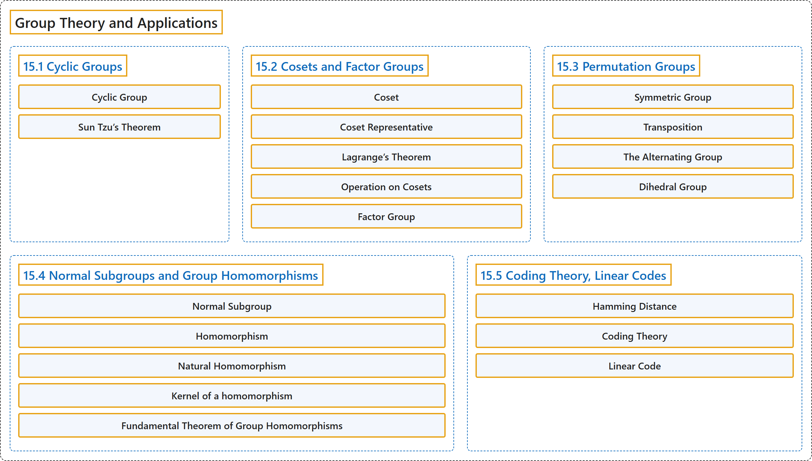

# 15 Group Theory and Applications

## Classification

## Glossary

| Term | Definition | 中文翻译 | Source |
|---|---|---|---|
| **15 Group Theory and Applications** 群论及其应用 | (No definition) | （无定义） | [Doerr & Levasseur, n.d., chapter 15](https://discretemath.org/ads/chapter_15.html) |
| **15.1 Cyclic Groups** 循环群 | (No definition) | （无定义） | [Doerr & Levasseur, n.d., section 15.1](https://discretemath.org/ads/s-cyclic-groups.html) |
| **Cyclic Group** 循环群 | "**Group $G$ is cyclic** if there exists $a \in G$ such that the cyclic subgroup generated by $a\text{,}$ $\langle a \rangle\text{,}$ equals all of $G\text{.}$ That is, $G = \{n a \vert n \in \mathbb{Z}\}\text{,}$ in which case $a$ is called **a generator of $G\text{.}$** The reader should note that additive notation is used for $G\text{.}$" | 若存在 $a \in G$ 使得由 $a$ 生成的循环子群 $\langle a \rangle$， 等于整个 $G$，则**群 $G$ 是循环的**。即 $G = \{n a \vert n \in \mathbb{Z}\}$， 此时 $a$ 称为 $G$ 的**生成元**。读者应注意，$G$ 采用加法记号。 | [Doerr & Levasseur, n.d., Definition 15.1.1](https://discretemath.org/ads/s-cyclic-groups.html#def-cyclic-group-15) |
| **Sun Tzu’s Theorem** 孙子定理 | "Let $n_1\text{,}$ $n_2\text{,}$ $\ldots\text{,}$ $n_p$ be integers that have **no common factor greater than one between any pair of them**; i. e., they are **relatively prime**. Let $n = n_1 n_2 \cdots n_p\text{.}$ Define" | 设 $n_1$， $n_2$， $\ldots$， $n_p$ 为**任意两个之间没有大于 1 的公因子**的整数，即它们**两两互素**。设 $n = n_1 n_2 \cdots n_p$。 定义 | [Doerr & Levasseur, n.d., Theorem 15.1.15](https://discretemath.org/ads/s-cyclic-groups.html#th-crt) |
| **15.2 Cosets and Factor Groups** 陪集与商群 | (No definition) | （无定义） | [Doerr & Levasseur, n.d., section 15.2](https://discretemath.org/ads/s-cosets-and-factor-groups.html) |
| **Coset** 陪集 | "If $[G;*]$ is a group, $H \leq G$ and $a \in G\text{,}$ **the left coset of $H$ generated by $a$** is" | 若 $[G;*]$ 是群，$H \leq G$ 且 $a \in G$， 则 **$H$ 的由 $a$ 生成的左陪集**为 | [Doerr & Levasseur, n.d., Definition 15.2.2](https://discretemath.org/ads/s-cosets-and-factor-groups.html#def-coset) |
| **Coset Representative** 陪集代表元 | "Any element of a coset is called **a representative of that coset**." | 陪集的任一元素称为**该陪集的代表元**。 | [Doerr & Levasseur, n.d., Definition 15.2.4](https://discretemath.org/ads/s-cosets-and-factor-groups.html#def-coset-representative) |
| **Lagrange’s Theorem** 拉格朗日定理 | "**The order of a subgroup of a finite group** **must divide the order of the group**." | 有限群的**子群的阶**必**整除该群的阶**。 | [Doerr & Levasseur, n.d., Theorem 15.2.12](https://discretemath.org/ads/s-cosets-and-factor-groups.html#th-lagrange-theorem) |
| **Operation on Cosets** 陪集上的运算 | "Let $C$ and $D$ be **left cosets of $H\text{,}$** a subgroup of $G$ with **representatives** $c$ and $d\text{,}$ respectively. Then" | 设 $C$ 与 $D$ 为 $H$， 的**左陪集**，$H$， 是 $G$ 的子群，其**代表元**分别为 $c$ 和 $d$， 则 | [Doerr & Levasseur, n.d., Definition 15.2.13](https://discretemath.org/ads/s-cosets-and-factor-groups.html#def-operation-on-cosets) |
| **Factor Group** 商群 | "Let $G$ be a group and $H \leq G\text{.}$ If **the set of left cosets of $H$ forms a group**, then that group is called **the factor group** of “$G$ modulo $H\text{.}$” It is denoted $G/H\text{.}$" | 设 $G$ 为群且 $H \leq G$。 若 $H$ 的**左陪集的集合构成群**，则该群称为“$G$ 模 $H$”的**商群**。记作 $G/H$。 | [Doerr & Levasseur, n.d., Definition 15.2.20](https://discretemath.org/ads/s-cosets-and-factor-groups.html#def-factor-group) |
| **15.3 Permutation Groups** 置换群 | (No definition) | （无定义） | [Doerr & Levasseur, n.d., section 15.3](https://discretemath.org/ads/s-permutation-groups.html) |
| **Symmetric Group** 对称群 | "Let $A$ be a nonempty set. The set of **all permutations on $A$** with the operation of function composition is called **the symmetric group on $A\text{,}$** denoted $S_A\text{.}$" | 设 $A$ 为非空集。**$A$ 上所有置换**在函数复合运算下构成的集合称为 $A$ 上的**对称群**，记作 $S_A$。 | [Doerr & Levasseur, n.d., Definition 15.3.5](https://discretemath.org/ads/s-permutation-groups.html#def-symmetric-group) |
| **Transposition** 对换 | "**A transposition** is **a cycle of length 2**." | **对换**是长度为 2 的**轮换**。 | [Doerr & Levasseur, n.d., Definition 15.3.14](https://discretemath.org/ads/s-permutation-groups.html#def-transposition) |
| **The Alternating Group** 交错群 | "Let $n \geq 2\text{.}$ The set of **even permutations** in $S_n$ is **a proper subgroup** of $S_n$ called **the alternating group** on $\{1, 2, \ldots, n\}\text{,}$ denoted $A_n\text{.}$" | 设 $n \geq 2$。 $S_n$ 中的**偶置换**集合是 $S_n$ 的**真子群**，称为 $\{1, 2, \ldots, n\}$， 上的**交错群**，记作 $A_n$。 | [Doerr & Levasseur, n.d., Definition 15.3.18](https://discretemath.org/ads/s-permutation-groups.html#def-alternating-group) |
| **Dihedral Group** 二面体群 | "Let $n$ be **a positive integer greater than or equal to 3**. If $r= (1,2, \ldots, n)\text{,}$ **an $n$-cycle**, and $f= (1,n)(2,n-1)\ldots$ Then" | 设 $n$ 为**大于或等于 3 的正整数**。若 $r= (1,2, \ldots, n)$， 是一个 **$n$ 轮换**，且 $f= (1,n)(2,n-1)\ldots$，则 | [Doerr & Levasseur, n.d., Definition 15.3.26](https://discretemath.org/ads/s-permutation-groups.html#ss-dihedral-group-13) |
| **15.4 Normal Subgroups and Group Homomorphisms** 正规子群与群同态 | (No definition) | （无定义） | [Doerr & Levasseur, n.d., section 15.4](https://discretemath.org/ads/s-normal-subgroups-homomorphisms.html) |
| **Normal Subgroup** 正规子群 | "If $G$ is a group, $H \leq G\text{,}$ then $H$ is **a normal subgroup of $G\text{,}$** denoted $H \triangleleft G\text{,}$ if and only if **every left coset of $H$ is a right coset of $H\text{;}$** i. e. $a*H = H*a \quad \forall a \in G$" | 若 $G$ 是群，$H \leq G$， 则 $H$ 是 $G$ 的**正规子群**（记作 $H \triangleleft G$），当且仅当 **$H$ 的每个左陪集都是 $H$ 的右陪集**；即 $a*H = H*a \quad \forall a \in G$ | [Doerr & Levasseur, n.d., Definition 15.4.5](https://discretemath.org/ads/s-normal-subgroups-homomorphisms.html#def-normal-subgroup) |
| **Homomorphism** 同态 | "Let $[G; *]$ and $[G';\diamond ]$ be groups. $\theta:G \to G'$ is **a homomorphism** if $\theta(x * y) = \theta(x) \diamond \theta(y)$ for all $x, y \in G\text{.}$" | 设 $[G; *]$ 和 $[G';\diamond ]$ 为群。若对所有 $x, y \in G$。 有 $\theta(x * y) = \theta(x) \diamond \theta(y)$，则 $\theta:G \to G'$ 是**同态**。 | [Doerr & Levasseur, n.d., Definition 15.4.12](https://discretemath.org/ads/s-normal-subgroups-homomorphisms.html#def-homomorphism) |
| **Natural Homomorphism** 自然同态 | "If $H \triangleleft G\text{,}$ then the function $\pi:G\to G/H$ defined by $\pi(a) = a H$ is called **the natural homomorphism**." | 若 $H \triangleleft G$， 则由 $\pi(a) = a H$ 定义的函数 $\pi:G\to G/H$ 称为**自然同态**。 | [Doerr & Levasseur, n.d., Definition 15.4.18](https://discretemath.org/ads/s-normal-subgroups-homomorphisms.html#def-natural-homomorphism) |
| **Kernel of a homomorphism** 同态的核 | "Let $\theta: G \to G'$ be a homomorphism, and let $e$ and $e'$ be **the identities of $G$ and $G'\text{,}$** respectively. **The kernel of $\theta$** is the set $\ker \theta=\{a\in G \mid \theta(a)=e'\}$" | 设 $\theta: G \to G'$ 为同态，$e$ 与 $e'$ 分别为 $G$ 与 $G'$， 的**单位元**。**$\theta$ 的核**是集合 $\ker \theta=\{a\in G \mid \theta(a)=e'\}$ | [Doerr & Levasseur, n.d., Definition 15.4.19](https://discretemath.org/ads/s-normal-subgroups-homomorphisms.html#def-group-kernel) |
| **Fundamental Theorem of Group Homomorphisms** 群同态基本定理 | "Let $\theta: G \to G'$ be a homomorphism. Then $\theta(G)$ is **isomorphic** to $G/\ker \theta\text{.}$" | 设 $\theta: G \to G'$ 为同态。则 $\theta(G)$ 与 $G/\ker \theta$。 **同构**。 | [Doerr & Levasseur, n.d., Theorem 15.4.21](https://discretemath.org/ads/s-normal-subgroups-homomorphisms.html#theorem-fund-group-homomorphism) |
| **15.5 Coding Theory, Linear Codes** 编码理论、线性码 | (No definition) | （无定义） | [Doerr & Levasseur, n.d., section 15.5](https://discretemath.org/ads/s-coding-theory-groups.html) |
| **Hamming Distance** 汉明距离 | "Given two elements of $\mathbb{Z}_2{}^n\text{,}$ $a$ and $b\text{,}$ the **Hamming Distance**, $d_H(a,b)$ between them is **the number of positions in which they differ**." | 给定 $\mathbb{Z}_2{}^n$， 的两个元素 $a$ 和 $b$， 它们之间的**汉明距离** $d_H(a,b)$ 是它们**取值不同的位置的个数**。 | [Doerr & Levasseur, n.d., Definition 15.5.3](https://discretemath.org/ads/s-coding-theory-groups.html#def-hammingdistance) |
| **Coding Theory** 编码理论 | (context) "In this section, we will introduce the basic ideas involved in **coding theory** and consider solutions of a coding problem by means of **linear codes**." | （语境）在本节中，我们将介绍**编码理论**所涉及的基本思想，并借助**线性码**来考虑一个编码问题的解法。 | [Doerr & Levasseur, n.d., section 15.5](https://discretemath.org/ads/s-coding-theory-groups.html#s-coding-theory-groups-4-2) |
| **Linear Code** 线性码 | (Definition pending) | （定义待补） | [Doerr & Levasseur, n.d., section 15.5](https://discretemath.org/ads/s-coding-theory-groups.html) |

## References

Doerr, A., & Levasseur, K. (n.d.). *Applied discrete structures*. Retrieved October 28, 2026, from <https://discretemath.org/ads/index-ads.html>
