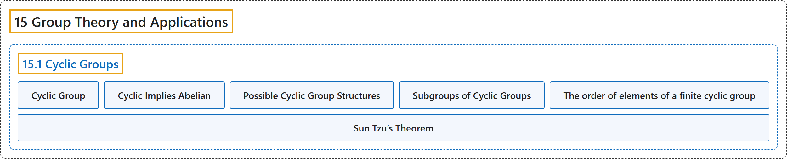

# 15.1 Cyclic Groups

## Classification

## Glossary

| Term | Definition | 中文翻译 | Source |
|---|---|---|---|
| **15.1 Cyclic Groups** 循环群 | (No definition) | （无定义） | [Doerr & Levasseur, n.d., section 15.1](https://discretemath.org/ads/s-cyclic-groups.html) |
| **Cyclic Group** 循环群 | "**Group $G$ is cyclic** if there exists $a \in G$ such that the cyclic subgroup generated by $a\text{,}$ $\langle a \rangle\text{,}$ equals all of $G\text{.}$ That is, $G = \{n a \vert n \in \mathbb{Z}\}\text{,}$ in which case $a$ is called **a generator of $G\text{.}$** The reader should note that additive notation is used for $G\text{.}$" | 若存在 $a \in G$ 使得由 $a$ 生成的循环子群 $\langle a \rangle$， 等于整个 $G$，则**群 $G$ 是循环的**。即 $G = \{n a \vert n \in \mathbb{Z}\}$， 此时 $a$ 称为 $G$ 的**生成元**。读者应注意，$G$ 采用加法记号。 | [Doerr & Levasseur, n.d., Definition 15.1.1](https://discretemath.org/ads/s-cyclic-groups.html#def-cyclic-group-15) |
| **Cyclic Implies Abelian** 循环群必为阿贝尔群 | "If $[G;*]$ is cyclic, then **it is abelian**." | 若 $[G;*]$ 是循环群，则**它是阿贝尔群**。 | [Doerr & Levasseur, n.d., Theorem 15.1.5](https://discretemath.org/ads/s-cyclic-groups.html#cyclic-implies-abelian) |
| **Possible Cyclic Group Structures** 循环群的可能结构 | "If $G$ is a cyclic group, then $G$ is either finite or countably infinite. If $G$ is finite and $\lvert G\rvert=n$, **it is isomorphic to $[\mathbb{Z}_n; +_n]$**. If $G$ is infinite, **it is isomorphic to $[\mathbb{Z};+]$**." | 若 $G$ 是循环群，则 $G$ 或者是有限的，或者是可数无限的。若 $G$ 有限且 $\lvert G\rvert=n$，则**它同构于 $[\mathbb{Z}_n; +_n]$**。若 $G$ 无限，则**它同构于 $[\mathbb{Z};+]$**。 | [Doerr & Levasseur, n.d., Theorem 15.1.9](https://discretemath.org/ads/s-cyclic-groups.html#theorem-cyclic-groups) |
| **Subgroups of Cyclic Groups** 循环群的子群 | "Every subgroup of a cyclic group **is cyclic**." | 循环群的每个子群**都是循环群**。 | [Doerr & Levasseur, n.d., Theorem 15.1.10](https://discretemath.org/ads/s-cyclic-groups.html#theorem-subgroups-of-cyclic-groups) |
| **The order of elements of a finite cyclic group** 有限循环群中元素的阶 | "If $G$ is a cyclic group of order $n$ and $a$ is a generator of $G$, **the order of $k a$ is $n/d$**, where $d$ is the greatest common divisor of $n$ and $k$." | 若 $G$ 是 $n$ 阶循环群，$a$ 是 $G$ 的生成元，则 **$k a$ 的阶是 $n/d$**，其中 $d$ 是 $n$ 与 $k$ 的最大公因数。 | [Doerr & Levasseur, n.d., Theorem 15.1.13](https://discretemath.org/ads/s-cyclic-groups.html#theorem-order-in-cyclic) |
| **Sun Tzu’s Theorem** 孙子定理 | "Let $n_1\text{,}$ $n_2\text{,}$ $\ldots\text{,}$ $n_p$ be integers that have **no common factor greater than one between any pair of them**; i. e., they are **relatively prime**. Let $n = n_1 n_2 \cdots n_p\text{.}$ Define" | 设 $n_1$， $n_2$， $\ldots$， $n_p$ 为**任意两个之间没有大于 1 的公因子**的整数，即它们**两两互素**。设 $n = n_1 n_2 \cdots n_p$。 定义 | [Doerr & Levasseur, n.d., Theorem 15.1.15](https://discretemath.org/ads/s-cyclic-groups.html#th-crt) |

## References

Doerr, A., & Levasseur, K. (n.d.). *Applied discrete structures*. Retrieved October 28, 2026, from <https://discretemath.org/ads/index-ads.html>
