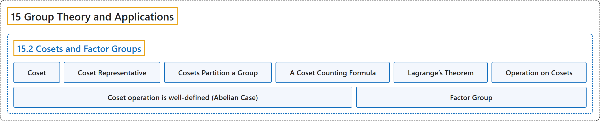

# 15.2 Cosets and Factor Groups

## Classification

## Glossary

| Term | Definition | 中文翻译 | Source |
|---|---|---|---|
| **15.2 Cosets and Factor Groups** 陪集与商群 | (No definition) | （无定义） | [Doerr & Levasseur, n.d., section 15.2](https://discretemath.org/ads/s-cosets-and-factor-groups.html) |
| **Coset** 陪集 | "If $[G;*]$ is a group, $H \leq G$ and $a \in G\text{,}$ **the left coset of $H$ generated by $a$** is" | 若 $[G;*]$ 是群，$H \leq G$ 且 $a \in G$， 则 **$H$ 的由 $a$ 生成的左陪集**为 | [Doerr & Levasseur, n.d., Definition 15.2.2](https://discretemath.org/ads/s-cosets-and-factor-groups.html#def-coset) |
| **Coset Representative** 陪集代表元 | "Any element of a coset is called **a representative of that coset**." | 陪集的任一元素称为**该陪集的代表元**。 | [Doerr & Levasseur, n.d., Definition 15.2.4](https://discretemath.org/ads/s-cosets-and-factor-groups.html#def-coset-representative) |
| **Cosets Partition a Group** 陪集划分群 | "If $[G; *]$ is a group and $H\leq G$, the set of left cosets of $H$ **is a partition of $G$**. In addition, all of the left cosets of $H$ **have the same cardinality**. The same is true for right cosets." | 若 $[G; *]$ 是群且 $H\leq G$，则 $H$ 的左陪集的集合**是 $G$ 的一个划分**。此外，$H$ 的所有左陪集**具有相同的基数**。右陪集也是如此。 | [Doerr & Levasseur, n.d., Theorem 15.2.8](https://discretemath.org/ads/s-cosets-and-factor-groups.html#theorem-cosets-partition) |
| **A Coset Counting Formula** 陪集计数公式 | "If $\lvert G\rvert \lt \infty$ and $H\leq G$, the number of distinct left cosets of $H$ **equals $\frac{\lvert G\rvert }{\lvert H\rvert }$**. For this reason we use $G/H$ to denote the set of left cosets of $H$ in $G$" | 若 $\lvert G\rvert \lt \infty$ 且 $H\leq G$，则 $H$ 的不同左陪集的个数**等于 $\frac{\lvert G\rvert }{\lvert H\rvert }$**。因此，我们用 $G/H$ 表示 $H$ 在 $G$ 中的左陪集的集合 | [Doerr & Levasseur, n.d., Corollary 15.2.9](https://discretemath.org/ads/s-cosets-and-factor-groups.html#corollary-counting-cosets) |
| **Lagrange’s Theorem** 拉格朗日定理 | "**The order of a subgroup of a finite group** **must divide the order of the group**." | 有限群的**子群的阶**必**整除该群的阶**。 | [Doerr & Levasseur, n.d., Theorem 15.2.12](https://discretemath.org/ads/s-cosets-and-factor-groups.html#th-lagrange-theorem) |
| **Operation on Cosets** 陪集上的运算 | "Let $C$ and $D$ be **left cosets of $H\text{,}$** a subgroup of $G$ with **representatives** $c$ and $d\text{,}$ respectively. Then" | 设 $C$ 与 $D$ 为 $H$， 的**左陪集**，$H$， 是 $G$ 的子群，其**代表元**分别为 $c$ 和 $d$， 则 | [Doerr & Levasseur, n.d., Definition 15.2.13](https://discretemath.org/ads/s-cosets-and-factor-groups.html#def-operation-on-cosets) |
| **Coset operation is well-defined (Abelian Case)** 陪集运算是良定义的（阿贝尔群情形） | "If $G$ is an abelian group, and $H \leq G$, the operation induced on cosets of $H$ by the operation of $G$ **is well defined**." | 若 $G$ 是阿贝尔群且 $H \leq G$，则由 $G$ 的运算在 $H$ 的陪集上诱导的运算**是良定义的**。 | [Doerr & Levasseur, n.d., Theorem 15.2.18](https://discretemath.org/ads/s-cosets-and-factor-groups.html#theorem-coset-operation-well-defined) |
| **Factor Group** 商群 | "Let $G$ be a group and $H \leq G\text{.}$ If **the set of left cosets of $H$ forms a group**, then that group is called **the factor group** of “$G$ modulo $H\text{.}$” It is denoted $G/H\text{.}$" | 设 $G$ 为群且 $H \leq G$。 若 $H$ 的**左陪集的集合构成群**，则该群称为“$G$ 模 $H$”的**商群**。记作 $G/H$。 | [Doerr & Levasseur, n.d., Definition 15.2.20](https://discretemath.org/ads/s-cosets-and-factor-groups.html#def-factor-group) |

## References

Doerr, A., & Levasseur, K. (n.d.). *Applied discrete structures*. Retrieved October 28, 2026, from <https://discretemath.org/ads/index-ads.html>
