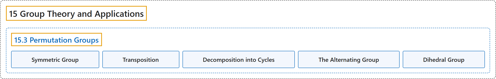

# 15.3 Permutation Groups

## Classification

## Glossary

| Term | Definition | 中文翻译 | Source |
|---|---|---|---|
| **15.3 Permutation Groups** 置换群 | (No definition) | （无定义） | [Doerr & Levasseur, n.d., section 15.3](https://discretemath.org/ads/s-permutation-groups.html) |
| **Symmetric Group** 对称群 | "Let $A$ be a nonempty set. The set of **all permutations on $A$** with the operation of function composition is called **the symmetric group on $A\text{,}$** denoted $S_A\text{.}$" | 设 $A$ 为非空集。**$A$ 上所有置换**在函数复合运算下构成的集合称为 $A$ 上的**对称群**，记作 $S_A$。 | [Doerr & Levasseur, n.d., Definition 15.3.5](https://discretemath.org/ads/s-permutation-groups.html#def-symmetric-group) |
| **Transposition** 对换 | "**A transposition** is **a cycle of length 2**." | **对换**是长度为 2 的**轮换**。 | [Doerr & Levasseur, n.d., Definition 15.3.14](https://discretemath.org/ads/s-permutation-groups.html#def-transposition) |
| **Decomposition into Cycles** 分解为轮换 | "Every cycle of length greater than 2 **can be expressed as a product of transpositions**." | 每个长度大于 2 的轮换**都可以表示为对换的乘积**。 | [Doerr & Levasseur, n.d., Theorem 15.3.16](https://discretemath.org/ads/s-permutation-groups.html#theorem-products-of-transpositions) |
| **The Alternating Group** 交错群 | "Let $n \geq 2\text{.}$ The set of **even permutations** in $S_n$ is **a proper subgroup** of $S_n$ called **the alternating group** on $\{1, 2, \ldots, n\}\text{,}$ denoted $A_n\text{.}$" | 设 $n \geq 2$。 $S_n$ 中的**偶置换**集合是 $S_n$ 的**真子群**，称为 $\{1, 2, \ldots, n\}$， 上的**交错群**，记作 $A_n$。 | [Doerr & Levasseur, n.d., Definition 15.3.18](https://discretemath.org/ads/s-permutation-groups.html#def-alternating-group) |
| **Dihedral Group** 二面体群 | "Let $n$ be **a positive integer greater than or equal to 3**. If $r= (1,2, \ldots, n)\text{,}$ **an $n$-cycle**, and $f= (1,n)(2,n-1)\ldots$ Then" | 设 $n$ 为**大于或等于 3 的正整数**。若 $r= (1,2, \ldots, n)$， 是一个 **$n$ 轮换**，且 $f= (1,n)(2,n-1)\ldots$，则 | [Doerr & Levasseur, n.d., Definition 15.3.26](https://discretemath.org/ads/s-permutation-groups.html#ss-dihedral-group-13) |

## References

Doerr, A., & Levasseur, K. (n.d.). *Applied discrete structures*. Retrieved October 28, 2026, from <https://discretemath.org/ads/index-ads.html>
