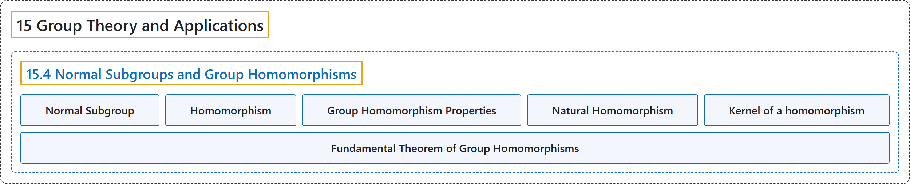

# 15.4 Normal Subgroups and Group Homomorphisms

## Classification

## Glossary

| Term | Definition | 中文翻译 | Source |
|---|---|---|---|
| **15.4 Normal Subgroups and Group Homomorphisms** 正规子群与群同态 | (No definition) | （无定义） | [Doerr & Levasseur, n.d., section 15.4](https://discretemath.org/ads/s-normal-subgroups-homomorphisms.html) |
| **Normal Subgroup** 正规子群 | "If $G$ is a group, $H \leq G\text{,}$ then $H$ is **a normal subgroup of $G\text{,}$** denoted $H \triangleleft G\text{,}$ if and only if **every left coset of $H$ is a right coset of $H\text{;}$** i. e. $a*H = H*a \quad \forall a \in G$" | 若 $G$ 是群，$H \leq G$， 则 $H$ 是 $G$ 的**正规子群**（记作 $H \triangleleft G$），当且仅当 **$H$ 的每个左陪集都是 $H$ 的右陪集**；即 $a*H = H*a \quad \forall a \in G$ | [Doerr & Levasseur, n.d., Definition 15.4.5](https://discretemath.org/ads/s-normal-subgroups-homomorphisms.html#def-normal-subgroup) |
| **Homomorphism** 同态 | "Let $[G; *]$ and $[G';\diamond ]$ be groups. $\theta:G \to G'$ is **a homomorphism** if $\theta(x * y) = \theta(x) \diamond \theta(y)$ for all $x, y \in G\text{.}$" | 设 $[G; *]$ 和 $[G';\diamond ]$ 为群。若对所有 $x, y \in G$。 有 $\theta(x * y) = \theta(x) \diamond \theta(y)$，则 $\theta:G \to G'$ 是**同态**。 | [Doerr & Levasseur, n.d., Definition 15.4.12](https://discretemath.org/ads/s-normal-subgroups-homomorphisms.html#def-homomorphism) |
| **Group Homomorphism Properties** 群同态的性质 | "If $\theta: G \rightarrow G'$ is a homomorphism, then: $\theta(e) =\theta(\textrm{the identity of } G) = \textrm{the identity of } G' = e'$. $\theta\left(a ^{-1}\right) = \theta(a)^{-1}$ for all $a \in G$. If $H \leq G$, then $\theta(H) = \{\theta(h) \vert  h\in H\}\leq G'$." | 若 $\theta: G \rightarrow G'$ 是同态，则：$\theta(e) =\theta(\textrm{the identity of } G) = \textrm{the identity of } G' = e'$。对所有 $a \in G$，$\theta\left(a ^{-1}\right) = \theta(a)^{-1}$。若 $H \leq G$，则 $\theta(H) = \{\theta(h) \vert  h\in H\}\leq G'$。 | [Doerr & Levasseur, n.d., Theorem 15.4.14](https://discretemath.org/ads/s-normal-subgroups-homomorphisms.html#theorem-homomorphism-properties) |
| **Natural Homomorphism** 自然同态 | "If $H \triangleleft G\text{,}$ then the function $\pi:G\to G/H$ defined by $\pi(a) = a H$ is called **the natural homomorphism**." | 若 $H \triangleleft G$， 则由 $\pi(a) = a H$ 定义的函数 $\pi:G\to G/H$ 称为**自然同态**。 | [Doerr & Levasseur, n.d., Definition 15.4.18](https://discretemath.org/ads/s-normal-subgroups-homomorphisms.html#def-natural-homomorphism) |
| **Kernel of a homomorphism** 同态的核 | "Let $\theta: G \to G'$ be a homomorphism, and let $e$ and $e'$ be **the identities of $G$ and $G'\text{,}$** respectively. **The kernel of $\theta$** is the set $\ker \theta=\{a\in G \mid \theta(a)=e'\}$" | 设 $\theta: G \to G'$ 为同态，$e$ 与 $e'$ 分别为 $G$ 与 $G'$， 的**单位元**。**$\theta$ 的核**是集合 $\ker \theta=\{a\in G \mid \theta(a)=e'\}$ | [Doerr & Levasseur, n.d., Definition 15.4.19](https://discretemath.org/ads/s-normal-subgroups-homomorphisms.html#def-group-kernel) |
| **Fundamental Theorem of Group Homomorphisms** 群同态基本定理 | "Let $\theta: G \to G'$ be a homomorphism. Then $\theta(G)$ is **isomorphic** to $G/\ker \theta\text{.}$" | 设 $\theta: G \to G'$ 为同态。则 $\theta(G)$ 与 $G/\ker \theta$。 **同构**。 | [Doerr & Levasseur, n.d., Theorem 15.4.21](https://discretemath.org/ads/s-normal-subgroups-homomorphisms.html#theorem-fund-group-homomorphism) |

## References

Doerr, A., & Levasseur, K. (n.d.). *Applied discrete structures*. Retrieved October 28, 2026, from <https://discretemath.org/ads/index-ads.html>
