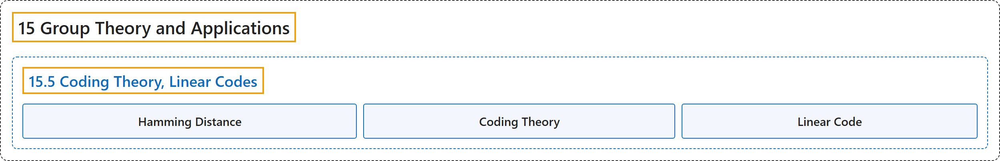

# 15.5 Coding Theory, Linear Codes

## Classification

## Glossary

| Term | Definition | 中文翻译 | Source |
|---|---|---|---|
| **15.5 Coding Theory, Linear Codes** 编码理论、线性码 | (No definition) | （无定义） | [Doerr & Levasseur, n.d., section 15.5](https://discretemath.org/ads/s-coding-theory-groups.html) |
| **Hamming Distance** 汉明距离 | "Given two elements of $\mathbb{Z}_2{}^n\text{,}$ $a$ and $b\text{,}$ the **Hamming Distance**, $d_H(a,b)$ between them is **the number of positions in which they differ**." | 给定 $\mathbb{Z}_2{}^n$， 的两个元素 $a$ 和 $b$， 它们之间的**汉明距离** $d_H(a,b)$ 是它们**取值不同的位置的个数**。 | [Doerr & Levasseur, n.d., Definition 15.5.3](https://discretemath.org/ads/s-coding-theory-groups.html#def-hammingdistance) |
| **Coding Theory** 编码理论 | (context) "In this section, we will introduce the basic ideas involved in **coding theory** and consider solutions of a coding problem by means of **linear codes**." | （语境）在本节中，我们将介绍**编码理论**所涉及的基本思想，并借助**线性码**来考虑一个编码问题的解法。 | [Doerr & Levasseur, n.d., section 15.5](https://discretemath.org/ads/s-coding-theory-groups.html#s-coding-theory-groups-4-2) |
| **Linear Code** 线性码 | (Definition pending) | （定义待补） | [Doerr & Levasseur, n.d., section 15.5](https://discretemath.org/ads/s-coding-theory-groups.html) |

## References

Doerr, A., & Levasseur, K. (n.d.). *Applied discrete structures*. Retrieved October 28, 2026, from <https://discretemath.org/ads/index-ads.html>
