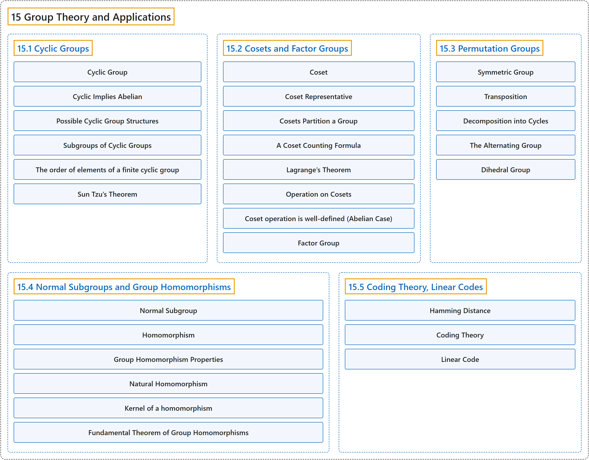

# 15 Group Theory and Applications

## Classification

## Glossary

| Term | Definition | 中文翻译 | Source |
|---|---|---|---|
| **15 Group Theory and Applications** 群论及其应用 | (No definition) | （无定义） | [Doerr & Levasseur, n.d., chapter 15](https://discretemath.org/ads/chapter_15.html) |
| **[15.1 Cyclic Groups](15-1-cyclic-groups.md)** 循环群 | (No definition) | （无定义） | [Doerr & Levasseur, n.d., section 15.1](https://discretemath.org/ads/s-cyclic-groups.html) |
| **[15.2 Cosets and Factor Groups](15-2-cosets-and-factor-groups.md)** 陪集与商群 | (No definition) | （无定义） | [Doerr & Levasseur, n.d., section 15.2](https://discretemath.org/ads/s-cosets-and-factor-groups.html) |
| **[15.3 Permutation Groups](15-3-permutation-groups.md)** 置换群 | (No definition) | （无定义） | [Doerr & Levasseur, n.d., section 15.3](https://discretemath.org/ads/s-permutation-groups.html) |
| **[15.4 Normal Subgroups and Group Homomorphisms](15-4-normal-subgroups-and-group-homomorphisms.md)** 正规子群与群同态 | (No definition) | （无定义） | [Doerr & Levasseur, n.d., section 15.4](https://discretemath.org/ads/s-normal-subgroups-homomorphisms.html) |
| **[15.5 Coding Theory, Linear Codes](15-5-coding-theory-linear-codes.md)** 编码理论、线性码 | (No definition) | （无定义） | [Doerr & Levasseur, n.d., section 15.5](https://discretemath.org/ads/s-coding-theory-groups.html) |

## References

Doerr, A., & Levasseur, K. (n.d.). *Applied discrete structures*. Retrieved October 28, 2026, from <https://discretemath.org/ads/index-ads.html>
