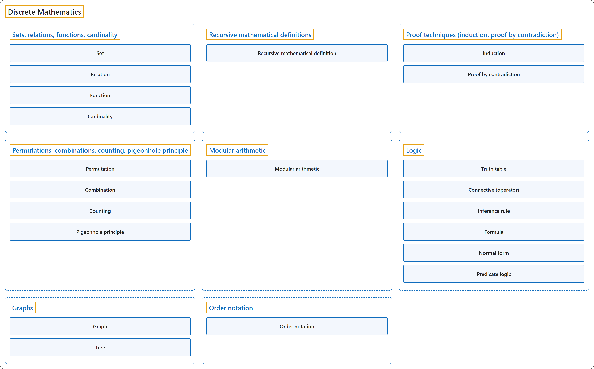

# 1. Discrete Mathematics

## Classification

## Glossary

| Term | Definition | 中文翻译 | Source |
|---|---|---|---|
| **Discrete Mathematics** 离散数学 | "Discrete mathematics is the branch of mathematics dealing with objects that can assume **only distinct, separated values**." | 离散数学是处理一类对象的数学分支，这些对象**只能取彼此分开的不同值**。 | [Weisstein, n.d.-a, "Discrete mathematics" entry, para. 1](https://mathworld.wolfram.com/DiscreteMathematics.html#:~:text=dealing%20with%20objects%20that%20can%20assume%20only%20distinct) |
| **[Sets, relations, functions, cardinality](sets-relations-functions-cardinality.md)** 集合、关系、函数、基数 | "A set is a finite or infinite **collection of objects** in which **order has no significance**, and multiplicity is generally also ignored (unlike a list or multiset)." | 集合是有限或无限的**对象的汇集**，其中**顺序没有意义**，重复次数通常也被忽略（不同于列表或多重集）。 | [Weisstein, n.d.-i, "Set" entry, para. 1](https://mathworld.wolfram.com/Set.html#:~:text=A%20set%20is%20a%20finite%20or%20infinite%20collection%20of%20objects) |
| **[Recursive mathematical definitions](recursive-mathematical-definitions.md)** 递归数学定义 | (context) "A recursive process is one in which objects are **defined in terms of other objects of the same type**." | （语境）递归过程是这样一种过程：对象**用同类型的其他对象来定义**。 | [Weisstein, n.d.-h, "Recursion" entry, para. 1](https://mathworld.wolfram.com/Recursion.html#:~:text=A%20recursive%20process%20is%20one%20in%20which%20objects%20are%20defined) |
| **[Proof techniques (induction, proof by contradiction)](proof-techniques-induction-proof-by-contradiction.md)** 证明技巧（归纳法、反证法） | (context) "A proof by contradiction establishes the truth of a given proposition by the **supposition that it is false** and the subsequent drawing of a conclusion that is **contradictory to something that is proven to be true**." | （语境）反证法这样确立一个命题为真：先**假设它为假**，再推出一个**与某个已证明为真的事实相矛盾**的结论。 | [Weisstein, n.d.-g, "Proof by contradiction" entry, para. 1](https://mathworld.wolfram.com/ProofbyContradiction.html#:~:text=A%20proof%20by%20contradiction%20establishes%20the%20truth) |
| **[Permutations, combinations, counting, pigeonhole principle](permutations-combinations-counting-pigeonhole-principle.md)** 排列、组合、计数、鸽巢原理 | "A permutation of a set S is a **one-to-one correspondence of S with itself**." | 集合 S 的排列是 **S 与它自身之间的一一对应**。 | [Weisstein, n.d.-f, "Permutation" entry, para. 1](https://mathworld.wolfram.com/Permutation.html#:~:text=is%20a%20one%2Dto%2Done%20correspondence%20of) |
| **[Modular arithmetic](modular-arithmetic.md)** 模运算 | "Modular arithmetic is the **arithmetic of congruences**, sometimes known informally as '**clock arithmetic**.'" | 模运算是**同余的算术**，非正式地也称为“**时钟算术**”。 | [Weisstein, n.d.-e, "Modular arithmetic" entry, para. 1](https://mathworld.wolfram.com/ModularArithmetic.html#:~:text=Modular%20arithmetic%20is%20the%20arithmetic%20of%20congruences) |
| **[Logic](logic.md)** 逻辑 | "Logic is the **formal mathematical study** of the methods, structure, and validity of **mathematical deduction and proof**." | 逻辑是一种**形式化的数学研究**，研究对象是**数学演绎和证明**的方法、结构和有效性。 | [Weisstein, n.d.-d, "Logic" entry, para. 1](https://mathworld.wolfram.com/Logic.html#:~:text=Logic%20is%20the%20formal%20mathematical%20study) |
| **[Graphs](graphs.md)** 图 | "In a mathematician's terminology, a graph is a **collection of points and lines** connecting **some (possibly empty) subset of them**." | 按数学家的术语，图是**点和线的集合**，这些线连接**其中某个子集的点**（子集可能为空）。 | [Weisstein, n.d.-b, "Graph" entry, para. 3](https://mathworld.wolfram.com/Graph.html#:~:text=a%20graph%20is%20a%20collection%20of%20points%20and%20lines) |
| **[Order notation](order-notation.md)** 阶的记号 | (context) "... the symbols **O(x)** (sometimes called 'big-O') and o(x) (sometimes called 'little-o') are known as the **Landau symbols** ..." | （语境）……符号 **O(x)**（有时称为“大 O”）和 o(x)（有时称为“小 o”）称为**朗道符号**…… | [Weisstein, n.d.-c, "Landau symbols" entry, para. 1](https://mathworld.wolfram.com/LandauSymbols.html#:~:text=are%20known%20as%20the%20Landau%20symbols) |

## References

- Joint Task Force on Computing Curricula. (2024). *Computer science curricula 2023*. Association for Computing Machinery. <https://doi.org/10.1145/3664191>
- Weisstein, E. W. (n.d.-a). *Discrete mathematics*. MathWorld: A Wolfram Resource. Retrieved October 27, 2026, from <https://mathworld.wolfram.com/DiscreteMathematics.html>
- Weisstein, E. W. (n.d.-b). *Graph*. MathWorld: A Wolfram Resource. Retrieved October 27, 2026, from <https://mathworld.wolfram.com/Graph.html>
- Weisstein, E. W. (n.d.-c). *Landau symbols*. MathWorld: A Wolfram Resource. Retrieved October 27, 2026, from <https://mathworld.wolfram.com/LandauSymbols.html>
- Weisstein, E. W. (n.d.-d). *Logic*. MathWorld: A Wolfram Resource. Retrieved October 27, 2026, from <https://mathworld.wolfram.com/Logic.html>
- Weisstein, E. W. (n.d.-e). *Modular arithmetic*. MathWorld: A Wolfram Resource. Retrieved October 27, 2026, from <https://mathworld.wolfram.com/ModularArithmetic.html>
- Weisstein, E. W. (n.d.-f). *Permutation*. MathWorld: A Wolfram Resource. Retrieved October 27, 2026, from <https://mathworld.wolfram.com/Permutation.html>
- Weisstein, E. W. (n.d.-g). *Proof by contradiction*. MathWorld: A Wolfram Resource. Retrieved October 27, 2026, from <https://mathworld.wolfram.com/ProofbyContradiction.html>
- Weisstein, E. W. (n.d.-h). *Recursion*. MathWorld: A Wolfram Resource. Retrieved October 27, 2026, from <https://mathworld.wolfram.com/Recursion.html>
- Weisstein, E. W. (n.d.-i). *Set*. MathWorld: A Wolfram Resource. Retrieved October 27, 2026, from <https://mathworld.wolfram.com/Set.html>
