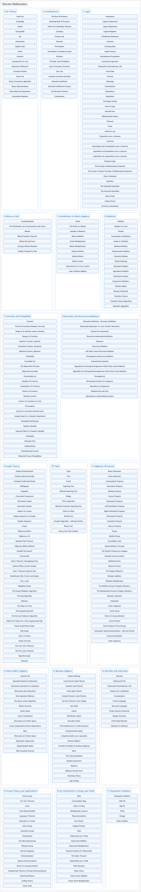

# 1. Discrete Mathematics

## Classification

## Glossary

| Term | Definition | 中文翻译 | Source |
|---|---|---|---|
| **Discrete Mathematics** 离散数学 | "Discrete mathematics is the branch of mathematics dealing with objects that can assume **only distinct, separated values**." | 离散数学是处理一类对象的数学分支，这些对象**只能取彼此分开的不同值**。 | [Weisstein, n.d., "Discrete mathematics" entry, para. 1](https://mathworld.wolfram.com/DiscreteMathematics.html#:~:text=dealing%20with%20objects%20that%20can%20assume%20only%20distinct) |
| **[1 Set Theory](set-theory.md)** 集合论 | (No definition) | （无定义） | [Doerr & Levasseur, n.d., chapter 1](https://discretemath.org/ads/chapter_1.html) |
| **[2 Combinatorics](combinatorics.md)** 组合数学 | (No definition) | （无定义） | [Doerr & Levasseur, n.d., chapter 2](https://discretemath.org/ads/chapter_2.html) |
| **[3 Logic](logic.md)** 逻辑 | (No definition) | （无定义） | [Doerr & Levasseur, n.d., chapter 3](https://discretemath.org/ads/chapter3.html) |
| **[4 More on Sets](more-on-sets.md)** 集合再论 | (No definition) | （无定义） | [Doerr & Levasseur, n.d., chapter 4](https://discretemath.org/ads/chapter_4.html) |
| **[5 Introduction to Matrix Algebra](introduction-to-matrix-algebra.md)** 矩阵代数导论 | (No definition) | （无定义） | [Doerr & Levasseur, n.d., chapter 5](https://discretemath.org/ads/chapter_5.html) |
| **[6 Relations](relations.md)** 关系 | (No definition) | （无定义） | [Doerr & Levasseur, n.d., chapter 6](https://discretemath.org/ads/chapter_6.html) |
| **[7 Functions and Probability](functions-and-probability.md)** 函数与概率 | (No definition) | （无定义） | [Doerr & Levasseur, n.d., chapter 7](https://discretemath.org/ads/chapter_7.html) |
| **[8 Recursion and Recurrence Relations](recursion-and-recurrence-relations.md)** 递归与递推关系 | (No definition) | （无定义） | [Doerr & Levasseur, n.d., chapter 8](https://discretemath.org/ads/chapter_8.html) |
| **[9 Graph Theory](graph-theory.md)** 图论 | (No definition) | （无定义） | [Doerr & Levasseur, n.d., chapter 9](https://discretemath.org/ads/chapter_9.html) |
| **[10 Trees](trees.md)** 树 | (No definition) | （无定义） | [Doerr & Levasseur, n.d., chapter 10](https://discretemath.org/ads/chapter_10.html) |
| **[11 Algebraic Structures](algebraic-structures.md)** 代数结构 | (No definition) | （无定义） | [Doerr & Levasseur, n.d., chapter 11](https://discretemath.org/ads/chapter_11.html) |
| **[12 More Matrix Algebra](more-matrix-algebra.md)** 矩阵代数再论 | (No definition) | （无定义） | [Doerr & Levasseur, n.d., chapter 12](https://discretemath.org/ads/chapter_12.html) |
| **[13 Boolean Algebra](boolean-algebra.md)** 布尔代数 | (No definition) | （无定义） | [Doerr & Levasseur, n.d., chapter 13](https://discretemath.org/ads/chapter_13.html) |
| **[14 Monoids and Automata](monoids-and-automata.md)** 幺半群与自动机 | (No definition) | （无定义） | [Doerr & Levasseur, n.d., chapter 14](https://discretemath.org/ads/chapter_14.html) |
| **[15 Group Theory and Applications](group-theory-and-applications.md)** 群论及其应用 | (No definition) | （无定义） | [Doerr & Levasseur, n.d., chapter 15](https://discretemath.org/ads/chapter_15.html) |
| **[16 An Introduction to Rings and Fields](an-introduction-to-rings-and-fields.md)** 环与域导论 | (No definition) | （无定义） | [Doerr & Levasseur, n.d., chapter 16](https://discretemath.org/ads/chapter_16.html) |
| **[17 Asymptotic Notation](asymptotic-notation.md)** 渐近记号 | (No definition) | （无定义） | [Lehman et al., 2018, section 14.7](https://courses.csail.mit.edu/6.042/spring18/mcs.pdf) |

## References

Doerr, A., & Levasseur, K. (n.d.). *Applied discrete structures*. Retrieved October 28, 2026, from <https://discretemath.org/ads/index-ads.html>

Lehman, E., Leighton, F. T., & Meyer, A. R. (2018). *Mathematics for computer science*. Massachusetts Institute of Technology. <https://courses.csail.mit.edu/6.042/spring18/mcs.pdf>

Weisstein, E. W. (n.d.). *Discrete mathematics*. MathWorld: A Wolfram Resource. Retrieved October 27, 2026, from <https://mathworld.wolfram.com/DiscreteMathematics.html>
