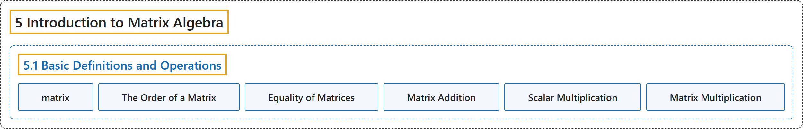

# 5.1 Basic Definitions and Operations

## Classification

## Glossary

| Term | Definition | 中文翻译 | Source |
|---|---|---|---|
| **5.1 Basic Definitions and Operations** 基本定义与运算 | (No definition) | （无定义） | [Doerr & Levasseur, n.d., section 5.1](https://discretemath.org/ads/s-basic-matrix-definitions.html) |
| **matrix** 矩阵 | "A **matrix** is a **rectangular array of elements** of the form" | **矩阵**是**元素的矩形阵列**，形如 | [Doerr & Levasseur, n.d., Definition 5.1.1](https://discretemath.org/ads/s-basic-matrix-definitions.html#def-matrix) |
| **The Order of a Matrix** 矩阵的阶 | "A matrix $A$ that has **$m$ rows and $n$ columns** is called an $m\times n$ (read “$m$ by $n$”) matrix, and is said to have **order $m \times n\text{.}$**" | 具有 **$m$ 行 $n$ 列**的矩阵 $A$ 称为 $m\times n$（读作“$m$ 乘 $n$”）矩阵，并称其**阶数为 $m\times n$**。 | [Doerr & Levasseur, n.d., Definition 5.1.2](https://discretemath.org/ads/s-basic-matrix-definitions.html#def-matrix-order) |
| **Equality of Matrices** 矩阵相等 | "A matrix $A$ is said to be **equal to matrix $B$** (written $A = B$) if and only if:" | 矩阵 $A$ 称为**等于矩阵 $B$**（记作 $A = B$），当且仅当： | [Doerr & Levasseur, n.d., Definition 5.1.4](https://discretemath.org/ads/s-basic-matrix-definitions.html#def-matrix-equality) |
| **Matrix Addition** 矩阵加法 | "Let $A$ and $B$ be $m\times n$ matrices. Then **$A+B$ is an $m\times n$ matrix where $(A + B)_{ij} = a_{ij} + b_{ij}$** (read “The $i\text{th}$ $j\text{th}$ entry of the matrix $A + B$ is obtained by adding the $i\text{th}$ $j\text{th}$ entry of $A$ to the $i\text{th}$ $j\text{th}$ entry of $B$”). If the orders of $A$ and $B$ are not identical, $A+B$ is **not defined**." | 设 $A$ 和 $B$ 是 $m\times n$ 矩阵。则 **$A+B$ 是 $m\times n$ 矩阵，其中 $(A + B)_{ij} = a_{ij} + b_{ij}$**（读作“矩阵 $A + B$ 的第 $i$ 行第 $j$ 列元素由 $A$ 的第 $i$ 行第 $j$ 列元素加上 $B$ 的第 $i$ 行第 $j$ 列元素得到”）。若 $A$ 和 $B$ 的阶数不同，则 $A+B$ **没有定义**。 | [Doerr & Levasseur, n.d., Definition 5.1.5](https://discretemath.org/ads/s-basic-matrix-definitions.html#def-matrix-addition) |
| **Scalar Multiplication** 数乘 | "Let $A$ be an $m \times n$ matrix and $c$ a scalar. Then **$c A$ is the $m\times n$ matrix obtained by multiplying $c$ times each entry of $A\text{;}$** that is $(c A)_{ij} = c a_{ij}\text{.}$" | 设 $A$ 是 $m \times n$ 矩阵，$c$ 是标量。则 **$c A$ 是将 $c$ 乘以 $A$ 的每个元素所得到的 $m\times n$ 矩阵**；即 $(c A)_{ij} = c a_{ij}$。 | [Doerr & Levasseur, n.d., Definition 5.1.7](https://discretemath.org/ads/s-basic-matrix-definitions.html#def-scalar-multiplication) |
| **Matrix Multiplication** 矩阵乘法 | "Let $A$ be an $m\times n$ matrix and let $B$ be an $n\times p$ matrix. The **product of $A$ and $B\text{,}$** denoted by $AB\text{,}$ is an **$m\times p$ matrix** whose $i\text{th}$ row $j\text{th}$ column entry is" | 设 $A$ 是 $m\times n$ 矩阵，$B$ 是 $n\times p$ 矩阵。$A$ 与 $B$ 的**乘积**记作 $AB$，是一个 **$m\times p$ 矩阵**，其第 $i$ 行第 $j$ 列元素为 | [Doerr & Levasseur, n.d., Definition 5.1.8](https://discretemath.org/ads/s-basic-matrix-definitions.html#def-matrix-multiplication) |

## References

Doerr, A., & Levasseur, K. (n.d.). *Applied discrete structures*. Retrieved October 28, 2026, from <https://discretemath.org/ads/index-ads.html>
