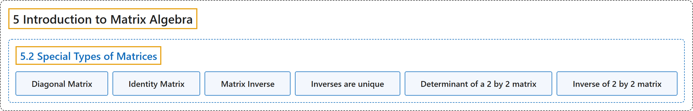

# 5.2 Special Types of Matrices

## Classification

## Glossary

| Term | Definition | 中文翻译 | Source |
|---|---|---|---|
| **5.2 Special Types of Matrices** 特殊类型的矩阵 | (No definition) | （无定义） | [Doerr & Levasseur, n.d., section 5.2](https://discretemath.org/ads/s-special-matrices.html) |
| **Diagonal Matrix** 对角矩阵 | "A **square matrix** D is called a **diagonal matrix** if **$d_{i j}$ = 0 whenever $i \neq j\text{.}$**" | **方阵** D 称为**对角矩阵**，若**每当 $i \neq j$。 时 $d_{i j}$ = 0**。 | [Doerr & Levasseur, n.d., Definition 5.2.1](https://discretemath.org/ads/s-special-matrices.html#def-diagonal-matrix) |
| **Identity Matrix** 单位矩阵 | "The **$n\times n$ diagonal matrix $I_n$ whose diagonal components are all 1’s** is called the **identity matrix**. If the context is clear, we simply use $I\text{.}$" | **对角线元素全为 1 的 $n\times n$ 对角矩阵** $I_n$ 称为**单位矩阵**。若上下文清楚，我们简记为 $I$。 | [Doerr & Levasseur, n.d., Definition 5.2.4](https://discretemath.org/ads/s-special-matrices.html#def-identity-matrix) |
| **Matrix Inverse** 逆矩阵 | "Let $A$ be an $n\times n$ matrix. If there exists an $n\times n$ matrix $B$ such that **$A B = B A =I\text{,}$** then $B$ is a **multiplicative inverse of $A$** (called simply an **inverse of $A$**) and is denoted by $A^{-1}$" | 设 $A$ 是 $n\times n$ 矩阵。若存在 $n\times n$ 矩阵 $B$ 使得 **$A B = B A =I$，**则 $B$ 是 $A$ 的**乘法逆元**（简称 $A$ 的**逆矩阵**）记作 $A^{-1}$ | [Doerr & Levasseur, n.d., Definition 5.2.5](https://discretemath.org/ads/s-special-matrices.html#def-matrix-inverse) |
| **Inverses are unique** 逆矩阵是唯一的 | "The inverse of an $n\times n$ matrix A, when it exists, **is unique**." | $n\times n$ 矩阵 A 的逆矩阵（若存在）**是唯一的**。 | [Doerr & Levasseur, n.d., Theorem 5.2.6](https://discretemath.org/ads/s-special-matrices.html#theorem-unique-inverse) |
| **Determinant of a 2 by 2 matrix** 2 阶矩阵的行列式 | "Let $A =\left(\begin{array}{cc} a & b \\ c & d \\ \end{array} \right)\text{.}$ The **determinant of $A$** is the number **$\det A = a d - b c\text{.}$**" | 设 $A =\left(\begin{array}{cc} a & b \\ c & d \\ \end{array} \right)$。$A$ 的**行列式**是数 **$\det A = a d - b c$。** | [Doerr & Levasseur, n.d., Definition 5.2.7](https://discretemath.org/ads/s-special-matrices.html#determinant-2by2) |
| **Inverse of 2 by 2 matrix** 2 阶矩阵的逆矩阵 | "Let $A =\left( \begin{array}{cc} a & b \\ c & d \\ \end{array} \right)$. If $\det A\neq 0$, then **$A^{-1} =\frac{1}{\det A}\left( \begin{array}{cc} d & -b \\ -c & a \\ \end{array} \right)$**." | 设 $A =\left( \begin{array}{cc} a & b \\ c & d \\ \end{array} \right)$。若 $\det A\neq 0$，则 **$A^{-1} =\frac{1}{\det A}\left( \begin{array}{cc} d & -b \\ -c & a \\ \end{array} \right)$**。 | [Doerr & Levasseur, n.d., Theorem 5.2.9](https://discretemath.org/ads/s-special-matrices.html#theorem-inverse-two-by-two) |

## References

Doerr, A., & Levasseur, K. (n.d.). *Applied discrete structures*. Retrieved October 28, 2026, from <https://discretemath.org/ads/index-ads.html>
