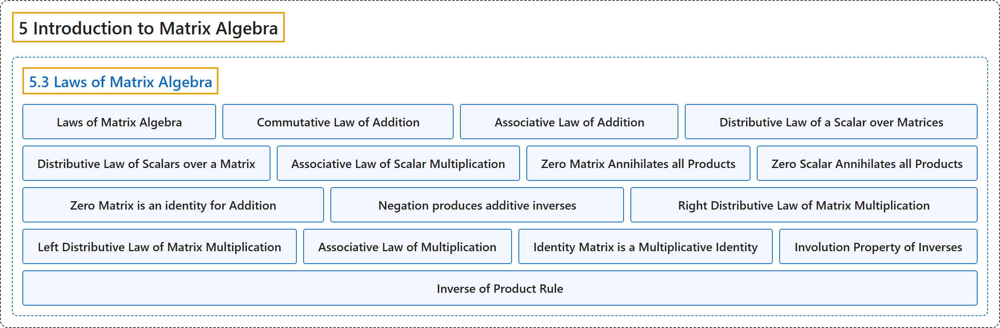

# 5.3 Laws of Matrix Algebra

## Classification

## Glossary

| Term | Definition | 中文翻译 | Source |
|---|---|---|---|
| **5.3 Laws of Matrix Algebra** 矩阵代数定律 | (No definition) | （无定义） | [Doerr & Levasseur, n.d., section 5.3](https://discretemath.org/ads/s-laws-of-matrix-algebra.html) |
| **Laws of Matrix Algebra** 矩阵代数定律 | (context) "The following is a summary of the basic **laws of matrix operations**." | （语境）以下是**矩阵运算基本定律**的汇总。 | [Doerr & Levasseur, n.d., section 5.3](https://discretemath.org/ads/s-laws-of-matrix-algebra.html#s-laws-of-matrix-algebra-3-2) |
| **Commutative Law of Addition** 加法交换律 | "$A + B = B + A$" | $A + B = B + A$ | [Doerr & Levasseur, n.d., Table 5.3.1](https://discretemath.org/ads/s-laws-of-matrix-algebra.html#table-matrix-laws) |
| **Associative Law of Addition** 加法结合律 | "$A + (B + C) = (A + B) + C$" | $A + (B + C) = (A + B) + C$ | [Doerr & Levasseur, n.d., Table 5.3.1](https://discretemath.org/ads/s-laws-of-matrix-algebra.html#table-matrix-laws) |
| **Distributive Law of a Scalar over Matrices** 数乘对矩阵加法的分配律 | "$c(A + B) = c A + c B$, where $c \in \mathbb{R}$." | $c(A + B) = c A + c B$，其中 $c \in \mathbb{R}$。 | [Doerr & Levasseur, n.d., Table 5.3.1](https://discretemath.org/ads/s-laws-of-matrix-algebra.html#table-matrix-laws) |
| **Distributive Law of Scalars over a Matrix** 标量加法对矩阵的分配律 | "$\left(c_1 + c_2 \right)A = c_1A +c_2 A$, where $c_1, c_2 \in \mathbb{R}$." | $\left(c_1 + c_2 \right)A = c_1A +c_2 A$，其中 $c_1, c_2 \in \mathbb{R}$。 | [Doerr & Levasseur, n.d., Table 5.3.1](https://discretemath.org/ads/s-laws-of-matrix-algebra.html#table-matrix-laws) |
| **Associative Law of Scalar Multiplication** 数乘结合律 | "$c_1 \left(c_2 A\right) =\left(c_1 \cdot c_2 \right)A$, where $c_1, c_2 \in \mathbb{R}$." | $c_1 \left(c_2 A\right) =\left(c_1 \cdot c_2 \right)A$，其中 $c_1, c_2 \in \mathbb{R}$。 | [Doerr & Levasseur, n.d., Table 5.3.1](https://discretemath.org/ads/s-laws-of-matrix-algebra.html#table-matrix-laws) |
| **Zero Matrix Annihilates all Products** 零矩阵使一切乘积为零 | "$\pmb{0}A = \pmb{0}$, where $\pmb{0}$ is the zero matrix." | $\pmb{0}A = \pmb{0}$，其中 $\pmb{0}$ 是零矩阵。 | [Doerr & Levasseur, n.d., Table 5.3.1](https://discretemath.org/ads/s-laws-of-matrix-algebra.html#table-matrix-laws) |
| **Zero Scalar Annihilates all Products** 零标量使一切乘积为零 | "$0 A =\pmb{0}$, where 0 on the left is the scalar zero." | $0 A =\pmb{0}$，其中左边的 0 是标量零。 | [Doerr & Levasseur, n.d., Table 5.3.1](https://discretemath.org/ads/s-laws-of-matrix-algebra.html#table-matrix-laws) |
| **Zero Matrix is an identity for Addition** 零矩阵是加法的单位元 | "$A + \pmb{0} = A$." | $A + \pmb{0} = A$。 | [Doerr & Levasseur, n.d., Table 5.3.1](https://discretemath.org/ads/s-laws-of-matrix-algebra.html#table-matrix-laws) |
| **Negation produces additive inverses** 取负得到加法逆元 | "$A + (-1)A = \pmb{0}$." | $A + (-1)A = \pmb{0}$。 | [Doerr & Levasseur, n.d., Table 5.3.1](https://discretemath.org/ads/s-laws-of-matrix-algebra.html#table-matrix-laws) |
| **Right Distributive Law of Matrix Multiplication** 矩阵乘法的右分配律 | "$(B + C)A = B A + C A$." | $(B + C)A = B A + C A$。 | [Doerr & Levasseur, n.d., Table 5.3.1](https://discretemath.org/ads/s-laws-of-matrix-algebra.html#table-matrix-laws) |
| **Left Distributive Law of Matrix Multiplication** 矩阵乘法的左分配律 | "$A(B + C) = A B + A C$." | $A(B + C) = A B + A C$。 | [Doerr & Levasseur, n.d., Table 5.3.1](https://discretemath.org/ads/s-laws-of-matrix-algebra.html#table-matrix-laws) |
| **Associative Law of Multiplication** 乘法结合律 | "$A(B C) = (A B)C$." | $A(B C) = (A B)C$。 | [Doerr & Levasseur, n.d., Table 5.3.1](https://discretemath.org/ads/s-laws-of-matrix-algebra.html#table-matrix-laws) |
| **Identity Matrix is a Multiplicative Identity** 单位矩阵是乘法单位元 | "$I A = A$ and $A I = A$." | $I A = A$ 以及 $A I = A$。 | [Doerr & Levasseur, n.d., Table 5.3.1](https://discretemath.org/ads/s-laws-of-matrix-algebra.html#table-matrix-laws) |
| **Involution Property of Inverses** 逆的对合性质 | "If $A^{-1}$ exists,$\left(A^{-1} \right)^{-1} = A$." | 若 $A^{-1}$ 存在，则 $\left(A^{-1} \right)^{-1} = A$。 | [Doerr & Levasseur, n.d., Table 5.3.1](https://discretemath.org/ads/s-laws-of-matrix-algebra.html#table-matrix-laws) |
| **Inverse of Product Rule** 乘积的逆法则 | "If $A^{-1}$ and $B^{-1}$ exist, $(A B)^{-1}= B^{-1}A^{-1}$" | 若 $A^{-1}$ 与 $B^{-1}$ 存在，则 $(A B)^{-1}= B^{-1}A^{-1}$ | [Doerr & Levasseur, n.d., Table 5.3.1](https://discretemath.org/ads/s-laws-of-matrix-algebra.html#table-matrix-laws) |

## References

Doerr, A., & Levasseur, K. (n.d.). *Applied discrete structures*. Retrieved October 28, 2026, from <https://discretemath.org/ads/index-ads.html>
