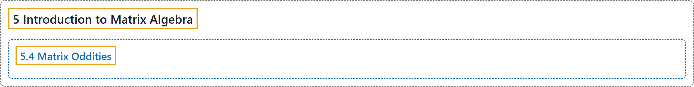

# 5.4 Matrix Oddities

## Classification

## Glossary

| Term | Definition | 中文翻译 | Source |
|---|---|---|---|
| **5.4 Matrix Oddities** 矩阵的奇特性质 | (No definition) | （无定义） | [Doerr & Levasseur, n.d., section 5.4](https://discretemath.org/ads/s-matrix-oddities.html) |

## References

Doerr, A., & Levasseur, K. (n.d.). *Applied discrete structures*. Retrieved October 28, 2026, from <https://discretemath.org/ads/index-ads.html>
