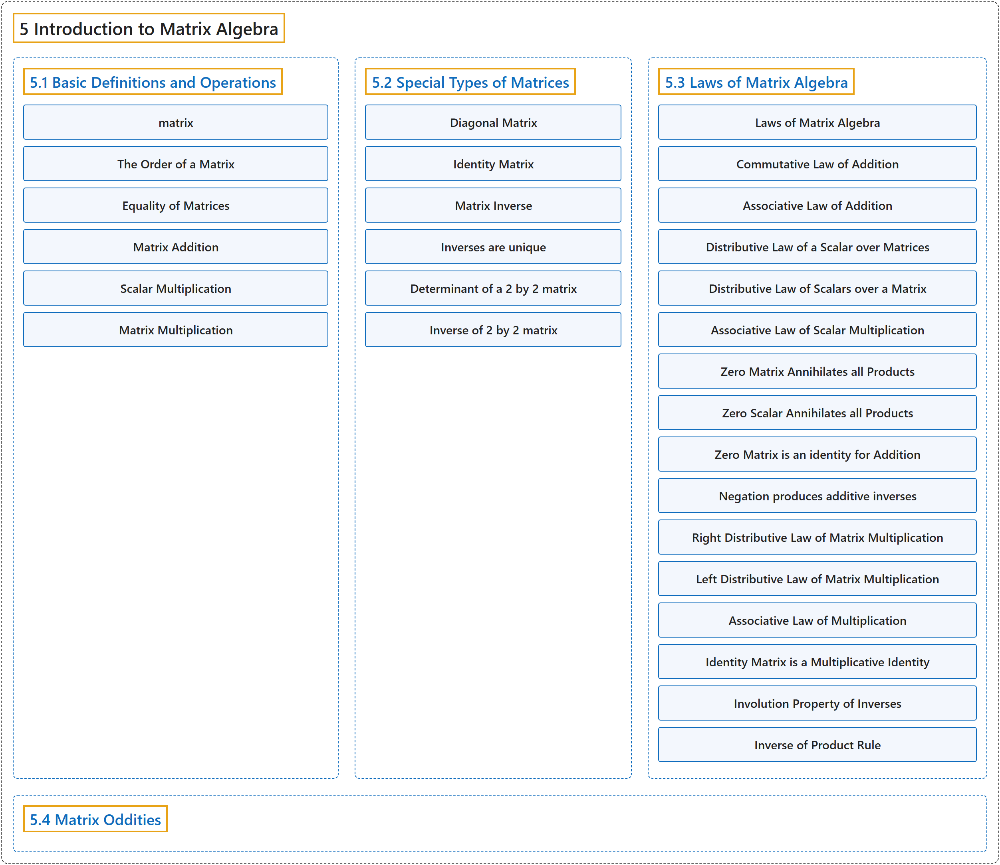

# 5 Introduction to Matrix Algebra

## Classification

## Glossary

| Term | Definition | 中文翻译 | Source |
|---|---|---|---|
| **5 Introduction to Matrix Algebra** 矩阵代数介绍 | (No definition) | （无定义） | [Doerr & Levasseur, n.d., chapter 5](https://discretemath.org/ads/chapter_5.html) |
| **[5.1 Basic Definitions and Operations](5-1-basic-definitions-and-operations.md)** 基本定义与运算 | (No definition) | （无定义） | [Doerr & Levasseur, n.d., section 5.1](https://discretemath.org/ads/s-basic-matrix-definitions.html) |
| **[5.2 Special Types of Matrices](5-2-special-types-of-matrices.md)** 特殊类型的矩阵 | (No definition) | （无定义） | [Doerr & Levasseur, n.d., section 5.2](https://discretemath.org/ads/s-special-matrices.html) |
| **[5.3 Laws of Matrix Algebra](5-3-laws-of-matrix-algebra.md)** 矩阵代数定律 | (No definition) | （无定义） | [Doerr & Levasseur, n.d., section 5.3](https://discretemath.org/ads/s-laws-of-matrix-algebra.html) |
| **[5.4 Matrix Oddities](5-4-matrix-oddities.md)** 矩阵的奇特性质 | (No definition) | （无定义） | [Doerr & Levasseur, n.d., section 5.4](https://discretemath.org/ads/s-matrix-oddities.html) |

## References

Doerr, A., & Levasseur, K. (n.d.). *Applied discrete structures*. Retrieved October 28, 2026, from <https://discretemath.org/ads/index-ads.html>
