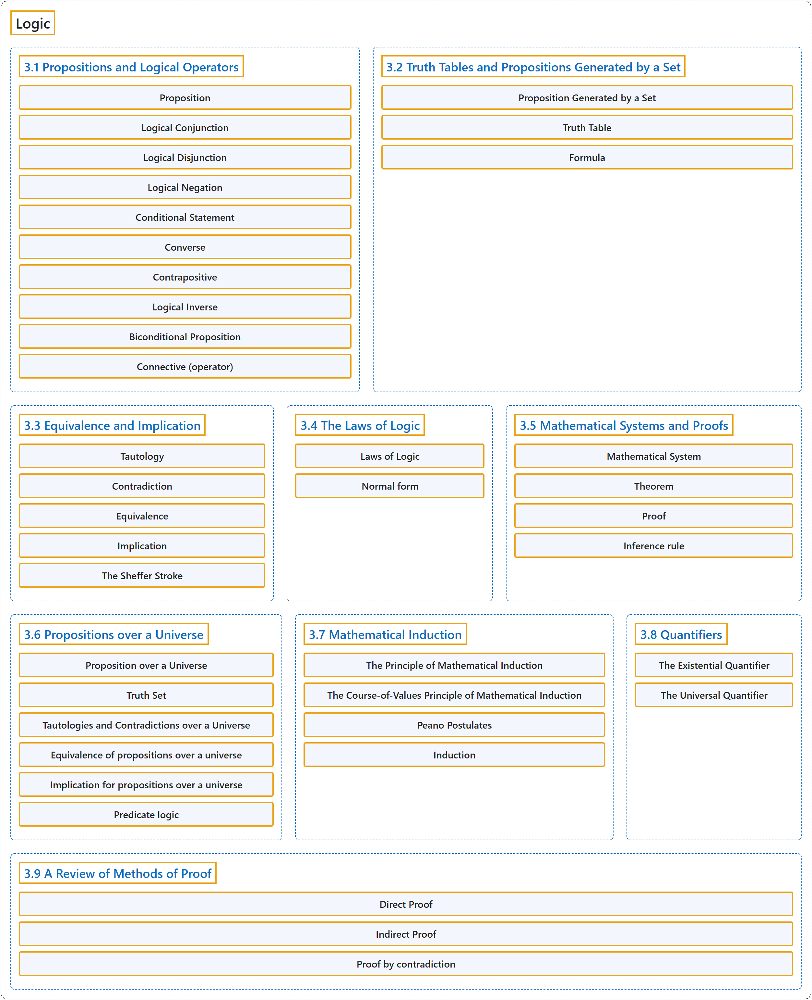

# 3 Logic

## Classification

## Glossary

| Term | Definition | 中文翻译 | Source |
|---|---|---|---|
| **3 Logic** 逻辑 | (No definition) | （无定义） | [Doerr & Levasseur, n.d., chapter 3](https://discretemath.org/ads/chapter3.html) |
| **3.1 Propositions and Logical Operators** 命题与逻辑运算符 | (No definition) | （无定义） | [Doerr & Levasseur, n.d., section 3.1](https://discretemath.org/ads/s-propositions-logic-operators.html) |
| **Proposition** 命题 | "A **proposition** is a **sentence to which one and only one of the terms true or false can be meaningfully applied**." | **命题**是**这样一种句子：真和假这两个词中有且仅有一个可以有意义地应用于它**。 | [Doerr & Levasseur, n.d., Definition 3.1.1](https://discretemath.org/ads/s-propositions-logic-operators.html#def-proposition) |
| **Logical Conjunction** 逻辑合取 | "If $p$ and $q$ are propositions, their **conjunction**, $p \textrm{ and } q$ (denoted $p \land q$), is **defined by the truth table**" | 若 $p$ 和 $q$ 是命题，则它们的**合取**“$p$ 并且 $q$”（记作 $p \land q$）由**真值表**定义 | [Doerr & Levasseur, n.d., Definition 3.1.3](https://discretemath.org/ads/s-propositions-logic-operators.html#def-conjunction) |
| **Logical Disjunction** 逻辑析取 | "If $p$ and $q$ are propositions, their **disjunction**, $p \textrm{ or } q$ (denoted $p \lor q$), is **defined by the truth table**" | 若 $p$ 和 $q$ 是命题，则它们的**析取**“$p$ 或 $q$”（记作 $p \lor q$）由**真值表**定义 | [Doerr & Levasseur, n.d., Definition 3.1.4](https://discretemath.org/ads/s-propositions-logic-operators.html#def-disjunction) |
| **Logical Negation** 逻辑否定 | "If $p$ is a proposition, its **negation**, $\textrm{not } p\text{,}$ denoted $\neg p\text{,}$ and is **defined by the truth table**" | 若 $p$ 是命题，则它的**否定**“非 $p$”记作 $\neg p$，由**真值表**定义 | [Doerr & Levasseur, n.d., Definition 3.1.5](https://discretemath.org/ads/s-propositions-logic-operators.html#def-negation) |
| **Conditional Statement** 条件命题 | "The **conditional statement** “If $p$ then $q\text{,}$” denoted $p \rightarrow q\text{,}$ is **defined by the truth table**" | **条件命题**“如果 $p$ 则 $q$，”记作 $p \rightarrow q$，由**真值表**定义 | [Doerr & Levasseur, n.d., Definition 3.1.6](https://discretemath.org/ads/s-propositions-logic-operators.html#def-conditional) |
| **Converse** 逆命题 | "The **converse** of the proposition $p \rightarrow q$ is the proposition **$q \rightarrow p\text{.}$**" | 命题 $p \rightarrow q$ 的**逆命题**是命题 **$q \rightarrow p$。** | [Doerr & Levasseur, n.d., Definition 3.1.9](https://discretemath.org/ads/s-propositions-logic-operators.html#def-converse) |
| **Contrapositive** 逆否命题 | "The **contrapositive** of the proposition $p \rightarrow q$ is the proposition **$\neg q \rightarrow \neg p\text{.}$**" | 命题 $p \rightarrow q$ 的**逆否命题**是命题 **$\neg q \rightarrow \neg p$。** | [Doerr & Levasseur, n.d., Definition 3.1.10](https://discretemath.org/ads/s-propositions-logic-operators.html#def-contrapositive) |
| **Logical Inverse** 否命题 | "The **inverse** of the proposition $p \rightarrow q$ is the proposition **$\neg p \rightarrow \neg q\text{.}$**" | 命题 $p \rightarrow q$ 的**否命题**是命题 **$\neg p \rightarrow \neg q$。** | [Doerr & Levasseur, n.d., Definition 3.1.11](https://discretemath.org/ads/s-propositions-logic-operators.html#def-inverse-proposition) |
| **Biconditional Proposition** 双条件命题 | "If $p$ and $q$ are propositions, the **biconditional statement** “$p$ if and only if $q\text{,}$” denoted $p \leftrightarrow q\text{,}$ is **defined by the truth table**" | 若 $p$ 和 $q$ 是命题，则**双条件命题**“$p$ 当且仅当 $q$”记作 $p \leftrightarrow q$，由**真值表**定义 | [Doerr & Levasseur, n.d., Definition 3.1.12](https://discretemath.org/ads/s-propositions-logic-operators.html#def-biconditional) |
| **Connective (operator)** 联结词（运算符） | "A function, or the symbol representing a function, which corresponds to English conjunctions such as 'and,' 'or,' 'not,' etc. that **takes one or more truth values as input** and **returns a single truth value as output**." | 一种函数（或表示该函数的符号），对应英语中的 and、or、not 等连词，它**以一个或多个真值为输入**，并**输出单个真值**。 | [Weisstein, n.d.-a, "Connective" entry, para. 1](https://mathworld.wolfram.com/Connective.html#:~:text=takes%20one%20or%20more%20truth%20values%20as%20input) |
| **3.2 Truth Tables and Propositions Generated by a Set** 真值表与由集合生成的命题 | (No definition) | （无定义） | [Doerr & Levasseur, n.d., section 3.2](https://discretemath.org/ads/s-truth-tables.html) |
| **Proposition Generated by a Set** 由集合生成的命题 | "Let $S$ be any set of propositions. A **proposition generated by $S$** is any **valid combination of propositions in $S$ with conjunction, disjunction, and negation**. Or, to be more precise," | 设 $S$ 是任意命题集。由 $S$ **生成的命题**是 **$S$ 中命题通过合取、析取和否定得到的任何有效组合**。更精确地说， | [Doerr & Levasseur, n.d., Definition 3.2.2](https://discretemath.org/ads/s-truth-tables.html#def-proposition-generated-by-set) |
| **Truth Table** 真值表 | "A truth table is a **two-dimensional array** with n+1 columns. The first n columns correspond to the possible values of n inputs, and the last column to the operation being performed. The rows list **all possible combinations of inputs** together with the corresponding outputs." | 真值表是一个有 n+1 列的**二维数组**。前 n 列对应 n 个输入的可能取值，最后一列对应所执行的运算。各行列出**所有可能的输入组合**以及对应的输出。 | [Weisstein, n.d.-f, "Truth table" entry, para. 1](https://mathworld.wolfram.com/TruthTable.html#:~:text=A%20truth%20table%20is%20a%20two%2Ddimensional%20array) |
| **Formula** 公式 | "The term 'formula' is also commonly used in the theory of logic to mean **sentential formula** (also called a propositional formula), i.e., **a formula in propositional calculus**." | “公式”一词在逻辑理论中也常用来指**语句公式**（也称为命题公式），即**命题演算中的公式**。 | [Weisstein, n.d.-b, "Formula" entry, para. 2](https://mathworld.wolfram.com/Formula.html#:~:text=is%20also%20commonly%20used%20in%20the%20theory%20of%20logic) |
| **3.3 Equivalence and Implication** 等价与蕴涵 | (No definition) | （无定义） | [Doerr & Levasseur, n.d., section 3.3](https://discretemath.org/ads/s-equivalence-implication.html) |
| **Tautology** 重言式 | "An expression involving logical variables that is **true in all cases** is a **tautology**. The number 1 is used to symbolize a tautology." | 涉及逻辑变量且**在所有情形下都为真**的表达式是**重言式**。数 1 用来表示重言式。 | [Doerr & Levasseur, n.d., Definition 3.3.2](https://discretemath.org/ads/s-equivalence-implication.html#def-tautology) |
| **Contradiction** 矛盾式 | "An expression involving logical variables that is **false for all cases** is called a **contradiction**. The number 0 is used to symbolize a contradiction." | 涉及逻辑变量且**在所有情形下都为假**的表达式称为**矛盾式**。数 0 用来表示矛盾式。 | [Doerr & Levasseur, n.d., Definition 3.3.4](https://discretemath.org/ads/s-equivalence-implication.html#def-contradiction) |
| **Equivalence** 等价 | "Let $S$ be a set of propositions and let $r$ and $s$ be propositions generated by $S\text{.}$ $r$ and $s$ are **equivalent if and only if $r\leftrightarrow s$ is a tautology**. The equivalence of $r$ and $s$ is denoted $r \iff s\text{.}$" | 设 $S$ 是命题集，$r$ 和 $s$ 是由 $S$ 生成的命题。**$r$ 和 $s$ 等价，当且仅当 $r\leftrightarrow s$ 是重言式**。$r$ 与 $s$ 的等价记作 $r \iff s$。 | [Doerr & Levasseur, n.d., Definition 3.3.6](https://discretemath.org/ads/s-equivalence-implication.html#def-equivalence) |
| **Implication** 蕴涵 | "Let $S$ be a set of propositions and let $r$ and $s$ be propositions generated by $S\text{.}$ We say that **$r$ implies $s$ if $r \to s$ is a tautology**. We write $r \Rightarrow s$ to indicate this implication." | 设 $S$ 是命题集，$r$ 和 $s$ 是由 $S$ 生成的命题。我们说 **$r$ 蕴含 $s$，若 $r \to s$ 是重言式**。我们记 $r \Rightarrow s$ 来表示这种蕴含。 | [Doerr & Levasseur, n.d., Definition 3.3.11](https://discretemath.org/ads/s-equivalence-implication.html#def-implication) |
| **The Sheffer Stroke** 谢弗竖线 | "The Sheffer Stroke is the **logical operator** defined by the following truth table:" | 谢弗竖线是由下面的真值表定义的**逻辑运算符**： | [Doerr & Levasseur, n.d., Definition 3.3.14](https://discretemath.org/ads/s-equivalence-implication.html#def-scheffer) |
| **3.4 The Laws of Logic** 逻辑定律 | (No definition) | （无定义） | [Doerr & Levasseur, n.d., section 3.4](https://discretemath.org/ads/s-logic-laws.html) |
| **Laws of Logic** 逻辑定律 | (context) "In this section, we will list the most basic **equivalences and implications of logic**." | （语境）在本节中，我们将列出逻辑中最基本的**等价式与蕴含式**。 | [Doerr & Levasseur, n.d., section 3.4](https://discretemath.org/ads/s-logic-laws.html#s-logic-laws-2-2) |
| **Normal form** 范式 | "In general, it refers to a **way of representing objects** so that, although each may have many different names, **every possible name corresponds to exactly one object** ..." | 一般来说，它指一种**表示对象的方式**，使得尽管每个对象可能有许多不同的名称，**每个可能的名称都恰好对应一个对象**…… | [Weisstein, n.d.-c, "Normal form" entry, para. 1](https://mathworld.wolfram.com/NormalForm.html#:~:text=it%20refers%20to%20a%20way%20of%20representing%20objects) |
| **3.5 Mathematical Systems and Proofs** 数学系统与证明 | (No definition) | （无定义） | [Doerr & Levasseur, n.d., section 3.5](https://discretemath.org/ads/s-math-systems.html) |
| **Mathematical System** 数学系统 | "A **mathematical system** consists of:" | **数学系统**由以下部分组成： | [Doerr & Levasseur, n.d., Definition 3.5.1](https://discretemath.org/ads/s-math-systems.html#def-mathematical-system) |
| **Theorem** 定理 | "A **true proposition derived from the axioms of a mathematical system** is called a **theorem**." | **由数学系统的公理推导出的真命题**称为**定理**。 | [Doerr & Levasseur, n.d., Definition 3.5.4](https://discretemath.org/ads/s-math-systems.html#def-theorem) |
| **Proof** 证明 | "A **proof** of a theorem is a **finite sequence of logically valid steps** that demonstrate that the **premises of a theorem imply its conclusion**." | 定理的**证明**是**有限的一系列逻辑上有效的步骤**，这些步骤表明**定理的前提蕴含其结论**。 | [Doerr & Levasseur, n.d., Definition 3.5.6](https://discretemath.org/ads/s-math-systems.html#def-proof) |
| **Inference rule** 推理规则 | "A syllogism, also known as a rule of inference, is a **formal logical scheme** used to **draw a conclusion from a set of premises**." | 三段论也称为推理规则，是一种**形式逻辑格式**，用于**从一组前提得出结论**。 | [Weisstein, n.d.-e, "Syllogism" entry, para. 1](https://mathworld.wolfram.com/Syllogism.html#:~:text=also%20known%20as%20a%20rule%20of%20inference) |
| **3.6 Propositions over a Universe** 全集上的命题 | (No definition) | （无定义） | [Doerr & Levasseur, n.d., section 3.6](https://discretemath.org/ads/s-propositions-over-universe.html) |
| **Proposition over a Universe** 全集上的命题 | "Let $U$ be a nonempty set. A **proposition over $U$** is a **sentence that contains a variable that can take on any value in $U$** and that has a **definite truth value** as a result of any such substitution." | 设 $U$ 是非空集合。$U$ 上的**命题**是**含有可取 $U$ 中任意值的变量的句子**，并且对任何这样的代入都**具有确定的真值**。 | [Doerr & Levasseur, n.d., Definition 3.6.1](https://discretemath.org/ads/s-propositions-over-universe.html#def-proposition-over-U) |
| **Truth Set** 真值集 | "If $p$ is a proposition over $U\text{,}$ the **truth set of $p$** is **$T_p = \{a \in U \mid p(a) \textrm{ is true}\}\text{.}$**" | 若 $p$ 是 $U$， 上的命题，则 $p$ 的**真值集**是 **$T_p = \{a \in U \mid p(a) \textrm{ is true}\}$。** | [Doerr & Levasseur, n.d., Definition 3.6.3](https://discretemath.org/ads/s-propositions-over-universe.html#def-truth-set) |
| **Tautologies and Contradictions over a Universe** 全集上的重言式与矛盾式 | "A proposition over $U$ is a **tautology if its truth set is $U\text{.}$** It is a **contradiction if its truth set is empty**." | 若 $U$ 上的命题的真值集为 $U$，则它是**重言式**。若其真值集为空，则它是**矛盾式**。 | [Doerr & Levasseur, n.d., Definition 3.6.6](https://discretemath.org/ads/s-propositions-over-universe.html#def-tautology-contradiction-over-U) |
| **Equivalence of propositions over a universe** 全集上命题的等价 | "Two propositions, $p$ and $q\text{,}$ are **equivalent if $p \leftrightarrow q$ is a tautology**. In terms of truth sets, this means that $p$ and $q$ are **equivalent** if **$T_p=T_q$**." | 两个命题 $p$ 和 $q$ 若 **$p \leftrightarrow q$ 是重言式**，则它们是**等价**的。就真值集而言，这意味着若 **$T_p=T_q$**，则 $p$ 和 $q$ 等价。 | [Doerr & Levasseur, n.d., Definition 3.6.9](https://discretemath.org/ads/s-propositions-over-universe.html#def-equivanlence-over-U) |
| **Implication for propositions over a universe** 全集上命题的蕴涵 | "If $p$ and $q$ are propositions over $U\text{,}$ **$p$ implies $q$ if $p \rightarrow q$ is a tautology**." | 若 $p$ 和 $q$ 是 $U$， 上的命题，则若 **$p \rightarrow q$ 是重言式**，$p$ 蕴含 $q$。 | [Doerr & Levasseur, n.d., Definition 3.6.11](https://discretemath.org/ads/s-propositions-over-universe.html#def-implication-over-U) |
| **Predicate logic** 谓词逻辑 | "Predicate calculus, also called predicate logic or functional calculus, is the **branch of formal logic** that deals with **representing the logical connections between statements** as well as the statements themselves." | 谓词演算也称为谓词逻辑或函数演算，是**形式逻辑的一个分支**，研究**表示陈述之间的逻辑联系**以及陈述本身。 | [Weisstein, n.d.-d, "Predicate calculus" entry, para. 1](https://mathworld.wolfram.com/PredicateCalculus.html#:~:text=also%20called%20predicate%20logic) |
| **3.7 Mathematical Induction** 数学归纳法 | (No definition) | （无定义） | [Doerr & Levasseur, n.d., section 3.7](https://discretemath.org/ads/s-induction.html) |
| **The Principle of Mathematical Induction** 数学归纳法原理 | "Let $p(n)$ be a **proposition over the positive integers**. If" | 设 $p(n)$ 是**正整数上的命题**。若 | [Doerr & Levasseur, n.d., Theorem 3.7.3](https://discretemath.org/ads/s-induction.html#th-math-induction-basic) |
| **The Course-of-Values Principle of Mathematical Induction** 数学归纳法的强归纳原理（取值过程原理） | "If $p(n)$ is a **proposition over $\{k_0, k_0+ 1, k_0+ 2,\ldots \}\text{,}$** where $k_0$ is any integer, then $p(n)$ is a **tautology** if" | 若 $p(n)$ 是 **$\{k_0, k_0+ 1, k_0+ 2,\ldots \}$， 上的命题**，其中 $k_0$ 是任意整数，则在以下条件下 $p(n)$ 是**重言式**： | [Doerr & Levasseur, n.d., Theorem 3.7.9](https://discretemath.org/ads/s-induction.html#th-math-induction-course-of-values) |
| **Peano Postulates** 皮亚诺公设 | "The **system of positive integers** consists of a nonempty set, $\mathbb{P}\text{;}$ a least element of $\mathbb{P}\text{,}$ denoted 1; and a “**successor function**,” s, with the properties" | **正整数系统**由一个非空集合 $\mathbb{P}$、$\mathbb{P}$； 的一个记作 1 的最小元素，以及一个具有以下性质的“**后继函数**”s 组成 | [Doerr & Levasseur, n.d., Axiom 3.7.11](https://discretemath.org/ads/s-induction.html#sss-peano-postulates) |
| **Induction** 归纳法 | "Mathematical induction is a **method for proving** that a proposition P(n) **holds for every integer** n>=n0." | 数学归纳法是一种**证明方法**，用来证明命题 P(n) **对每个整数都成立**（n>=n0）。 | [Weisstein, n.d.-a, "Mathematical induction" entry, para. 1](https://mathworld.wolfram.com/MathematicalInduction.html#:~:text=Mathematical%20induction%20is%20a%20method%20for%20proving) |
| **3.8 Quantifiers** 量词 | (No definition) | （无定义） | [Doerr & Levasseur, n.d., section 3.8](https://discretemath.org/ads/s-quantifiers.html) |
| **The Existential Quantifier** 存在量词 | "If $p(n)$ is a proposition over $U$ with $T_p\neq \emptyset\text{,}$ we commonly say “**There exists an $n$ in $U$ such that $p(n)$ (is true)**.” We abbreviate this with the symbols $(\exists n)_U(p(n))\text{.}$ The symbol $\exists$ is called the **existential quantifier**. If the context is clear, the mention of $U$ is dropped: $(\exists n)(p(n))\text{.}$" | 若 $p(n)$ 是 $U$ 上的命题且 $T_p\neq \emptyset$，我们通常说“**存在 $U$ 中的 $n$ 使得 $p(n)$（为真）**”。我们用符号 $(\exists n)_U(p(n))$。 来缩写它。符号 $\exists$ 称为**存在量词**。若上下文清楚，则省略 $U$：$(\exists n)(p(n))$。 | [Doerr & Levasseur, n.d., Definition 3.8.1](https://discretemath.org/ads/s-quantifiers.html#def-exist-quantifier) |
| **The Universal Quantifier** 全称量词 | "If $p(n)$ is a proposition over $U$ with $T_p=U\text{,}$ we commonly say “**For all $n$ in $U\text{,}$ $p(n)$ (is true)**.” We abbreviate this with the symbols $(\forall n)_U(p(n))\text{.}$ The symbol $\forall$ is called the **universal quantifier**. If the context is clear, the mention of $U$ is dropped: $(\forall n)(p(n))\text{.}$" | 若 $p(n)$ 是 $U$ 上的命题且 $T_p=U$，我们通常说“**对 $U$ 中所有的 $n$，$p(n)$（为真）**”。我们用符号 $(\forall n)_U(p(n))$。 来缩写它。符号 $\forall$ 称为**全称量词**。若上下文清楚，则省略 $U$：$(\forall n)(p(n))$。 | [Doerr & Levasseur, n.d., Definition 3.8.3](https://discretemath.org/ads/s-quantifiers.html#def-universal-quantifier) |
| **3.9 A Review of Methods of Proof** 证明方法回顾 | (No definition) | （无定义） | [Doerr & Levasseur, n.d., section 3.9](https://discretemath.org/ads/s-proof-review.html) |
| **Direct Proof** 直接证明 | "**Directly**: Assume $P$ is true and prove $C$ is true." | **直接证明**：假设 $P$ 为真，并证明 $C$ 为真。 | [Doerr & Levasseur, n.d., section 3.9](https://discretemath.org/ads/s-proof-review.html#ss-proof-concepts-5-1-1-1) |
| **Indirect Proof** 间接证明 | "**Indirectly** (or **by contradiction**): Assume $P$ is true and $C$ is false and prove that this leads to a contradiction of some premise, theorem, or basic truth." | **间接证明**（或**反证法**）：假设 $P$ 为真且 $C$ 为假，并证明这会导致与某个前提、定理或基本事实相矛盾。 | [Doerr & Levasseur, n.d., section 3.9](https://discretemath.org/ads/s-proof-review.html#ss-proof-concepts-5-1-2-1) |
| **Proof by contradiction** 反证法 | "A proof by contradiction establishes the truth of a given proposition by the **supposition that it is false** and the subsequent drawing of a conclusion that is **contradictory to something that is proven to be true**." | 反证法这样确立一个命题为真：先**假设它为假**，再推出一个**与某个已证明为真的事实相矛盾**的结论。 | [Weisstein, n.d.-b, "Proof by contradiction" entry, para. 1](https://mathworld.wolfram.com/ProofbyContradiction.html#:~:text=A%20proof%20by%20contradiction%20establishes%20the%20truth) |

## References

Doerr, A., & Levasseur, K. (n.d.). *Applied discrete structures*. Retrieved October 28, 2026, from <https://discretemath.org/ads/index-ads.html>

Weisstein, E. W. (n.d.-a). *Connective*. MathWorld: A Wolfram Resource. Retrieved October 27, 2026, from <https://mathworld.wolfram.com/Connective.html>

Weisstein, E. W. (n.d.-a). *Mathematical induction*. MathWorld: A Wolfram Resource. Retrieved October 27, 2026, from <https://mathworld.wolfram.com/MathematicalInduction.html>

Weisstein, E. W. (n.d.-b). *Formula*. MathWorld: A Wolfram Resource. Retrieved October 27, 2026, from <https://mathworld.wolfram.com/Formula.html>

Weisstein, E. W. (n.d.-b). *Proof by contradiction*. MathWorld: A Wolfram Resource. Retrieved October 27, 2026, from <https://mathworld.wolfram.com/ProofbyContradiction.html>

Weisstein, E. W. (n.d.-c). *Normal form*. MathWorld: A Wolfram Resource. Retrieved October 27, 2026, from <https://mathworld.wolfram.com/NormalForm.html>

Weisstein, E. W. (n.d.-d). *Predicate calculus*. MathWorld: A Wolfram Resource. Retrieved October 27, 2026, from <https://mathworld.wolfram.com/PredicateCalculus.html>

Weisstein, E. W. (n.d.-e). *Syllogism*. MathWorld: A Wolfram Resource. Retrieved October 27, 2026, from <https://mathworld.wolfram.com/Syllogism.html>

Weisstein, E. W. (n.d.-f). *Truth table*. MathWorld: A Wolfram Resource. Retrieved October 27, 2026, from <https://mathworld.wolfram.com/TruthTable.html>
