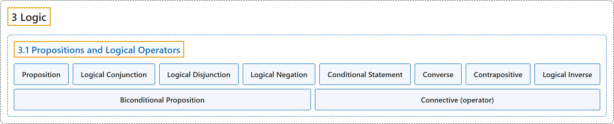

# 3.1 Propositions and Logical Operators

## Classification

## Glossary

| Term | Definition | 中文翻译 | Source |
|---|---|---|---|
| **3.1 Propositions and Logical Operators** 命题与逻辑运算符 | (No definition) | （无定义） | [Doerr & Levasseur, n.d., section 3.1](https://discretemath.org/ads/s-propositions-logic-operators.html) |
| **Proposition** 命题 | "A **proposition** is a **sentence to which one and only one of the terms true or false can be meaningfully applied**." | **命题**是**这样一种句子：真和假这两个词中有且仅有一个可以有意义地应用于它**。 | [Doerr & Levasseur, n.d., Definition 3.1.1](https://discretemath.org/ads/s-propositions-logic-operators.html#def-proposition) |
| **Logical Conjunction** 逻辑合取 | "If $p$ and $q$ are propositions, their **conjunction**, $p \textrm{ and } q$ (denoted $p \land q$), is **defined by the truth table**" | 若 $p$ 和 $q$ 是命题，则它们的**合取**“$p$ 并且 $q$”（记作 $p \land q$）由**真值表**定义 | [Doerr & Levasseur, n.d., Definition 3.1.3](https://discretemath.org/ads/s-propositions-logic-operators.html#def-conjunction) |
| **Logical Disjunction** 逻辑析取 | "If $p$ and $q$ are propositions, their **disjunction**, $p \textrm{ or } q$ (denoted $p \lor q$), is **defined by the truth table**" | 若 $p$ 和 $q$ 是命题，则它们的**析取**“$p$ 或 $q$”（记作 $p \lor q$）由**真值表**定义 | [Doerr & Levasseur, n.d., Definition 3.1.4](https://discretemath.org/ads/s-propositions-logic-operators.html#def-disjunction) |
| **Logical Negation** 逻辑否定 | "If $p$ is a proposition, its **negation**, $\textrm{not } p\text{,}$ denoted $\neg p\text{,}$ and is **defined by the truth table**" | 若 $p$ 是命题，则它的**否定**“非 $p$”记作 $\neg p$，由**真值表**定义 | [Doerr & Levasseur, n.d., Definition 3.1.5](https://discretemath.org/ads/s-propositions-logic-operators.html#def-negation) |
| **Conditional Statement** 条件命题 | "The **conditional statement** “If $p$ then $q\text{,}$” denoted $p \rightarrow q\text{,}$ is **defined by the truth table**" | **条件命题**“如果 $p$ 则 $q$，”记作 $p \rightarrow q$，由**真值表**定义 | [Doerr & Levasseur, n.d., Definition 3.1.6](https://discretemath.org/ads/s-propositions-logic-operators.html#def-conditional) |
| **Converse** 逆命题 | "The **converse** of the proposition $p \rightarrow q$ is the proposition **$q \rightarrow p\text{.}$**" | 命题 $p \rightarrow q$ 的**逆命题**是命题 **$q \rightarrow p$。** | [Doerr & Levasseur, n.d., Definition 3.1.9](https://discretemath.org/ads/s-propositions-logic-operators.html#def-converse) |
| **Contrapositive** 逆否命题 | "The **contrapositive** of the proposition $p \rightarrow q$ is the proposition **$\neg q \rightarrow \neg p\text{.}$**" | 命题 $p \rightarrow q$ 的**逆否命题**是命题 **$\neg q \rightarrow \neg p$。** | [Doerr & Levasseur, n.d., Definition 3.1.10](https://discretemath.org/ads/s-propositions-logic-operators.html#def-contrapositive) |
| **Logical Inverse** 否命题 | "The **inverse** of the proposition $p \rightarrow q$ is the proposition **$\neg p \rightarrow \neg q\text{.}$**" | 命题 $p \rightarrow q$ 的**否命题**是命题 **$\neg p \rightarrow \neg q$。** | [Doerr & Levasseur, n.d., Definition 3.1.11](https://discretemath.org/ads/s-propositions-logic-operators.html#def-inverse-proposition) |
| **Biconditional Proposition** 双条件命题 | "If $p$ and $q$ are propositions, the **biconditional statement** “$p$ if and only if $q\text{,}$” denoted $p \leftrightarrow q\text{,}$ is **defined by the truth table**" | 若 $p$ 和 $q$ 是命题，则**双条件命题**“$p$ 当且仅当 $q$”记作 $p \leftrightarrow q$，由**真值表**定义 | [Doerr & Levasseur, n.d., Definition 3.1.12](https://discretemath.org/ads/s-propositions-logic-operators.html#def-biconditional) |
| **Connective (operator)** 联结词（运算符） | "A function, or the symbol representing a function, which corresponds to English conjunctions such as 'and,' 'or,' 'not,' etc. that **takes one or more truth values as input** and **returns a single truth value as output**." | 一种函数（或表示该函数的符号），对应英语中的 and、or、not 等连词，它**以一个或多个真值为输入**，并**输出单个真值**。 | [Weisstein, n.d.-a, "Connective" entry, para. 1](https://mathworld.wolfram.com/Connective.html#:~:text=takes%20one%20or%20more%20truth%20values%20as%20input) |

## References

Doerr, A., & Levasseur, K. (n.d.). *Applied discrete structures*. Retrieved October 28, 2026, from <https://discretemath.org/ads/index-ads.html>

Weisstein, E. W. (n.d.-a). *Connective*. MathWorld: A Wolfram Resource. Retrieved October 27, 2026, from <https://mathworld.wolfram.com/Connective.html>
