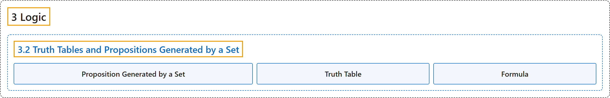

# 3.2 Truth Tables and Propositions Generated by a Set

## Classification

## Glossary

| Term | Definition | 中文翻译 | Source |
|---|---|---|---|
| **3.2 Truth Tables and Propositions Generated by a Set** 真值表与由集合生成的命题 | (No definition) | （无定义） | [Doerr & Levasseur, n.d., section 3.2](https://discretemath.org/ads/s-truth-tables.html) |
| **Proposition Generated by a Set** 由集合生成的命题 | "Let $S$ be any set of propositions. A **proposition generated by $S$** is any **valid combination of propositions in $S$ with conjunction, disjunction, and negation**. Or, to be more precise," | 设 $S$ 是任意命题集。由 $S$ **生成的命题**是 **$S$ 中命题通过合取、析取和否定得到的任何有效组合**。更精确地说， | [Doerr & Levasseur, n.d., Definition 3.2.2](https://discretemath.org/ads/s-truth-tables.html#def-proposition-generated-by-set) |
| **Truth Table** 真值表 | "A truth table is a **two-dimensional array** with n+1 columns. The first n columns correspond to the possible values of n inputs, and the last column to the operation being performed. The rows list **all possible combinations of inputs** together with the corresponding outputs." | 真值表是一个有 n+1 列的**二维数组**。前 n 列对应 n 个输入的可能取值，最后一列对应所执行的运算。各行列出**所有可能的输入组合**以及对应的输出。 | [Weisstein, n.d.-f, "Truth table" entry, para. 1](https://mathworld.wolfram.com/TruthTable.html#:~:text=A%20truth%20table%20is%20a%20two%2Ddimensional%20array) |
| **Formula** 公式 | "The term 'formula' is also commonly used in the theory of logic to mean **sentential formula** (also called a propositional formula), i.e., **a formula in propositional calculus**." | “公式”一词在逻辑理论中也常用来指**语句公式**（也称为命题公式），即**命题演算中的公式**。 | [Weisstein, n.d.-b, "Formula" entry, para. 2](https://mathworld.wolfram.com/Formula.html#:~:text=is%20also%20commonly%20used%20in%20the%20theory%20of%20logic) |

## References

Doerr, A., & Levasseur, K. (n.d.). *Applied discrete structures*. Retrieved October 28, 2026, from <https://discretemath.org/ads/index-ads.html>

Weisstein, E. W. (n.d.-b). *Formula*. MathWorld: A Wolfram Resource. Retrieved October 27, 2026, from <https://mathworld.wolfram.com/Formula.html>

Weisstein, E. W. (n.d.-f). *Truth table*. MathWorld: A Wolfram Resource. Retrieved October 27, 2026, from <https://mathworld.wolfram.com/TruthTable.html>
